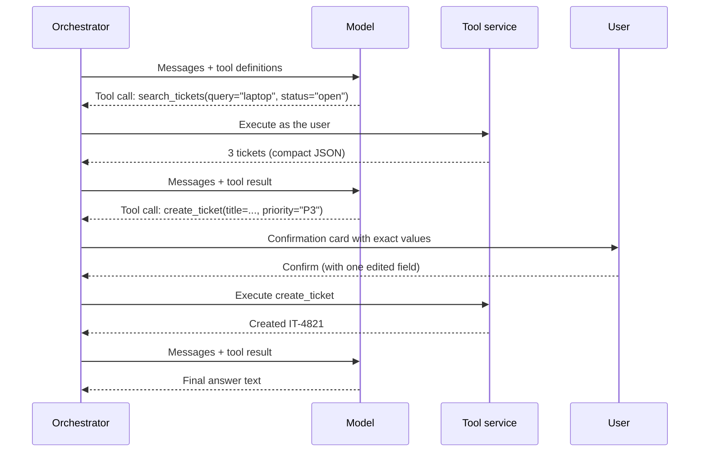

Tools let the assistant do more than write text: search a ticket system, look up a customer record, check a calendar, or create a ticket. An **agent** is a loop where the model chooses tools, sees their results, and decides what to do next until the task is done.

Tools are where AI systems become genuinely useful and genuinely risky. A wrong answer misleads one person. A wrong action changes real data.

## How tool calling works

The model does not run anything. It returns a structured request, and your code decides whether and how to run it.



## Read tools and write tools

Split every tool into one of two classes. The class decides how it is executed.

| Class | Examples | Execution |
| --- | --- | --- |
| **Read** | `search_tickets`, `get_customer`, `list_calendar_events`, `search_documents` | Runs automatically, with the user's permissions |
| **Write** (side effects) | `create_ticket`, `send_email`, `update_record`, `book_meeting`, `delete_*` | Pauses for explicit user confirmation through the UI |

The confirmation step is the most important safety control in an agent. It defends against model mistakes and against prompt injection: a malicious document can trick the model into requesting an action, but it cannot click Confirm. See [Prompt injection](/docs/security/prompt-injection).

Some write actions are low risk and reversible, such as adding a draft to the user's own notes. You may auto-run those, but make the decision explicitly per tool, not by default.

## Designing tools models use well

The model only knows a tool from its name, description, and parameter schema. Treat these as a user interface for the model.

| Principle | Good | Bad |
| --- | --- | --- |
| Name says what it does | `search_open_tickets` | `ticket_api` |
| Description says when to use it | "Search the user's open IT tickets by keyword. Use before creating a ticket, to avoid duplicates." | "Ticket search." |
| Few, typed parameters | `priority: "P1" \| "P2" \| "P3"` as an enum | `options: object` |
| Tasks, not raw APIs | `create_ticket(title, description, priority)` | Mirroring a 40-field REST endpoint |
| Compact results | `[{id, title, status, updated}]` with 5 fields | The raw API response with 200 fields |
| Errors the model can act on | `"No user named 'Jon Smit'. Did you mean 'Jon Smith' (jsmith)?"` | `"400 Bad Request"` |

Keep the number of tools per conversation small, about 10 to 20. With many more, models choose the wrong tool more often, and tool definitions consume context. If you have many integrations, select a relevant subset per request based on the user's enabled tools and the question.

### Example definition

```json
{
  "name": "create_it_ticket",
  "description": "Create a new IT support ticket for the current user. Search existing open tickets first to avoid duplicates. Requires user confirmation before it runs.",
  "parameters": {
    "type": "object",
    "properties": {
      "title": { "type": "string", "description": "Short summary, under 80 characters" },
      "description": { "type": "string", "description": "What happened, what the user tried, any error messages" },
      "category": { "type": "string", "enum": ["hardware", "software", "access", "network", "other"] },
      "priority": { "type": "string", "enum": ["P2", "P3", "P4"], "description": "P2 only if the user cannot work at all" }
    },
    "required": ["title", "description", "category", "priority"]
  }
}
```

Note that `P1` is not in the enum. The model cannot open a top-priority incident even if asked to, because the schema does not allow it. **Constrain in the schema whatever you can**, rather than relying on instructions.

## The agent loop

```ts
async function runAgent(ctx: RequestContext, messages: Message[], tools: ToolDef[]) {
  for (let step = 0; step < MAX_STEPS; step++) {
    const res = await modelGateway.generate(ctx, { model: 'agent', messages, tools });
    if (!res.toolCalls.length) return res.text; // finished

    for (const call of res.toolCalls) {
      const tool = registry.get(call.name);
      const args = tool.schema.safeParse(call.arguments);
      if (!args.success) {
        messages.push(toolError(call, `Invalid arguments: ${args.error.message}`));
        continue;
      }
      if (tool.kind === 'write') {
        const decision = await requestConfirmation(ctx, call, args.data); // pauses the stream
        if (decision.rejected) { messages.push(toolResult(call, 'User rejected this action.')); continue; }
        args.data = decision.editedArgs ?? args.data;
      }
      const result = await toolService.execute(ctx, call.name, args.data);
      messages.push(toolResult(call, truncate(result, TOOL_RESULT_BUDGET)));
    }
  }
  throw new AgentStepLimitError();
}
```

### Limits

| Limit | Typical value | Why |
| --- | --- | --- |
| Maximum steps per turn | 10 to 20 | Stops loops where the model repeats the same call |
| Maximum write actions per turn | 1 to 3 | Bounds the damage of a confused or manipulated agent |
| Tool timeout | 10 to 30 s | A hanging API should not hang the conversation |
| Tool result size | A few thousand tokens | Keeps context under control |
| Total turn time | 2 to 5 minutes | Longer tasks become background jobs |

Also detect repetition: the same tool with the same arguments three times in a row means the agent is stuck. Stop and tell the user.

## The tool service

Tool execution runs in a separate service, not in the orchestrator.

- It holds credentials for target systems. Keeping them in a separate service with its own permissions limits what a compromised orchestrator could do.
- It executes **as the user**: using the user's delegated OAuth token, or checking the user's permissions before using a service account. See [Authentication and authorization](/docs/backend/auth).
- It **validates arguments again**, independently of the orchestrator. Never trust that the model's arguments were checked upstream.
- It enforces per-tool allowlists from tenant settings.
- It writes an **audit event** for every write action: who, what tool, what arguments, confirmed by whom, result. See [Audit logging](/docs/compliance/audit-logging).
- It uses **idempotency keys** with target systems when they support them, so a retry cannot create two tickets.

## Multi-agent systems

Splitting work across several specialized agents (a planner, a researcher, a writer) is popular. It adds latency, cost, and many new failure modes, and is hard to debug.

Start with **one agent with good tools**. Add a second agent only when you have a clear reason, such as a sub-task that needs a very different prompt and toolset, and evaluation data showing the split improves results.

## Evaluating agents

Agents need evaluation beyond answer quality:

- **Tool selection accuracy**: did it call the right tool for each test case?
- **Argument accuracy**: were the arguments correct?
- **Steps to completion**: fewer is better, and spikes signal confusion.
- **Unsafe action rate**: attempted write actions that should not have happened, including in injection test cases.
- **Task success**: for end-to-end scenarios, did the final state match the expected state? Run these against sandboxed copies of target systems.

See [Evaluation](/docs/evaluation).

## Checklist

- [ ] Every tool is classified as read or write.
- [ ] Write tools require explicit confirmation through the UI, showing exact arguments.
- [ ] Tool schemas use enums and constraints to block disallowed values.
- [ ] Tool results are compact and truncated.
- [ ] The agent has step, write-action, time, and repetition limits.
- [ ] Tools execute in a separate service, as the user, with arguments re-validated.
- [ ] Every write action is audited and uses idempotency keys where possible.
- [ ] Agent evaluations cover tool choice, arguments, and unsafe actions.
