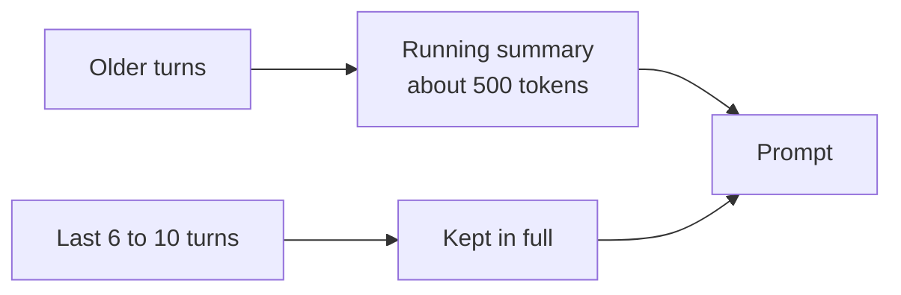
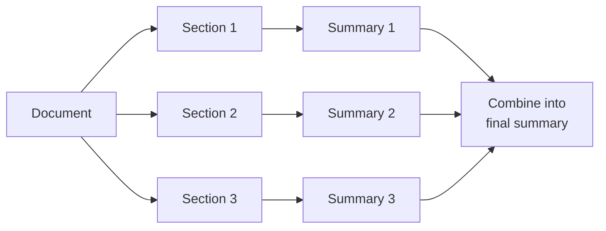

The context window is the model's working memory for one call. Everything it knows about this request must fit inside: instructions, retrieved sources, conversation history, attachments, tool results, and room for the answer. Context windows are large now, often hundreds of thousands of tokens, but filling them is slow, expensive, and often makes answers worse.

## Why not just send everything

| Problem | Explanation |
| --- | --- |
| Cost | You pay for every input token on every call. A 100,000 token prompt costs about 25 times a 4,000 token prompt |
| Latency | Time to first token grows with prompt size. Large prompts can add seconds |
| Quality | Models find and use information less reliably in very long prompts, especially in the middle. Irrelevant content distracts |
| Limits | Provider tokens-per-minute limits are hit sooner |

The goal is the **smallest context that contains everything needed**, not the largest that fits.

## A context budget

Set an explicit token budget per part, and enforce it in the context builder. Example for the answer prompt with a model that has a 128,000 token window:

| Part | Budget | Notes |
| --- | --- | --- |
| System instructions and tenant additions | 1,500 | Fixed, measured at build time |
| Retrieved sources | 6,000 | About 8 to 12 chunks of 400 to 600 tokens |
| Conversation history | 4,000 | Recent turns in full, older turns summarized |
| Current question and attachment excerpts | 8,000 | Larger only when the task is about the attachment |
| Tool results (agent turns) | 6,000 | Truncated or summarized per call |
| Reserved for the answer | 2,000 | Must match `max_tokens` |
| **Total target** | **about 27,500** | Far below the window. Leaves room for spikes |

Count tokens with the model's own tokenizer. Character-based estimates are off by 20 to 50 percent for code and for languages other than English.

## Conversation history

### Strategy

1. Keep the most recent turns in full. Follow-up questions mostly refer to the last few exchanges.
2. Replace older turns with a **running summary** generated by a small model, updated every few turns. The summary keeps facts the user stated ("I'm based in Berlin", "the project is called Atlas") and decisions made.
3. **Do not resend old retrieved sources.** Each turn retrieves fresh sources for its own question. Old sources in history waste tokens and can mislead.
4. Keep tool calls and results from earlier turns only as short summaries, such as "Created ticket IT-4821".

### When the conversation is too long

Eventually a conversation drifts across many topics, and even a summary cannot carry it well. Suggest a new conversation when the summary passes a size threshold or the topic clearly changes. Offer to carry a summary over.

## Attachments and long documents

When a user uploads a document and asks about it, the strategy depends on size and task.

| Document size | Task | Strategy |
| --- | --- | --- |
| Fits comfortably, under about 30,000 tokens | Any | Put the whole document in context. Simplest and most accurate |
| Large | Specific question ("What is the termination clause?") | Chunk and retrieve from the document, like RAG over one file |
| Large | Whole-document task ("Summarize", "List all risks") | Map-reduce: process sections separately, then combine |
| Very large or many files | Whole-document task | Map-reduce as a background job, with progress shown |

### Map-reduce summarization

- Split on the document's own structure (chapters, headings) when possible, not fixed token counts.
- Run the map step in parallel with a small or mid-size model.
- Tell the map step what the final goal is, such as "extract risks related to liability", so it keeps the right details.
- Keep page or section references through both steps, so the final answer can cite them.

## Tool results

In agent loops, tool results can be huge: a search returning 50 tickets, or an API returning a large JSON object.

- Design tools to return **compact, relevant fields**, not raw API responses. See [Agents and tools](/docs/ai-model/agents-tools).
- Truncate long results with a clear marker, such as "... 42 more results. Refine the search to see them."
- Summarize older tool results in long agent runs, keeping IDs the model may need later.

## Ordering inside the prompt

- Put stable content first: instructions, then tenant additions. This makes provider prompt caching effective.
- Put sources before the question, and the question last. Models attend well to the end of the prompt.
- Order sources by relevance, best first.

## Measuring

Record, per request: tokens per part (instructions, sources, history, tools, question), total input tokens, and whether any part was truncated. Plot the distribution. You will find surprises, such as a tenant whose custom instructions are 5,000 tokens, or a tool that returns 20,000 tokens of JSON.

## Checklist

- [ ] Each prompt part has a token budget enforced by the context builder.
- [ ] Tokens are counted with the model's tokenizer.
- [ ] Old turns are summarized, and old sources are not resent.
- [ ] Attachments use full context, retrieval, or map-reduce based on size and task.
- [ ] Tool results are compact and truncated with clear markers.
- [ ] Token usage per prompt part is recorded and monitored.
