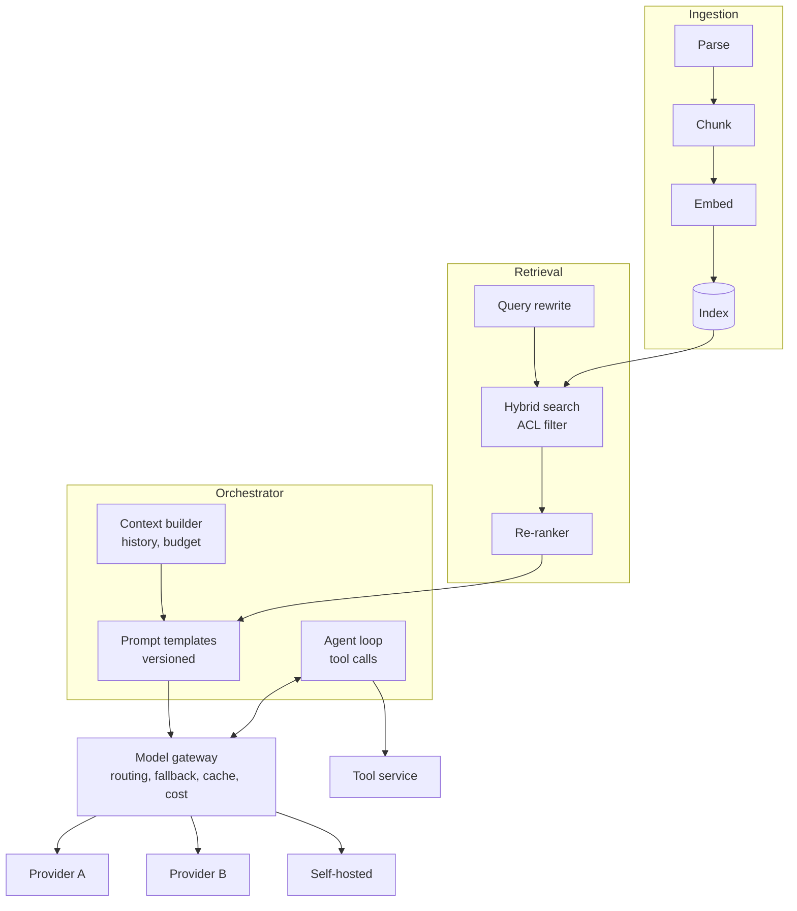

This section covers the parts that make the assistant intelligent: which model answers, what it is told, what knowledge it is given, and what actions it can take. Everything else in the system exists to feed this layer safely and to show its output well.

## The design

## How the pieces relate

A useful way to think about it: the model is a very capable reader and writer with no memory and no access to your company. Every call, you hand it a sheet of paper (the prompt) that must contain everything it needs. This layer decides what goes on that sheet.

| Question | Component | Page |
| --- | --- | --- |
| Which model reads the sheet? | Model gateway and routing | [Model selection](/docs/ai-model/model-selection) |
| What instructions are on it? | Prompt templates | [Prompts](/docs/ai-model/prompts) |
| How much fits, and what gets cut? | Context builder | [Context management](/docs/ai-model/context) |
| How does company knowledge get into a searchable form? | Ingestion pipeline | [RAG ingestion](/docs/ai-model/rag-ingestion) |
| Which knowledge goes on the sheet for this question? | Retrieval | [RAG retrieval](/docs/ai-model/rag-retrieval) |
| What can the model do beyond writing text? | Tools and agent loop | [Agents and tools](/docs/ai-model/agents-tools) |
| How do we keep this affordable and fast? | Caching and routing | [Caching and cost](/docs/ai-model/caching-cost) |

## What determines answer quality

When an answer is bad, the cause is almost always one of these, roughly in order of how often each is the culprit:

1. **Retrieval missed the right content.** The answer was in the documents but never reached the prompt. This is the most common cause by far.
2. **The right content was there but buried.** Too many irrelevant chunks, and the model used the wrong one.
3. **The source content itself was wrong, outdated, or contradictory.** Two versions of a policy, both indexed.
4. **The instructions were unclear.** The model did not know it should say "I don't know", or how to handle conflicting sources.
5. **The model was not capable enough** for the task. Less common than teams assume.

So when quality is poor, look at retrieval first. Teams often switch to a bigger model when the real problem is that the right paragraph was never retrieved. Tracing every request with the retrieved chunks, as described in [Observability](/docs/observability), is what lets you tell these causes apart.

## Rules for this layer

- **Every model call goes through the model gateway.** No direct provider SDK calls from feature code.
- **Every prompt is a versioned template.** No prompt strings assembled inline in business logic.
- **Every answer records what it was built from**: prompt version, model, retrieved chunk IDs, tool calls.
- **Every change is evaluated** against the golden dataset before release. See [Evaluation](/docs/evaluation).
- **Permissions are applied before content reaches the prompt.** The model is never trusted to withhold information.
