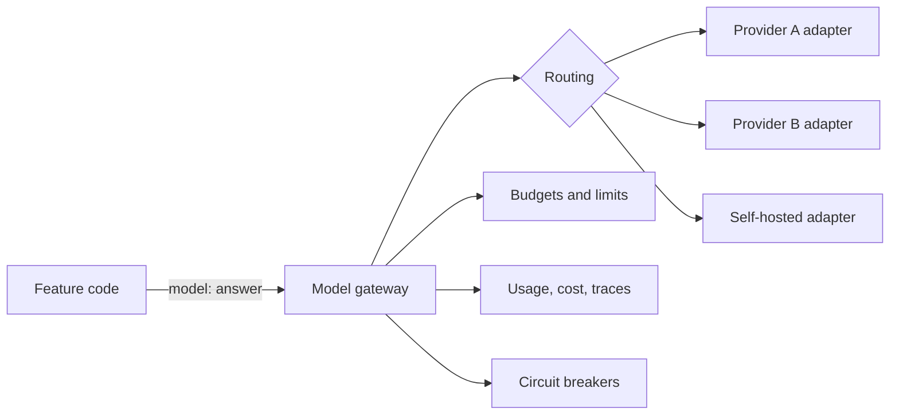

There is no single best model. There is a best model **for each task** at an acceptable cost and latency. An assistant usually uses three to five models: a strong one for answers, small fast ones for rewriting and classification, an embedding model, and a re-ranker.

## Match models to tasks

| Task | What matters | Model tier |
| --- | --- | --- |
| Final answer generation | Reasoning, following instructions, citing sources, writing quality | Large or mid-size general model |
| Agentic tool use | Reliable tool calling, planning, recovering from errors | Large model with strong tool use |
| Query rewriting | Speed, cost | Small fast model |
| Conversation titles, short summaries | Speed, cost | Small fast model |
| Classification: intent, guardrails, routing | Speed, consistency | Small model, or a fine-tuned classifier |
| Embeddings | Retrieval quality in your languages and domain, dimension size, cost | Dedicated embedding model |
| Re-ranking | Relevance accuracy | Cross-encoder re-ranker |
| Extraction to structured data | Schema adherence | Mid-size model with structured output support |
| LLM-as-judge evals | Careful reasoning, consistency | A strong model, ideally from a different family than the one being judged |

Model tiers move quickly. A small model from this year often beats a large model from two years ago. Re-run your evaluation set when new models appear rather than relying on benchmark leaderboards, which rarely match your tasks.

## How to choose

1. **Build the evaluation set first.** 100 to 300 real questions with expected answers or grading criteria. See [Datasets](/docs/evaluation/datasets).
2. **Run every candidate model** on the same set with the same prompt, adapted only where a model requires it.
3. **Score quality, latency, and cost together.**

| Model | Quality score | p50 TTFT | p95 total | Cost per 1,000 answers |
| --- | --- | --- | --- | --- |
| Model A | 0.86 | 0.9 s | 9 s | High |
| Model B | 0.84 | 0.5 s | 6 s | Medium |
| Model C | 0.71 | 0.3 s | 3 s | Low |

4. **Pick the cheapest model that meets your quality bar.** If Model B is within the margin of error of Model A at half the cost, choose B.
5. **Check the failure cases, not just the average.** A model with a slightly higher average score but more confident wrong answers is worse for an enterprise assistant.

Also check things benchmarks ignore: behavior in each of your users' languages, refusal rate on legitimate work questions, and how well it follows your citation format.

## Non-functional requirements

| Requirement | Questions to ask |
| --- | --- |
| Data handling | Does the provider train on your data? What is the retention period? Is zero data retention available? |
| Region | Can requests be processed in the regions your customers require? |
| Context window | Is it large enough for your longest realistic prompt with margin? |
| Throughput | What are the rate limits, and can you get them raised? Are there provisioned throughput options? |
| Stability | How long are model versions supported before deprecation? |
| Features | Tool calling, structured output, prompt caching, streaming, batch API |
| Contract | Is it covered by your company's existing cloud agreement and security review? |

## Model gateway

All model calls go through one internal component, the model gateway. It can be a library inside your backend or a separate service. It exists so that feature code never depends on a specific provider.



### Responsibilities

| Responsibility | Detail |
| --- | --- |
| One API | Feature code calls `generate` or `stream` with messages, tools, and a **logical model name** such as `answer`, `fast`, or `judge` |
| Routing | Maps logical names to concrete provider models per tenant, region, and rollout percentage |
| Adapters | Translate the common request format into each provider's API, including tool calling and streaming formats |
| Retries and fallback | Retries transient errors, then falls back to the next model in the chain |
| Limits | Enforces token budgets and provider rate limits. See [Rate limits](/docs/backend/rate-limits) |
| Usage and cost | Records input, output, and cached tokens and computes cost per call |
| Tracing | Emits a span per call with model, latency, token counts, and prompt version |
| Data controls | Applies tenant rules: allowed providers, allowed regions, zero retention flags |

### Logical model names

Feature code should never contain `"gpt-x-2026-01"` or similar. It asks for a role:

```yaml
# model-routes.yaml
answer:
  primary: provider_a/large-2026-02
  fallback: [provider_b/large-latest, provider_a/medium-2026-02]
  max_output_tokens: 2000
fast:
  primary: provider_a/small-2026-02
  fallback: [provider_b/small-latest]
judge:
  primary: provider_b/large-latest
embed:
  primary: provider_a/embed-v3   # changing this requires re-indexing
```

Changing the model behind `answer` is then a config change, rolled out with a canary and evaluated, not a code change across many files.

**Embeddings are the exception.** You cannot fall back to a different embedding model at query time, because the query vector must come from the same model as the indexed vectors. Changing the embedding model means re-embedding the whole corpus. See [RAG ingestion](/docs/ai-model/rag-ingestion).

## Routing strategies

| Strategy | How | Good for |
| --- | --- | --- |
| Static per task | Each task uses its configured model | Default. Simple and predictable |
| By tenant | Some tenants get specific providers or regions | Contract and residency requirements |
| By difficulty | A small classifier or rules decide whether a question needs the large model | Cost reduction when many questions are simple |
| Cascade | Try the small model, and escalate if its confidence is low or a check fails | Cost reduction with a quality safety net |
| Percentage rollout | Send a share of traffic to a new model | Safe migration between models |

Start with static routing. Add difficulty routing only after you have data showing many questions are simple and that the small model handles them at your quality bar. Routing errors are hard to see: a wrongly routed hard question gets a weak answer with no error anywhere.

## Model version pinning

Providers update models, and behavior changes. A prompt that worked last month can degrade silently.

- **Pin exact model versions** in production when providers offer them, rather than "latest" aliases.
- Track **deprecation dates** for every pinned version, and plan migrations months ahead.
- Treat a model upgrade like a code change: run the evaluation set, compare, canary, then roll out. See [Rollouts](/docs/deployment/rollouts).

## Self-hosted models

If you self-host open-weight models:

- Use a serving engine built for throughput, such as vLLM, TGI, or TensorRT-LLM. They batch requests continuously and manage GPU memory for long contexts.
- Expose an OpenAI-compatible API from the serving engine, and add it as one more adapter in the gateway.
- Plan capacity for peak concurrent requests and context length, not average. GPU memory for long contexts is usually the limit.
- Monitor GPU utilization. Idle GPUs are the largest waste in self-hosting.

See [Infrastructure](/docs/deployment/infrastructure) for hosting details.

## Checklist

- [ ] Each task has a chosen model backed by evaluation results.
- [ ] Feature code uses logical model names only.
- [ ] Routing, fallbacks, and limits are configured in one place.
- [ ] Production uses pinned model versions with known deprecation dates.
- [ ] Fallback models are evaluated with the same prompts.
- [ ] Usage and cost are recorded for every call.
- [ ] Tenant data rules (providers, regions, retention) are enforced by the gateway.
