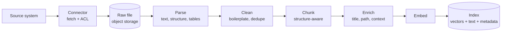

Retrieval can only find what ingestion put in the index, in the shape ingestion gave it. Most "the assistant can't find it" bugs are ingestion bugs: a table parsed into garbage, a heading separated from its content, a document indexed twice in two versions, or permissions that were never copied.

## The design



Each stage writes its output somewhere you can inspect. When an answer is wrong, you need to see what the parser produced and how the document was chunked, not just the final vectors.

## 1. Parsing

Parsing turns a file into clean text that keeps its structure: headings, lists, tables, and page numbers.

| Format | Approach | Pitfalls |
| --- | --- | --- |
| HTML, wiki pages | Convert to markdown, keeping headings and tables. Drop navigation, footers, and sidebars | Boilerplate repeated on every page pollutes search |
| DOCX | Library that reads styles to recover headings | Headings made with bold text instead of styles look like body text |
| PDF with text layer | Layout-aware parser that recovers reading order, columns, and tables | Two-column layouts read across columns. Headers and footers repeat on every page |
| Scanned PDF, images | OCR, or a vision-capable model for complex layouts | Slow and costly. Check quality on samples |
| Spreadsheets | Each sheet as a table, or rows as records with column headers repeated | Huge sheets. Formulas without values |
| Slides | Text per slide, with slide titles and speaker notes | Meaning often lives in diagrams that parse to nothing |
| Email, tickets | Thread structure, sender, date, subject. Strip quoted replies and signatures | Quoted history duplicates text many times |

**Tables need special care.** A table flattened into a stream of cell values is useless. Convert tables to markdown tables, or for large tables, to one line per row with the column headers repeated: `Region: APAC | City: Singapore | Daily allowance: SGD 180`. Each row then stands alone when retrieved.

**Test parsing on your real documents.** Take 50 representative files, parse them, and read the output. You will find problems no library documentation warns about.

## 2. Cleaning

- **Remove boilerplate**: repeated headers, footers, cookie banners, legal disclaimers on every page.
- **Normalize whitespace and characters**: odd unicode, ligatures, hyphenation at line breaks.
- **Deduplicate**: the same document often exists in several places. Hash normalized content and keep one copy, while merging the ACLs of all copies.
- **Handle versions**: if a source system keeps old versions, index only the current one unless users need history.
- **Detect low-value content**: empty pages, auto-generated files, logs. Skip them.

## 3. Chunking

A chunk is the unit that retrieval returns. Chunk quality has a direct effect on answer quality.

### Size

| Chunk size | Effect |
| --- | --- |
| Too small (under about 150 tokens) | Chunks lack context. "The limit is 350" with no hint of what limit |
| Good range (about 300 to 800 tokens) | Enough context to stand alone, specific enough to rank well |
| Too large (over about 1,500 tokens) | The embedding averages several topics and matches nothing strongly. Fewer chunks fit in the prompt |

Start around 500 tokens with 10 to 15 percent overlap, then tune with your evaluation set. The right size depends on your documents: dense policy text works with smaller chunks, narrative documents with larger.

### Structure-aware splitting

Split on the document's own structure first, and fall back to size limits only when a section is too long.

1. Split by headings (H1, H2, H3).
2. If a section is over the size limit, split by paragraphs.
3. If a paragraph is over the limit, split by sentences.
4. Never split inside a table row, list item, or code block.

### Contextual headers

A chunk taken out of its document loses context. Prepend a short header to each chunk's text **before embedding**:

```text
Document: Travel Policy 2025
Section: Client visits > Asia-Pacific > Allowances
Updated: 2025-11-02

Client visits in Asia-Pacific: daily allowance of SGD 180 for meals and
local transport. Hotel up to SGD 350 per night in Singapore...
```

This one change often gives a large retrieval improvement, because a question about "Singapore travel allowance" now matches on the document title and section path, not just the body.

A more powerful variant is to have a small model write a one or two sentence summary of where the chunk sits in the document, and prepend that. It costs one model call per chunk at ingestion time, but ingestion is offline and can afford it.

### Parent and child chunks

Index small chunks for precise matching, but give the model a larger surrounding passage. Store each small chunk with a pointer to its parent section. At query time, match on small chunks and then expand to the parent, deduplicating parents that several matches share.

## 4. Metadata

Every chunk carries metadata used for filtering, ranking, display, and deletion.

| Field | Used for |
| --- | --- |
| `chunk_id` | Deterministic: hash of `document_id` and chunk position. Makes re-ingestion idempotent |
| `document_id`, `source`, `source_url` | Citations and deletion |
| `tenant_id` | Isolation |
| `allowed_principals` | Permission filtering at query time |
| `title`, `section_path` | Display and contextual headers |
| `updated_at` | Freshness ranking and showing dates in citations |
| `language` | Filtering and choosing the right keyword analyzer |
| `doc_type` | Filtering, such as policies only |
| `page` or `anchor` | Deep links to the exact location |
| `content_hash` | Skip re-embedding unchanged chunks |
| `embedding_model` | Know which model produced the vector |

## 5. Embeddings

An embedding model turns text into a vector. Similar meanings produce nearby vectors.

- **Choose with your own data.** Run retrieval evaluation with two or three candidate models on your questions. Public leaderboards are a starting point, not an answer.
- **Check language coverage** if your documents are multilingual. Some models are much weaker outside English.
- **Use the right input type.** Many embedding models distinguish between documents and queries. Embed chunks as documents and questions as queries.
- **Batch requests** during ingestion and respect rate limits. Embedding a large corpus is mostly a throughput problem.
- **Store the model name** with each vector. You cannot compare vectors from different models.

### Changing the embedding model

A new embedding model means re-embedding every chunk. Plan it as a migration:

1. Create a new index alongside the old one.
2. Re-embed all chunks into the new index in the background.
3. Run retrieval evaluation against both indexes.
4. Switch reads to the new index with a feature flag.
5. Keep the old index until you are confident, then delete it.

During the migration, new and changed documents must be written to both indexes.

## 6. Keeping the index in sync

The index is a copy of source data, and copies go stale.

| Change in source | What must happen |
| --- | --- |
| Document edited | Re-parse, re-chunk. Re-embed only chunks whose content hash changed. Delete chunks that no longer exist |
| Document deleted | Delete all its chunks and files. This is also a compliance requirement |
| Permissions changed | Update `allowed_principals` on all chunks. No re-embedding needed. Must be fast |
| Document moved | Update path metadata and URLs |

Permission changes need the shortest delay. If someone is removed from a confidential project, the assistant must stop showing them its documents within minutes, not at the next nightly sync. Use change notifications or webhooks from the source system where available. See [Data sources and connectors](/docs/data/sources-connectors).

## Quality checks

Automate checks that catch ingestion problems before users do:

- Documents with zero chunks after parsing.
- Chunks with very little text, or mostly non-alphabetic characters, which usually signal a parsing failure.
- Duplicate chunks across documents.
- Chunks missing `allowed_principals`. These must never be searchable. Treat a missing ACL as "nobody", not "everybody".
- Documents whose last successful sync is older than expected.

## Checklist

- [ ] Parser output is stored and can be inspected per document.
- [ ] Tables are converted to markdown or row records with headers.
- [ ] Chunking follows document structure, with a size limit as a fallback.
- [ ] Chunks have contextual headers before embedding.
- [ ] Chunk IDs are deterministic, so re-ingestion is idempotent.
- [ ] Every chunk has tenant ID, ACL, source URL, and updated date.
- [ ] A missing ACL makes a chunk unsearchable.
- [ ] Unchanged chunks are not re-embedded.
- [ ] Permission changes reach the index within minutes.
- [ ] Embedding model changes are planned as a dual-index migration.
