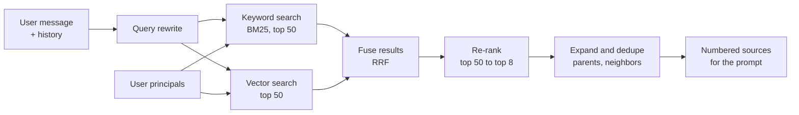

Retrieval decides what the model reads. If the right passage is not retrieved, no prompt and no model can produce the right answer. This page covers each step of retrieval and the settings that matter.

## The design



## 1. Query rewriting

Users write follow-ups that make no sense alone: "and for Tokyo?", "who approves it?", "what about contractors?". A small model rewrites the latest message into a standalone search query using the recent conversation.

```text
History:
  User: What's the hotel limit for client visits in Singapore?
  Assistant: SGD 350 per night [1].
Latest: and Tokyo?
Rewritten: hotel limit per night for client visits in Tokyo
```

Variants worth considering once the basics work:

- **Multiple queries**: generate two or three phrasings and search with each, then fuse. Helps when users use different words than documents.
- **Keyword extraction**: pull out names, codes, and IDs, such as "INC-48211" or "Form W-8BEN", and make sure keyword search receives them exactly.
- **Filters from the question**: "policies updated this year" becomes a date filter. Only add this when you have evaluation cases that need it.

## 2. Hybrid search

Run two searches and combine them.

| Search | Finds well | Misses |
| --- | --- | --- |
| **Keyword (BM25)** | Exact terms: product names, error codes, people's names, acronyms, IDs | Synonyms and paraphrases. "Time off" vs "leave" |
| **Vector** | Meaning: paraphrases, synonyms, conceptual questions | Rare exact terms, codes, and names the embedding model never learned |

Neither alone is enough for enterprise content, which is full of both concepts and codes. Hybrid search is the standard baseline.

### Fusing results

The two searches return scores on different scales, so you cannot add them. Use **Reciprocal Rank Fusion (RRF)**, which only uses rank positions:

```text
score(chunk) = sum over each result list of  1 / (k + rank_in_that_list)
               with k = 60 as a common default
```

A chunk ranked 1st in keyword search and 5th in vector search scores `1/61 + 1/65`. A chunk found by only one search scores just one term. RRF is simple, needs no tuning to start, and works well.

### Permission filtering

Apply the ACL filter **inside both searches**, as part of the query. With pgvector, for example:

```sql
SELECT id, text, title, source_url, updated_at
FROM chunks
WHERE tenant_id = $1
  AND allowed_principals && $2::text[]   -- any overlap with the user's principals
ORDER BY embedding <=> $3                 -- cosine distance to the query vector
LIMIT 50;
```

Be careful with approximate vector indexes such as HNSW. With a very selective filter, the index can return fewer than `LIMIT` rows or miss good matches, because it filters after traversing a fixed number of candidates. Mitigations: increase the search's candidate size (for pgvector, `hnsw.ef_search`), enable iterative scans where supported, or partition the index by tenant so filters are less selective.

## 3. Re-ranking

Search engines are fast but approximate. A **re-ranker** reads the question and each candidate chunk together and scores how well the chunk answers the question. It is slower per item but much more accurate.

- Retrieve a wide set, about 30 to 100 candidates, from hybrid search.
- Re-rank them with a cross-encoder model or a re-ranking API.
- Keep the top 5 to 10.

Re-ranking is usually the single biggest quality improvement after hybrid search. It is also often the slowest step in retrieval. Control its cost with the candidate count: re-ranking 50 candidates is usually a good balance.

### Relevance threshold

Do not always pass the top 8 to the model. If the best re-ranker score is low, the honest answer is "I couldn't find this". Set a minimum score, tuned on evaluation data, below which chunks are dropped. If no chunk passes, tell the model there are no relevant sources, and it will say so instead of stretching weak matches into an answer.

## 4. Assembling sources

After re-ranking:

1. **Expand** small chunks to their parent section, or add neighboring chunks, if your ingestion supports it.
2. **Deduplicate** overlapping text and chunks that came from duplicate documents.
3. **Diversify** if one long document dominates the top results and the question is broad. Cap chunks per document at around 3.
4. **Order** by re-ranker score, best first.
5. **Number** them and render them into the prompt with title, date, and URL. See [Prompts](/docs/ai-model/prompts).
6. **Send citation metadata** to the frontend, so the source panel can show titles and highlight passages.

## 5. Freshness

Enterprise content has many outdated versions of the truth. Options, in order of preference:

1. **Fix it at the source**: archive outdated documents, and exclude archived content from ingestion.
2. **Boost recent documents** slightly in ranking, for example a small bonus that decays with document age.
3. **Show dates to the model and the user**, and instruct the model to prefer recent sources when they conflict.

Do not apply a strong recency boost by default. Many authoritative documents, such as a code of conduct, change rarely and should not be ranked down for being old.

## Debugging retrieval

When an answer is wrong, find out where the right content was lost. Every request's trace should record the rewritten query, the candidates from each search with scores, the re-ranked list, and the final sources. Then:

| Question | If no | Fix area |
| --- | --- | --- |
| Is the right document in the index at all? | Not ingested | Connector, parser, or filters in ingestion |
| Is it visible to this user (ACL)? | Filtered out | Correct behavior, or ACL sync problem |
| Is the right chunk well formed? | Garbled table, missing context | Parsing and chunking |
| Did it appear in keyword or vector candidates? | Not retrieved | Query rewrite, embeddings, contextual headers, candidate count |
| Did it survive re-ranking? | Ranked too low | Re-ranker choice, threshold |
| Was it in the prompt but ignored? | Model problem | Prompt instructions, too many sources, or model capability |

Build a small internal tool that runs a query as a given user and shows each of these stages side by side. It will pay for itself within a week.

## Measuring retrieval

Evaluate retrieval separately from answer quality, using questions labeled with the chunks or documents that contain the answer.

| Metric | Meaning |
| --- | --- |
| **Recall at k** | Share of questions where a correct chunk appears in the top k. The most important retrieval metric |
| **MRR** (mean reciprocal rank) | How high the first correct chunk ranks, on average |
| **Precision at k** | Share of the top k that are relevant. Matters because irrelevant chunks distract the model |

Track recall at the candidate stage (top 50) and after re-ranking (top 8). If recall at 50 is high but recall at 8 is low, improve re-ranking. If recall at 50 is low, improve search, chunking, or query rewriting. See [Metrics](/docs/evaluation/metrics).

## Checklist

- [ ] Follow-up questions are rewritten into standalone queries.
- [ ] Hybrid search combines keyword and vector results with RRF.
- [ ] ACL filters are applied inside both searches.
- [ ] Filtered vector search is tested for missed results at realistic selectivity.
- [ ] A re-ranker narrows candidates to the final set.
- [ ] A relevance threshold lets the system say "not found".
- [ ] Every stage of retrieval is recorded in the trace.
- [ ] Recall at k is measured at the candidate stage and the final stage.
