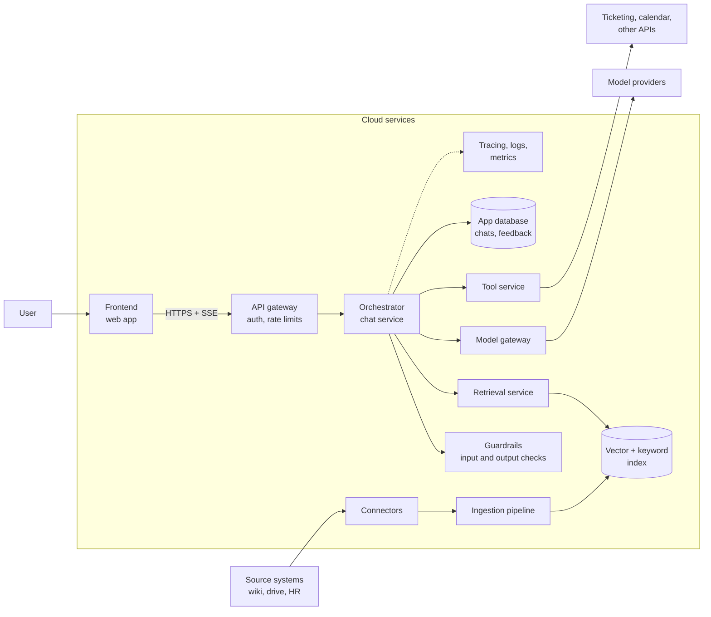

This page shows where AI systems are useful, then walks through one design: its components, how they connect, and what problem each one solves. Later pages go deep on one component at a time.

## Where AI systems are useful

AI systems solve very different problems. These companies use AI in production today:

| Company | Scenario | What the AI system does |
| --- | --- | --- |
| [Shopee](https://fintechnews.sg/133456/ai/shopee-chatgpt/) | E-commerce | Shoppers describe what they want in plain language, such as a gift idea, and get product suggestions from Shopee's real-time inventory inside ChatGPT. |
| [Grab](https://openai.com/index/grab/) | Maps and transport | A vision model reads street-level images from driver cameras to detect speed limit signs, turn restrictions, and road geometry, so maps are built faster and cheaper. |
| [GovTech Singapore](https://www.tech.gov.sg/products-and-services/for-government-agencies/productivity-and-marketing/pair) | Public sector | Pair is an AI assistant that helps public officers write, research, and summarise. It runs on government devices and keeps data within government infrastructure. |
| [Morgan Stanley](https://openai.com/index/morgan-stanley/) | Wealth management | Financial advisors ask questions over about 100,000 internal research reports and get answers with links to the source documents. |
| [Duolingo](https://blog.duolingo.com/duolingo-max) | Education | An AI tutor explains why a learner's answer was right or wrong, and runs roleplay conversations with feedback afterwards. |
| [Stripe](https://stripe.com/radar) | Payments | Models score every payment for fraud risk in real time, trained on transactions from businesses across the Stripe network. No chat interface is involved. |

Some of these are conversational. Others, such as Grab's maps and Stripe's fraud checks, run in the background and the user never talks to them. Each scenario needs a different design. The sections of these docs help you choose the right components for yours.

## The design

This design is for a chatbot use case.

Everything inside the frame is hosted on a cloud provider, such as AWS, Azure, or Google Cloud. The user, the source systems, the model providers, and the external APIs sit outside it.

Two flows run through this diagram:

- **The online path** (top): a user sends a message and gets a streamed answer. It must be fast and reliable. Everything on it has a latency budget.
- **The offline path** (bottom): connectors pull documents from source systems, and the ingestion pipeline turns them into searchable chunks. It runs in the background and must be correct and complete, but it is not latency-sensitive.

Keep these two paths separate in your head and in your code. Mixing them, for example parsing a large PDF inside a chat request, is the most common cause of slow and fragile AI systems.

## Why each component exists

Every component below solves a specific problem. The right column says what breaks if you leave it out. That column is the real reason the component exists.

| Component | What it does | What breaks without it |
| --- | --- | --- |
| Frontend | Chat UI, streaming display, citations, feedback buttons | Users cannot see sources, so they cannot trust or verify answers |
| API gateway | Authenticates requests, applies rate limits, routes to services | One user or script can exhaust the model budget for everyone |
| Orchestrator | Runs the steps of a request: load history, retrieve, build prompt, call model, call tools | Logic spreads across the frontend and many services, and nobody can explain why an answer was produced |
| Guardrails | Checks input and output for policy violations, PII, and prompt injection | Harmful or leaked content reaches users with nothing in between |
| Retrieval service | Finds the most relevant chunks for a question, filtered by the user's permissions | The model answers from its training data and invents company facts |
| Vector and keyword index | Stores chunk embeddings and text for fast search | Retrieval has nothing to search |
| Model gateway | One interface to all model providers, with retries, fallback, and cost tracking | A provider outage takes the product down, and cost is invisible |
| Tool service | Executes actions against other systems with the user's permissions | The model gets raw API keys, or actions run without checks |
| Connectors and ingestion | Pull documents, parse, chunk, embed, and index them | The index is stale or missing data, so answers are wrong |
| App database | Stores chats, messages, feedback, and settings | No history, no feedback loop, no audit trail |
| Observability | Traces each request across every step, with prompts and costs | When an answer is wrong, nobody can find out why |

## How a question becomes an answer

The short version of the online path:

1. The frontend sends the message over HTTPS and opens a stream.
2. The gateway checks the user's token and rate limit.
3. The orchestrator loads the conversation and runs input guardrails.
4. The retrieval service searches the index, keeping only chunks the user is allowed to see.
5. The orchestrator builds the prompt: instructions, retrieved chunks, history, and the question.
6. The model gateway calls a model and streams tokens back.
7. Output guardrails check the stream. The frontend renders tokens and citations as they arrive.
8. The orchestrator saves the message, the sources used, and a trace.

[Request lifecycle](/docs/architecture/request-lifecycle) walks through each step with timings and failure points.

## Design principles

These principles shape decisions in every section. When two options look equal, pick the one that follows them.

- **Permissions are enforced before the model sees data.** The model cannot be trusted to hide what it has read. If a chunk reaches the prompt, assume the user can see it.
- **Every answer is traceable.** For any answer you must be able to show the prompt, the retrieved chunks, the model, and the prompt version that produced it.
- **Prompts are code.** They are versioned, reviewed, tested, and rolled out like code.
- **Measure quality before and after every change.** A prompt edit that looks better on three examples can be worse on three hundred. See [Evaluation](/docs/evaluation).
- **Humans approve side effects.** Reading is automatic. Writing, sending, and deleting need a click from the user.

## Where to go next

| If you want to | Read |
| --- | --- |
| Follow one request through the whole system | [Request lifecycle](/docs/architecture/request-lifecycle) |
| Decide what runs in the request and what runs in the background | [Sync and async work](/docs/architecture/sync-async) |
| Serve many customers or departments from one deployment | [Multi-tenancy](/docs/architecture/multi-tenancy) |
| Understand the big technology choices and their trade-offs | [Key decisions](/docs/architecture/decisions) |
| Look up a term | [Glossary](/docs/architecture/glossary) |
