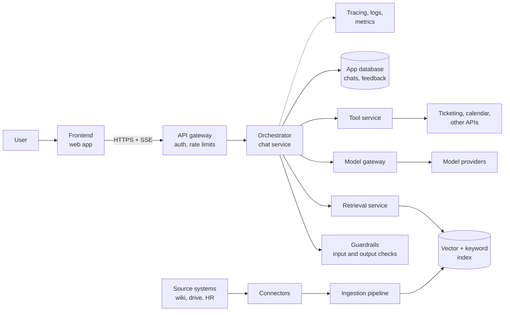

This page describes the system every other section refers to. Read it first. It names the components, shows how they connect, and explains what problem each one solves. Later pages go deep on one component at a time.

## The reference system

The docs use one running example so that every page talks about the same thing: an **internal AI assistant** for a company with a few thousand employees.

It does three jobs:

1. **Answers questions over company knowledge.** "What is our parental leave policy in Germany?" The answer comes from HR documents, wiki pages, and tickets, with citations.
2. **Works with documents the user brings.** The user uploads a contract and asks for a summary or a risk list.
3. **Takes small actions.** "Open an IT ticket for my broken laptop." The assistant calls a tool, but asks the user to confirm before anything is written.

Most enterprise AI products are a variation of these three jobs. A support copilot, a sales research tool, and a legal review assistant all retrieve private data, reason over it, and sometimes act. If you understand this system, you can adapt it.

### What the system does not do

Stating limits early prevents bad design decisions later.

- It does **not** train or fine-tune its own foundation model. It calls hosted or self-hosted models through an API.
- It does **not** make final decisions on people, such as hiring, firing, or credit. Those uses carry legal risk and need a different review process. See [Responsible AI](/docs/responsible-ai).
- It does **not** act without confirmation on anything that writes, sends, or deletes.
- It is **not** a system of record. Source documents live in their original systems. The assistant keeps copies for search only.

## The design

Two flows run through this diagram:

- **The online path** (top): a user sends a message and gets a streamed answer. It must be fast and reliable. Everything on it has a latency budget.
- **The offline path** (bottom): connectors pull documents from source systems, and the ingestion pipeline turns them into searchable chunks. It runs in the background and must be correct and complete, but it is not latency-sensitive.

Keep these two paths separate in your head and in your code. Mixing them, for example parsing a large PDF inside a chat request, is the most common cause of slow and fragile AI systems.

## Why each component exists

Every component below solves a specific problem. The right column says what breaks if you leave it out. That column is the real reason the component exists.

| Component | What it does | What breaks without it |
| --- | --- | --- |
| Frontend | Chat UI, streaming display, citations, feedback buttons | Users cannot see sources, so they cannot trust or verify answers |
| API gateway | Authenticates requests, applies rate limits, routes to services | One user or script can exhaust the model budget for everyone |
| Orchestrator | Runs the steps of a request: load history, retrieve, build prompt, call model, call tools | Logic spreads across the frontend and many services, and nobody can explain why an answer was produced |
| Guardrails | Checks input and output for policy violations, PII, and prompt injection | Harmful or leaked content reaches users with nothing in between |
| Retrieval service | Finds the most relevant chunks for a question, filtered by the user's permissions | The model answers from its training data and invents company facts |
| Vector and keyword index | Stores chunk embeddings and text for fast search | Retrieval has nothing to search |
| Model gateway | One interface to all model providers, with retries, fallback, and cost tracking | A provider outage takes the product down, and cost is invisible |
| Tool service | Executes actions against other systems with the user's permissions | The model gets raw API keys, or actions run without checks |
| Connectors and ingestion | Pull documents, parse, chunk, embed, and index them | The index is stale or missing data, so answers are wrong |
| App database | Stores chats, messages, feedback, and settings | No history, no feedback loop, no audit trail |
| Observability | Traces each request across every step, with prompts and costs | When an answer is wrong, nobody can find out why |

## How a question becomes an answer

The short version of the online path:

1. The frontend sends the message over HTTPS and opens a stream.
2. The gateway checks the user's token and rate limit.
3. The orchestrator loads the conversation and runs input guardrails.
4. The retrieval service searches the index, keeping only chunks the user is allowed to see.
5. The orchestrator builds the prompt: instructions, retrieved chunks, history, and the question.
6. The model gateway calls a model and streams tokens back.
7. Output guardrails check the stream. The frontend renders tokens and citations as they arrive.
8. The orchestrator saves the message, the sources used, and a trace.

[Request lifecycle](/docs/architecture/request-lifecycle) walks through each step with timings and failure points.

## Design principles

These principles shape decisions in every section. When two options look equal, pick the one that follows them.

- **Permissions are enforced before the model sees data.** The model cannot be trusted to hide what it has read. If a chunk reaches the prompt, assume the user can see it.
- **Every answer is traceable.** For any answer you must be able to show the prompt, the retrieved chunks, the model, and the prompt version that produced it.
- **Models are replaceable.** Business logic never depends on one provider's quirks. The model gateway hides providers behind one interface.
- **Prompts are code.** They are versioned, reviewed, tested, and rolled out like code.
- **Measure quality before and after every change.** A prompt edit that looks better on three examples can be worse on three hundred. See [Evaluation](/docs/evaluation).
- **Humans approve side effects.** Reading is automatic. Writing, sending, and deleting need a click from the user.

## Where to go next

| If you want to | Read |
| --- | --- |
| Follow one request through the whole system | [Request lifecycle](/docs/architecture/request-lifecycle) |
| Decide what runs in the request and what runs in the background | [Sync and async work](/docs/architecture/sync-async) |
| Serve many customers or departments from one deployment | [Multi-tenancy](/docs/architecture/multi-tenancy) |
| Understand the big technology choices and their trade-offs | [Key decisions](/docs/architecture/decisions) |
| Look up a term | [Glossary](/docs/architecture/glossary) |
