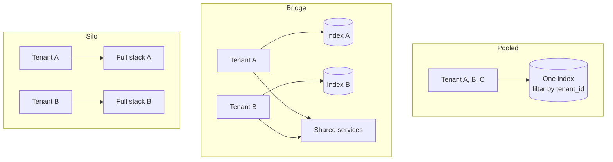

A **tenant** is a group whose data must be kept apart from other groups. For a SaaS product, a tenant is a customer company. For an internal tool, a tenant might be a subsidiary, a region, or a business unit with its own data rules.

Multi-tenancy in an AI system is harder than in a normal web app, because data does not only live in database rows. It also lives in vector indexes, caches, prompts, logs, traces, and evaluation datasets. Every one of those can leak.

## Isolation models

There are three standard models. Most real systems mix them.

| Model | What is shared | Isolation strength | Cost per tenant | Use it for |
| --- | --- | --- | --- | --- |
| **Pooled** | Everything. Tenants share databases and indexes, separated by a `tenant_id` column or filter | Logical only. A bug in a filter leaks data | Lowest | Many small tenants, internal departments |
| **Bridge** | Compute is shared. Each tenant gets its own database schema, index, or namespace | Strong at the storage layer | Medium | Mid-size customers, most B2B SaaS |
| **Silo** | Nothing. Each tenant gets its own deployment, sometimes its own cloud account | Strongest. Physical separation | Highest | Regulated customers, contractual requirements, data residency |



**A practical default:** pooled compute and services, with a separate index namespace or collection per tenant (the bridge model for data). This gives strong data separation where leaks would be worst, without running a full stack per customer. Offer silo only to customers who pay for it.

## Where the tenant ID must flow

The tenant ID is resolved once, at the gateway, from the user's token. From then on it travels with every call. It must never come from the request body, because the user controls the body.

| Layer | How tenant isolation is applied |
| --- | --- |
| Gateway | Resolves `tenant_id` from the verified token and adds it to the request context |
| App database | Every table has `tenant_id`. Use row-level security in Postgres so a missing `WHERE` clause cannot leak data |
| Vector index | Separate namespace or collection per tenant, or a mandatory filter on every query |
| Object storage | Prefix per tenant, for example `s3://bucket/tenant-a/...`, with IAM policies scoped to the prefix |
| Caches | Tenant ID is part of every cache key. A cached answer for tenant A must never serve tenant B |
| Prompt cache and response cache | Same rule. Never share cached completions across tenants |
| Logs and traces | Tagged with tenant ID, so you can export or delete one tenant's data |
| Eval datasets | Built per tenant, or from synthetic data. Never copy one customer's data into a shared test set without consent |
| Model fine-tunes or adapters | Per tenant, if you use them at all |

### The cache trap

Response caching is where AI systems most often leak across tenants. A question like "What is our refund policy?" is identical text for two companies, but the correct answer is different. If the cache key is only the question text, tenant B gets tenant A's policy.

Rule: **cache keys include tenant ID, and for permission-filtered answers, a hash of the user's permission set.** If you cannot compute a reliable permission hash, do not cache answers that used retrieval.

## Permissions inside a tenant

Tenant isolation is the outer wall. Inside a tenant, users still see different data. The HR folder is not visible to engineering.

Copy each document's access control list (ACL) into the index at ingestion time, as metadata on every chunk. At query time, filter by the user's identities: their user ID and their group IDs.

```text
chunk.allowed_principals = ["group:hr", "user:alice@corp.com"]
query filter: allowed_principals contains any of ["user:bob@corp.com", "group:eng", "group:all-staff"]
```

The hard part is keeping ACLs fresh. When someone is removed from a group or a document is unshared, the index must update quickly. See [Data sources and connectors](/docs/data/sources-connectors) for sync strategies.

## Noisy neighbors

In shared infrastructure, one tenant's heavy use slows down everyone. In AI systems the scarce resources are:

- **Model throughput.** Providers limit tokens per minute per API key. One tenant's batch job can use all of it.
- **Embedding throughput** during large ingestions.
- **GPU capacity** if you self-host models.
- **Vector index query capacity.**

Protect them with per-tenant limits at each layer:

| Resource | Limit |
| --- | --- |
| Chat requests | Requests per minute per user and per tenant |
| Model tokens | Tokens per minute and per day per tenant, enforced at the model gateway |
| Ingestion | Concurrent jobs per tenant, separate queue for bulk work |
| Provider keys | Separate API keys or projects per large tenant, so their quota is their own |

## Per-tenant configuration

Enterprise tenants will ask for different behavior. Plan for configuration from the start rather than forking code.

Typical per-tenant settings:

- Allowed models and providers. Some customers ban certain providers or require models hosted in their region.
- Data retention period for chats and logs.
- Guardrail strictness and blocked topics.
- Enabled connectors and tools.
- Custom system prompt additions, such as company tone or terminology.
- SSO configuration and allowed email domains.

Store these in a tenant settings table, cache them, and load them at the start of each request. Validate them when they are saved, not when they are used.

## Trade-offs

| Decision | Option A | Option B |
| --- | --- | --- |
| Index per tenant vs shared index with filter | Per tenant: strong isolation, easy deletion, but many small indexes to manage | Shared: efficient, but one missing filter leaks data |
| Row-level security vs application filters | RLS: enforced by the database, safe against bugs | App filters: simpler, but every query must remember them |
| Shared provider keys vs per-tenant keys | Shared: simple billing, but one tenant can exhaust quota | Per tenant: isolated quota and cost, more keys to manage |

## Checklist

- [ ] Tenant ID comes only from the verified token, never from the request body.
- [ ] The vector index separates tenants by namespace or by a filter that cannot be skipped.
- [ ] Row-level security or an equivalent is enabled on the app database.
- [ ] All cache keys include tenant ID.
- [ ] Document ACLs are stored on chunks and applied at query time.
- [ ] Each tenant has limits on model tokens and ingestion jobs.
- [ ] You can export and delete all data for one tenant, including vectors, logs, and traces.
