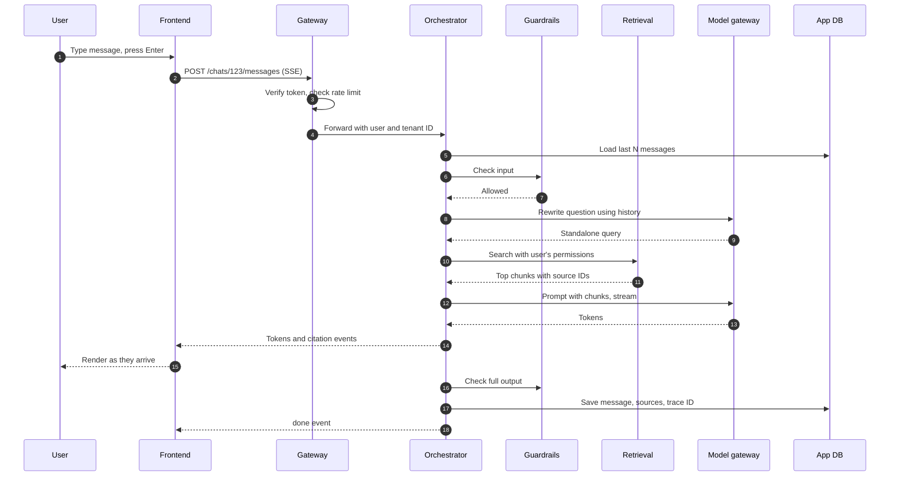

This page follows a single message through the system, from the moment the user presses Enter to the moment the answer is saved. Use it to understand where time goes, where things fail, and where to look when an answer is slow or wrong.

The example message: *"What is the travel budget for a client visit to Singapore?"*

## The design

## Step by step

### 1. Frontend sends the message

The frontend posts the message and keeps the connection open to receive a stream. It shows the user's message immediately, before the server replies. This is called an optimistic update, and it makes the app feel instant.

The request carries a **client message ID**, a UUID created in the browser. If the network drops and the frontend retries, the server uses this ID to avoid creating the message twice.

### 2. Gateway authenticates and limits

The gateway validates the session token, resolves the user ID and tenant ID, and checks two limits:

- **Request rate**, for example 30 messages per minute per user. This stops scripts and runaway loops.
- **Token budget**, for example a daily token allowance per user or team. This stops cost blowouts.

If either check fails, the gateway returns `429` before any expensive work starts. Rejecting early is the whole point of the gateway.

### 3. Orchestrator loads context

The orchestrator loads recent messages from the conversation. It does not load all of them. Long conversations are trimmed to fit the context budget, usually the last 10 to 20 turns or a summary of older turns. See [Context management](/docs/ai-model/context).

### 4. Input guardrails

A fast check runs on the user's message. It looks for:

- Prompt injection attempts, such as "ignore previous instructions".
- Content the company has banned.
- Sensitive data the user should not paste, such as credit card numbers.

This check must be fast, ideally under 100 ms, because it sits on the critical path. Use a small classifier or rules here. Save expensive checks for the output side or for async review.

### 5. Query rewriting

"What about Tokyo?" means nothing to a search engine without the earlier turns. A small, fast model rewrites the latest message into a standalone query: "What is the travel budget for a client visit to Tokyo?"

Skip this step for the first message in a conversation, because there is no history to resolve.

### 6. Retrieval

The retrieval service searches the index with the rewritten query. It applies the user's permissions **as a filter inside the search**, not after it. Then it re-ranks the candidates and returns the best 5 to 10 chunks, each with its source document ID, title, and URL.

Details are in [RAG retrieval](/docs/ai-model/rag-retrieval).

### 7. Prompt assembly and generation

The orchestrator builds the prompt in a fixed order:

1. System instructions, from a versioned prompt template.
2. Retrieved chunks, each labeled with a source number.
3. Conversation history.
4. The user's question.

It sends the prompt to the model gateway and asks for a streamed response. The model is told to cite sources by number, for example `[2]`.

### 8. Streaming to the user

As tokens arrive, the orchestrator forwards them to the frontend as server-sent events. When it sees a citation marker, it sends a separate event with the source's title and link, so the frontend can render a citation chip.

### 9. Output guardrails

Two kinds of output checks exist:

- **Streaming checks** run on chunks as they pass. They are cheap pattern checks, such as detecting a leaked API key format.
- **Full-answer checks** run after generation finishes. They can be slower, such as checking whether every claim is supported by a cited source.

If a full-answer check fails after the user already saw the text, the frontend replaces the message with a notice. This is rare but must be handled. The alternative, buffering the whole answer before showing it, destroys perceived speed.

### 10. Persist and trace

The orchestrator saves the assistant message with the IDs of the chunks it used, the model name, the prompt version, token counts, and a trace ID. Then it sends a final `done` event.

Saving the chunk IDs is what makes the answer auditable later. Without them, you cannot answer "why did the assistant say this?"

## Latency budget

Users judge speed by **time to first token**, the delay before text starts appearing. Total time matters less, because people read while the answer streams.

| Step | Target (p50) | Target (p95) | Notes |
| --- | --- | --- | --- |
| Gateway auth and limits | 5 ms | 20 ms | Cache token validation |
| Load history | 10 ms | 50 ms | Index by conversation ID |
| Input guardrails | 30 ms | 100 ms | Small model or rules |
| Query rewrite | 300 ms | 800 ms | Small, fast model |
| Retrieval and re-rank | 150 ms | 400 ms | Re-ranker is often the slowest part |
| Model time to first token | 500 ms | 1500 ms | Depends on provider and prompt size |
| **Time to first token, total** | **about 1 s** | **about 3 s** | What users feel |
| Full answer streamed | 5 s | 15 s | Depends on answer length |

If you are over budget, the usual culprits are, in order: a large prompt, a slow re-ranker, a cold or overloaded model endpoint, and query rewriting with a model that is bigger than needed.

## Where it fails and what to do

| Failure | What the user should see | What the system should do |
| --- | --- | --- |
| Token expired | Redirect to sign-in, then resend | Return `401`, frontend refreshes token and retries once |
| Rate limited | "You are sending messages too fast. Try again in 20 seconds." | Return `429` with a `Retry-After` header |
| Retrieval returns nothing relevant | An answer that says it found no matching documents | Do not let the model guess. Instruct it to say so |
| Model provider times out | A short delay, then the answer | Model gateway retries once, then falls back to a second provider |
| Stream drops midway | A "Reconnecting" notice, then the rest of the answer or a retry button | Frontend resumes using the last event ID |
| Output guardrail blocks after streaming | The message is replaced with a notice | Log the event with the trace ID for review |

## Checklist

- [ ] Every request carries user ID, tenant ID, and a trace ID from the gateway onwards.
- [ ] Permissions are applied inside the retrieval query.
- [ ] The prompt template has a version, and the version is saved with each answer.
- [ ] Time to first token is measured and alerted on.
- [ ] The frontend can resume or retry a dropped stream without duplicating the message.
