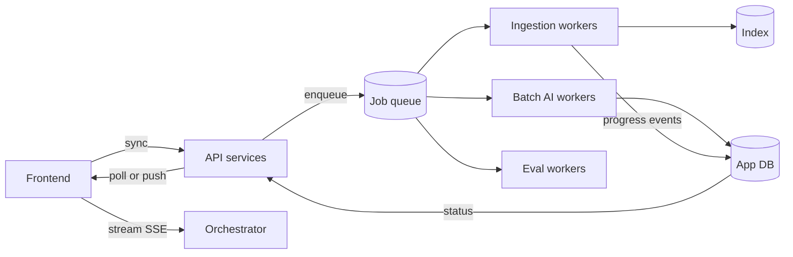
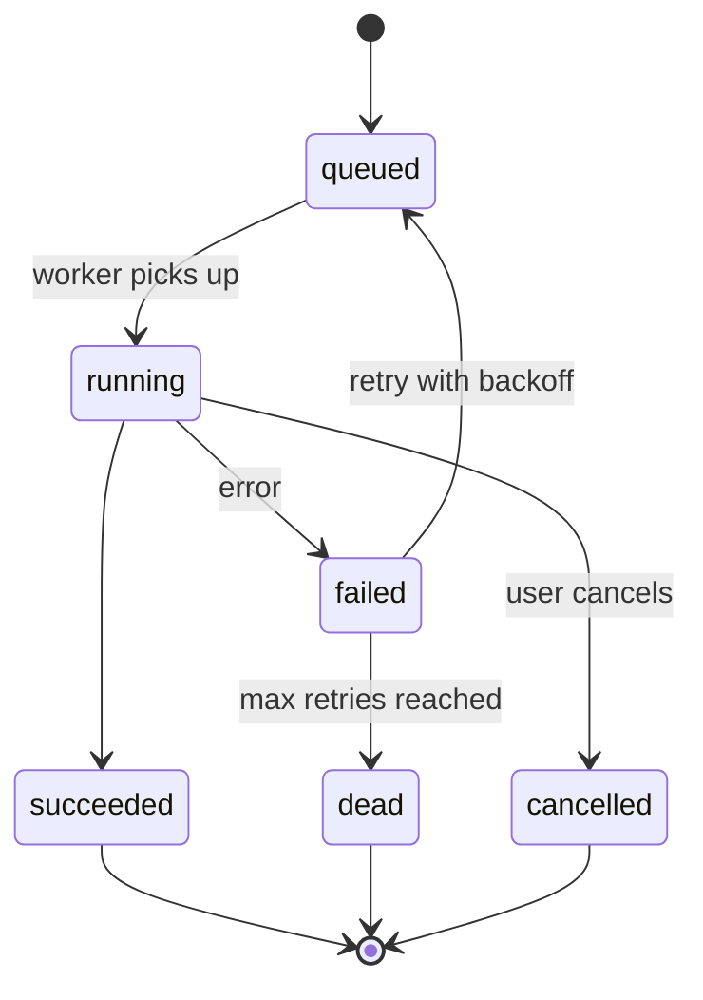

AI work is slow and uneven. A chat answer takes seconds. Indexing a 300-page PDF takes minutes. A nightly re-embedding of the whole corpus takes hours. If all of this runs the same way, the system is either slow for users or fragile in the background. This page explains how to split the work.

## Three execution modes

| Mode | Use it when | Examples | User experience |
| --- | --- | --- | --- |
| **Synchronous** | The work finishes in under about 1 second and the user waits for it | Load a chat, save feedback, list documents | Normal request and response |
| **Streaming** | The work takes seconds but produces output progressively | Chat answers, long summaries | Text appears token by token |
| **Asynchronous job** | The work takes longer than a user will wait, or does not need the user at all | Ingest an upload, sync a connector, run an eval suite, batch summarize | The user gets a job ID and sees progress or a notification |

The rule of thumb: **if a user could close the tab and still want the result, it is a job.**

## The design



## Streaming

Streaming is what makes a 10 second answer feel fast. It is not optional for chat.

**How it works.** The server keeps the HTTP response open and writes small events as they are ready. The standard choice is **server-sent events (SSE)**: one-way, text-based, works through most proxies, and reconnects automatically. WebSockets are only worth it if you need the client to send data mid-stream, such as live voice. See [Streaming](/docs/frontend/streaming) for the frontend side.

**What to stream.** Not just text. Use typed events so the frontend can render each part correctly:

```text
event: token
data: {"text": "The travel budget "}

event: citation
data: {"n": 1, "title": "Travel Policy 2025", "url": "https://wiki/..."}

event: tool_call
data: {"name": "create_ticket", "status": "awaiting_confirmation"}

event: done
data: {"message_id": "msg_812", "usage": {"input": 3120, "output": 410}}
```

**What breaks streaming.** Proxies and load balancers that buffer responses. If tokens arrive in one big lump at the end, check for buffering in nginx (`proxy_buffering off`), in your CDN, and in any compression middleware. Also check idle timeouts: a model that thinks for 40 seconds before the first token will be cut off by a 30 second load balancer timeout. Send a comment line such as `: keep-alive` every 15 seconds.

## Background jobs

### When something becomes a job

Make it a job if any of these is true:

- It can take more than about 10 seconds.
- It processes more than one item, such as a folder of files.
- It must survive a deploy or a crash and still finish.
- It calls a rate-limited external API many times.

### Job lifecycle



Store the job's state in the database, not only in the queue. The queue delivers work. The database is where the frontend and support staff look up what happened.

A minimal jobs table:

| Column | Purpose |
| --- | --- |
| `id` | Job ID returned to the client |
| `tenant_id`, `user_id` | Who owns it, for permissions and fair scheduling |
| `type` | For example `ingest_file`, `sync_connector`, `run_eval` |
| `status` | `queued`, `running`, `succeeded`, `failed`, `dead`, `cancelled` |
| `attempts` | Retry count |
| `progress` | For example `{"done": 120, "total": 300}` |
| `error` | Last error message, safe to show to support |
| `idempotency_key` | Prevents duplicate jobs for the same input |
| `created_at`, `started_at`, `finished_at` | For latency metrics and stuck-job alerts |

### Retries and idempotency

Jobs fail. Model APIs return `429` and `503`. Parsers crash on odd files. Plan for it:

- **Retry with exponential backoff and jitter**, for example 10 s, 30 s, 90 s, 270 s, then give up. Jitter stops a thousand failed jobs from retrying at the same second.
- **Retry only what can succeed later.** A rate limit will clear. A corrupt PDF will not. Mark permanent failures as `dead` right away and show the reason.
- **Make every job idempotent.** Running it twice must give the same result as running it once. For ingestion this means using a deterministic chunk ID, such as a hash of document ID plus chunk position, and upserting instead of inserting. Then a retry overwrites instead of duplicating.

Queues deliver messages **at least once**. Duplicates will happen. Idempotency is how you survive them.

### Fair scheduling

One tenant uploading 50,000 files must not delay everyone else's single upload. Options, from simple to robust:

1. **Separate queues by priority**: interactive uploads in a fast queue, bulk syncs in a slow queue.
2. **Per-tenant concurrency limits**: each tenant can run at most N jobs at once.
3. **Weighted fair queuing**: workers pick the next job from the tenant that has had the least recent share.

Start with option 1 and add option 2 when the first large customer arrives.

### Long workflows

Some jobs are many steps: fetch files, parse, chunk, embed, index, notify. If step 4 fails, you do not want to redo steps 1 to 3. Two approaches:

- **Chain small jobs.** Each step enqueues the next. Simple, and works well up to a few steps.
- **Use a durable workflow engine**, such as Temporal or AWS Step Functions. The engine records each step's result and resumes from the failed step. Worth it when workflows have branches, waits, or human approval steps.

## Telling the user

For jobs the user started, show progress where they started it. Two ways:

| Approach | How | Use it when |
| --- | --- | --- |
| Polling | Frontend calls `GET /jobs/:id` every 2 to 5 seconds | Simple, few concurrent jobs per user |
| Push | Server sends events over SSE or WebSocket when status changes | Many jobs, or you already have a live connection |

Always handle the case where the user leaves and comes back. The job list must be loadable from the database, not only from live events.

## Trade-offs

| Choice | Benefit | Cost |
| --- | --- | --- |
| Do more work synchronously | Simpler code, immediate result | Slow requests, timeouts, poor experience under load |
| Move work to jobs | Resilient, scalable, fair | Needs a queue, a jobs table, progress UI, and idempotent code |
| Managed queue (SQS, Pub/Sub, Cloud Tasks) | No servers to run | Vendor limits, such as message size and visibility timeouts |
| Self-hosted queue (Redis-based, RabbitMQ, Kafka) | Full control, low latency | You operate it, monitor it, and recover it |
| Workflow engine | Resume from failure, visible history | Another system to learn and run |

## Checklist

- [ ] Chat responses stream, and proxies do not buffer them.
- [ ] Keep-alive events are sent during long model pauses.
- [ ] Anything that can take more than about 10 seconds is a job with a database record.
- [ ] Every job is idempotent and has a retry limit.
- [ ] Permanent failures are not retried.
- [ ] One tenant cannot starve others in the job queue.
- [ ] Stuck jobs, running longer than expected, trigger an alert.
