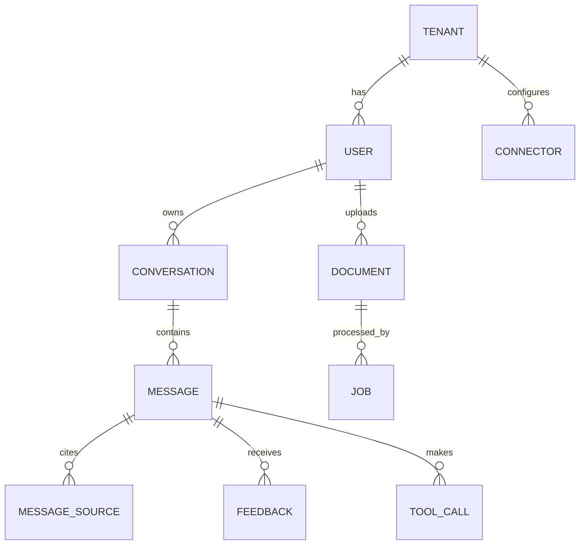

import { IdempotencyDemo } from "@/components/demos/api-design";

The API is the contract between the backend and every client: the web app, a mobile app, and customer integrations. Make each decision on this page once and apply it everywhere. Publish the contract as a specification, such as OpenAPI, and check it against the implementation in CI.

## API style

| Option | Strengths | Weaknesses | Fits when |
| --- | --- | --- | --- |
| **REST with JSON** | Universal. Works with every client, proxy, cache, and tool. Easy for customers to call | Several calls for nested data. Contract discipline is up to you | Public and browser-facing APIs |
| **GraphQL** | Clients fetch exactly the fields they need in one call | Streaming, caching, rate limiting by cost, and authorization per field are all harder | Many clients with very different data needs |
| **gRPC** | Typed contracts, fast binary format, built-in streaming | Browsers need a proxy. Harder for customers to call by hand | Internal service-to-service calls |
| **Typed RPC from shared code** | One language end to end with compile-time types and little boilerplate | Ties clients to your language and codebase. Not a public API | One team owns both frontend and backend in the same language |

**Default:** REST with JSON for everything clients call, with streaming responses for chat. Use gRPC between internal services only if you already run it.

## Resources

| Resource | Operations | Notes |
| --- | --- | --- |
| Conversations | Create, list, rename, archive, delete | The first message can create a conversation, so explicit creation is optional |
| Messages | Send, regenerate, stop, resume a stream, give feedback | Sending and regenerating return a stream |
| Tool calls | Confirm, with optional edited arguments, or reject | Actions with side effects wait here for the user |
| Documents | Get an upload URL, register an upload, list, delete | Files go straight to object storage, not through the API |
| Jobs | Get status and progress | One shape for every kind of background work |
| Admin | Settings, connectors, manual sync, usage, audit events | Admin-only, with stricter permission checks |

## Conventions

| Topic | Convention | Why |
| --- | --- | --- |
| Paths | Plural nouns, nested at most one level | Short, predictable URLs |
| IDs | Prefixed and opaque, such as conv_8f2k or msg_91xa | The prefix makes logs readable and wrong-type mistakes obvious |
| Timestamps | ISO 8601 in UTC | No time zone ambiguity |
| Field names | One casing everywhere | Clients do not need per-endpoint mapping |
| Tenant | Taken only from the verified token | A client cannot ask for another tenant's data |
| Errors | One format for every endpoint and stream | Clients handle errors in one place. See [Errors](/docs/backend/errors) |

## What clients control

| Clients may send | The server decides |
| --- | --- |
| The message text and attachments | Which model answers |
| A named mode, such as "fast" or "thorough" | The system prompt and prompt version |
| Answer language preference | Temperature and other sampling settings |
| Which conversation to continue | Which tools are available |

If clients could set the model or system prompt, any user could change the assistant's behavior and bypass its controls. Offer choices as named modes that the server maps to configurations.

## Streaming transport

| Option | Strengths | Weaknesses | Fits when |
| --- | --- | --- | --- |
| **Server-sent events (SSE)** | Plain HTTP. Works through most proxies. Simple to resume with event IDs | One direction only: server to client | Chat answers, job progress |
| **WebSocket** | Two directions on one connection | Separate auth, heartbeats, and sticky routing. Some proxies need configuration | The client also streams, such as live voice |
| **Long polling** | Works almost everywhere | Higher latency and more requests | Very restrictive networks |
| **Poll for the finished answer** | Simplest client | No progressive output. A 10 second answer feels broken | Non-interactive integrations |

**Default:** SSE. Treat the event types as part of the API: a status line, text tokens, citations, tool call updates, an error, and a final done event with usage. See [Streaming](/docs/frontend/streaming) for the frontend side.

## Idempotency

Networks fail after the server has done the work but before the client receives the response. The client retries, and without protection you get two messages, two tickets, or two ingestion jobs.

The client sends a unique key with every request that creates something. The server remembers the key and the result. A retry with the same key gets the stored result instead of doing the work again.

| Where to store keys | Strengths | Weaknesses |
| --- | --- | --- |
| **Database table with a unique constraint** | Durable. Can be written in the same transaction as the work | One more write per request |
| **Redis with an expiry, such as 24 hours** | Fast. Expires on its own | Lost on Redis failure, so a retry at that moment can duplicate work |
| **Natural key**, such as a client-generated message ID used as the record's ID | No extra storage. The database rejects duplicates | Only works where the client creates the ID |

When a duplicate arrives while the first request is still running, return a conflict, or for message streams, attach the retry to the stream already in progress.

**Default:** client-generated message IDs for messages, and a database table for everything else. Tool confirmations need idempotency most: confirming "create ticket" twice must create one ticket.

<IdempotencyDemo />

## Pagination

| Option | Strengths | Weaknesses |
| --- | --- | --- |
| **Offset and page number** | Simple. Clients can jump to page 7 | Items shift as new ones arrive, so users see duplicates or miss items. Slow on deep pages |
| **Cursor** | Stable while data changes. Fast at any depth | No jumping to an arbitrary page |
| **Time range** | Natural for logs and usage reports | Needs a tie-breaker when many items share a timestamp |

**Default:** cursor pagination with a capped page size, such as 100. Conversations and messages change constantly, which rules out offsets. The cursor is opaque to clients.

## Long-running work

Anything that takes more than a few seconds and is not a chat stream returns immediately with a job the client can follow.

| How the client learns the outcome | Fits when |
| --- | --- |
| **Polls the job** | Default. Simple, and works after the user leaves and returns |
| **Receives push events** on a live connection | The user watches many jobs, or a live connection already exists |
| **Receives a webhook** | Customer integrations that run unattended |

See [Sync and async work](/docs/backend/sync-async).

## Versioning

| Option | Strengths | Weaknesses |
| --- | --- | --- |
| **Major version in the path**, such as v1 | Obvious in every log line and URL | Coarse. A new major version is a large migration |
| **Version in a header** | Clean URLs | Easy to forget. Invisible in logs unless recorded |
| **Dated versions pinned per client** | Small, frequent breaking changes without a big migration | You maintain transformations between many versions |
| **Additive changes only** | Nothing to migrate | Requires discipline. Mistakes leave you stuck with them |

**Default:** a major version in the path, combined with an additive-only rule inside it. New fields, endpoints, and event types are allowed. Clients must ignore what they do not recognize. Breaking changes are removing or renaming a field, changing a type, changing what an error code means, or making an optional parameter required.

When something must go, announce it well ahead, return deprecation and sunset headers, and track who still calls it before removing it. The streaming event protocol follows the same rules: a new event type is additive, while changing the payload of an existing one is breaking.

## Public API for integrations

Customers will call the assistant from their own tools: a Slack bot, a CRM sidebar, a script.

| Option | Identity | Strengths | Weaknesses |
| --- | --- | --- | --- |
| **Tenant API keys** | A service identity owned by the tenant | Simple for customers | Long-lived secrets. Which documents can a key see? |
| **OAuth client credentials** | A registered application | Short-lived tokens, standard tooling | More setup for customers |
| **OAuth on behalf of a user** | A real user | The integration sees exactly what the user can see | Each user must connect. Not suited to unattended bots |

**Default:** tenant API keys with scopes, managed by admins and shown only once. Decide which documents a key can read, for example only documents shared with a named integration group. Apply the same rate limits, guardrails, and logging as the UI, and offer a non-streaming mode for simple integrations.

## Checklist

- [ ] The API specification is published and checked in CI.
- [ ] Tenant comes only from the token.
- [ ] Clients cannot set system prompts, raw model names, or sampling settings.
- [ ] Every request that creates something can be retried safely.
- [ ] Lists use cursor pagination with a capped page size.
- [ ] Long work returns a job.
- [ ] Changes within a version are additive, and clients ignore unknown fields and event types.
