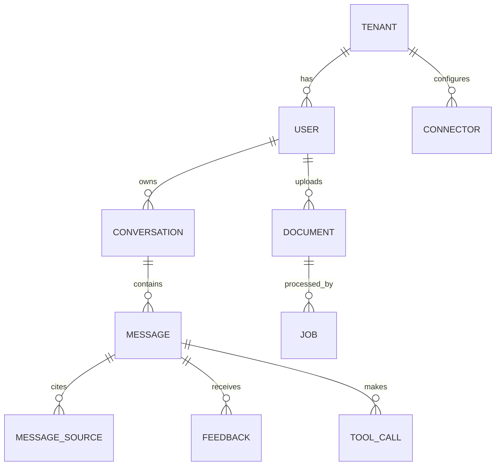

A consistent API makes the frontend simpler, makes integrations possible, and makes the system easier to reason about. This page defines the conventions and the main endpoints. Treat it as the contract: generate an OpenAPI specification from your code or write it first, and test against it.

## Conventions

| Topic | Convention |
| --- | --- |
| Style | REST over HTTPS with JSON bodies. Streaming endpoints return `text/event-stream` |
| Paths | Plural nouns, nested only one level: `/conversations/:id/messages`, not deeper |
| IDs | Prefixed, opaque strings: `conv_8f2k`, `msg_91xa`, `doc_7hq2`. The prefix makes logs readable and mistakes obvious |
| Timestamps | ISO 8601 in UTC: `2026-03-14T09:30:00Z` |
| Field names | `snake_case` in JSON, consistently |
| Tenant | Never in the path or body. Always from the auth token |
| Errors | One error format everywhere. See [Errors](/docs/backend/errors) |
| Spec | OpenAPI 3, published, and checked in CI against the implementation |

## Resources



## Endpoints

### Conversations and messages

| Method and path | Purpose |
| --- | --- |
| `POST /conversations` | Create an empty conversation. Optional, since the first message can create one |
| `GET /conversations?cursor=&limit=` | List the user's conversations, newest first |
| `GET /conversations/:id` | Get one conversation with metadata |
| `PATCH /conversations/:id` | Rename, archive |
| `DELETE /conversations/:id` | Delete a conversation and its messages |
| `GET /conversations/:id/messages?before=&limit=` | Page through messages, newest first |
| `POST /conversations/:id/messages` | Send a message. Returns an SSE stream |
| `POST /messages/:id/regenerate` | Generate a new answer for the same user message. Returns an SSE stream |
| `POST /messages/:id/cancel` | Stop generation |
| `GET /messages/:id/stream` | Resume a dropped stream, with the `Last-Event-ID` header |
| `POST /messages/:id/feedback` | Rating, reasons, and comment |
| `POST /tool-calls/:id/confirm` | Approve a pending tool action, with optional edited arguments |
| `POST /tool-calls/:id/reject` | Reject a pending tool action |

### Documents and jobs

| Method and path | Purpose |
| --- | --- |
| `POST /uploads` | Get a pre-signed URL to upload a file directly to storage |
| `POST /documents` | Register an uploaded file and start ingestion. Returns `202` with a job ID |
| `GET /documents?cursor=&limit=` | List documents the user uploaded |
| `DELETE /documents/:id` | Delete a document, its chunks, and its file |
| `GET /jobs/:id` | Status and progress of any background job |

### Admin

| Method and path | Purpose |
| --- | --- |
| `GET /admin/settings`, `PATCH /admin/settings` | Tenant settings: models, retention, guardrails, enabled tools |
| `GET /admin/connectors`, `POST /admin/connectors` | List and add data source connectors |
| `POST /admin/connectors/:id/sync` | Start a manual sync. Returns a job ID |
| `GET /admin/usage?from=&to=&group_by=` | Token usage and cost by user, team, or model |
| `GET /admin/audit-events?cursor=` | Audit log |

## Sending a message

Request:

```http
POST /conversations/conv_8f2k/messages
Content-Type: application/json
Accept: text/event-stream
Idempotency-Key: 5b0c3c7e-4c8b-4a9e-9a43-1f2d9c1e7a11

{
  "text": "What is the travel budget for a client visit to Singapore?",
  "attachments": ["doc_7hq2"],
  "options": { "answer_language": "auto" }
}
```

Response: an event stream as described in [Streaming](/docs/frontend/streaming). The first event is `meta` with the server message IDs, and the last is `done` or `error`.

Note what the request does **not** contain: no model name chosen freely by the client, no system prompt, no temperature. Those are server decisions, set by tenant settings and prompt templates. Exposing them lets any user change the assistant's behavior and bypass controls. If you offer choices, such as "fast" versus "thorough" modes, expose them as named modes that the server maps to configurations.

## Idempotency

Networks fail after the server has done the work but before the client got the response. The client retries, and without protection you get two messages, two tickets, or two ingestion jobs.

Every `POST` that creates something accepts an `Idempotency-Key` header, a UUID generated by the client.

How the server handles it:

1. Look up the key, scoped to the user, in a table or Redis with a 24 hour expiry.
2. If not found, store it as "in progress", do the work, and store the result.
3. If found and finished, return the stored result without doing the work again.
4. If found and still in progress, return `409 Conflict`, or for message streams, attach to the existing stream.

Tool confirmations need this most. Confirming "create ticket" twice must create one ticket.

## Pagination

Use **cursor pagination**, not page numbers. New messages arrive constantly, and page numbers shift and skip items.

```http
GET /conversations?limit=20
```

```json
{
  "data": [ { "id": "conv_8f2k", "title": "Singapore travel budget", "updated_at": "2026-03-14T09:30:00Z" } ],
  "next_cursor": "eyJ1cGRhdGVkX2F0IjoiMjAyNi0wMy0xNFQwOTozMDowMFoiLCJpZCI6ImNvbnZfOGYyayJ9"
}
```

The cursor encodes the sort key and the ID of the last item. It is opaque to clients. Cap `limit`, for example at 100.

## Long-running work

Anything that takes more than a few seconds and is not a chat stream returns `202 Accepted` with a job:

```json
{ "job_id": "job_3k9s", "status": "queued", "status_url": "/jobs/job_3k9s" }
```

Clients poll `GET /jobs/:id` or subscribe to job events. See [Sync and async work](/docs/backend/sync-async).

## Versioning

- Put the major version in the path: `/v1/...`. Breaking changes get `/v2`. Most teams never need v2 if they follow the additive rule below.
- **Additive changes are not breaking.** New fields, new endpoints, new event types, and new optional parameters are allowed in v1. Clients must ignore unknown fields and unknown event types.
- **Breaking changes**: removing or renaming a field, changing a type, changing what an error code means, making an optional parameter required.
- **Deprecation**: announce at least 6 months ahead for external API consumers, return a `Deprecation` header and a `Sunset` header on old endpoints, and track who still calls them before removing.

The SSE event protocol is part of the API. Version it the same way. A new event type is additive. Changing the payload of `token` is breaking.

## Public API for integrations

Customers will want to call the assistant from their own tools: a Slack bot, a CRM sidebar, a script.

- Issue **API keys per tenant** with scopes, managed by admins, and shown only once at creation.
- API keys act as a service identity, not a user. Decide which documents they can access. A common choice is "only documents shared with a named integration group".
- Apply the same rate limits, guardrails, and logging as the UI.
- Offer a non-streaming mode for simple integrations: the same endpoint with `Accept: application/json` returns the full answer when done.

## Checklist

- [ ] The OpenAPI spec is published and checked in CI.
- [ ] IDs are prefixed and opaque.
- [ ] Tenant comes only from the token.
- [ ] Clients cannot set system prompts, raw model names, or sampling parameters.
- [ ] Every creating `POST` supports `Idempotency-Key`.
- [ ] Lists use cursor pagination with a capped limit.
- [ ] Long work returns `202` with a job ID.
- [ ] Clients ignore unknown fields and event types, and the server only makes additive changes within a version.
