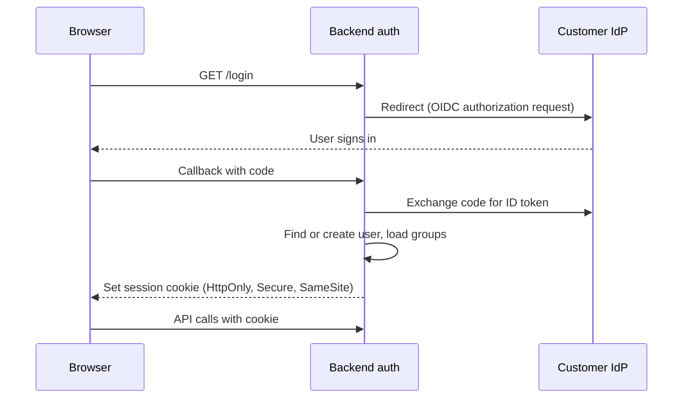

Authentication answers "who is this?" Authorization answers "what may they do and see?" In an AI assistant, authorization has an extra dimension: the assistant reads documents and calls other systems for the user, and it must never see or do more than that user could do directly.

## Sign-in: single sign-on

Enterprise customers expect to sign in with their company identity provider (IdP), such as Microsoft Entra ID, Okta, or Google Workspace. Do not build passwords.

| Protocol | Use it for | Notes |
| --- | --- | --- |
| **OIDC** (OpenID Connect) | Default for new integrations | Modern, JSON-based, works well with SPAs and mobile |
| **SAML 2.0** | Customers whose IdP setup requires it | Still common in large enterprises. Use a library or an identity broker |
| **SCIM** | Provisioning, not sign-in | The IdP creates, updates, and deactivates users and groups in your system automatically |

**SCIM matters more than teams expect.** When an employee leaves, the IdP deactivates them, and SCIM tells your system within minutes. Without SCIM, a departed employee's account and group memberships linger until someone notices. Group memberships from SCIM also feed document permission checks.

An identity broker such as Auth0, WorkOS, Keycloak, or a cloud provider's identity service lets you support many customers' IdPs without writing each integration.

## Sessions and tokens

Recommendations:

- For a browser app, use an **HttpOnly, Secure, SameSite cookie** holding a session ID or a short-lived token. Tokens in local storage can be read by any script, including one injected through a rendering bug.
- Keep access tokens short-lived, around 15 minutes, with refresh in the background.
- On sign-out, revoke the session server-side, not just in the browser.
- Re-check that the user is still active on refresh. Deactivated users must lose access within minutes.
- Bind the session to the tenant. A user who belongs to two tenants chooses one per session.

## Authorization model

There are three layers. Each needs its own check.

| Layer | Question | Example | Where it is checked |
| --- | --- | --- | --- |
| Tenant | Does this request belong to this tenant? | User of Acme cannot read Globex data | Gateway sets tenant ID from token. Database row-level security enforces it |
| Feature (role) | May this user use this feature? | Only admins can add connectors. Only the legal team can use the contract review tool | Backend checks role or permission on each endpoint |
| Data (document) | May this user see this document? | Only HR can see salary bands | Retrieval filters chunks by the user's principals |

### Roles

Start with a small set of roles. Every role you add is a combination to test.

| Role | Can |
| --- | --- |
| Member | Chat, upload documents, use enabled tools, give feedback |
| Admin | Everything a member can, plus manage settings, connectors, users, and view usage |
| Auditor | Read audit logs and usage, without chatting as other users |

Add **permissions** under the roles (`connectors.manage`, `tools.contract_review.use`) and check permissions in code, not role names. Then a customer who needs a custom role can get one without code changes.

### Document permissions

The assistant must respect the same document permissions as the source system. If Bob cannot open the salary spreadsheet in the drive, the assistant must not quote it to him.

- At ingestion, copy each document's ACL into the index as a list of principals.
- At query time, resolve the user's principals: their user ID plus all their groups, including nested groups.
- Filter in the search query, before ranking, not after.

Filtering after retrieval looks equivalent but is not. If you retrieve the top 10 and then remove 8 the user cannot see, you answer from 2 weak chunks while better allowed chunks were never considered.

Group resolution is the hard part. Group memberships change, groups nest, and some systems use sharing links ("anyone in the company with the link"). Cache resolved principals per user for a few minutes, and invalidate on SCIM updates.

## Acting on behalf of the user

When the assistant creates a ticket or reads a calendar, whose credentials does it use?

| Approach | How | Risk |
| --- | --- | --- |
| **Service account** | One powerful account for the whole assistant | The assistant can do anything the service account can, for any user. A prompt injection becomes a privilege escalation |
| **Delegated user token** (recommended) | The user connects their account with OAuth. The assistant calls the system with the user's own token | The assistant can only do what the user can do |
| **Service account with user impersonation checks** | Service account, but every action checks the user's permissions first | Works if the target system supports impersonation. Easy to forget a check |

Use **delegated tokens** wherever the target system supports OAuth. Request the narrowest scopes needed, such as read-only calendar access for a scheduling feature. Store refresh tokens encrypted, per user, and let users revoke connections from a settings page.

When delegated tokens are not possible, isolate the service account in the [tool service](/docs/ai-model/agents-tools), and check the user's permissions in your own code before each action.

## Service-to-service authentication

Internal services must authenticate to each other too. A compromised worker should not be able to call the tool service freely.

- Use workload identity from your platform (Kubernetes service accounts, cloud IAM roles) or mutual TLS.
- Pass the end user's identity along with the service identity, usually in a signed internal token, so downstream services can enforce user-level checks.
- Never pass the user's identity as a plain header that any internal caller could set.

## Admin and support access

Support staff sometimes need to see what a user saw to debug an answer.

- Make it an explicit, time-limited, logged action: "Support access granted to Alice for 2 hours, reason: ticket 4512."
- Prefer showing traces with content redacted, and reveal content only when needed.
- Let tenants disable vendor support access entirely if their policies require it.

## Checklist

- [ ] Sign-in uses SSO through OIDC or SAML. No passwords.
- [ ] SCIM provisioning deactivates users and updates groups automatically.
- [ ] Session tokens are in HttpOnly cookies, short-lived, and revocable.
- [ ] Endpoints check permissions, not role names.
- [ ] Document ACLs are enforced inside the search query.
- [ ] Tools use delegated user tokens with narrow scopes where possible.
- [ ] Internal calls carry a verified service identity and a signed user identity.
- [ ] Support access to user content is time-limited and logged.
