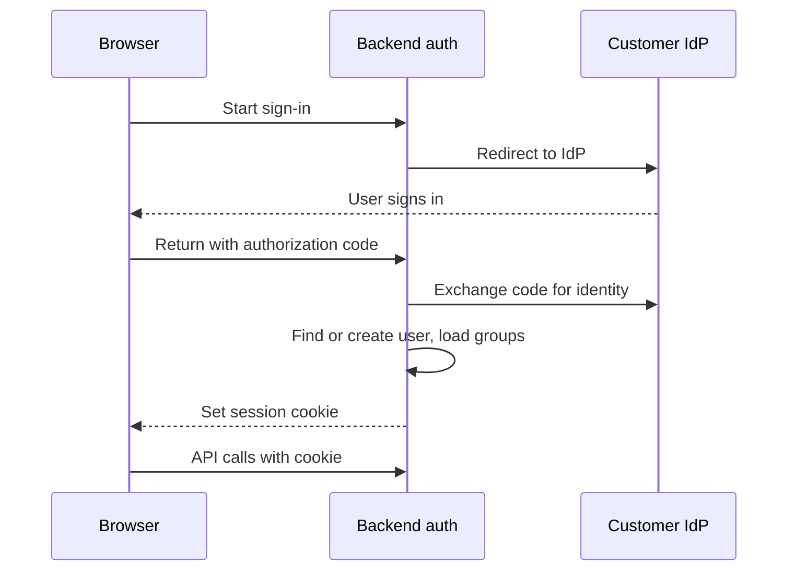

Authentication answers "who is this?" Authorization answers "what may they do and see?" In an AI assistant, authorization has an extra dimension: the assistant reads documents and calls other systems for the user, and it must never see or do more than that user could do directly.

## Sign-in

Enterprise customers expect to sign in with their company identity provider (IdP), such as Microsoft Entra ID, Okta, or Google Workspace. Do not build passwords.

| Protocol | Use it for | Notes |
| --- | --- | --- |
| **OIDC** (OpenID Connect) | Default for new integrations | Modern, JSON-based, works well with browser and mobile apps |
| **SAML 2.0** | Customers whose IdP setup requires it | Still common in large enterprises |
| **SCIM** | Provisioning, not sign-in | The IdP creates, updates, and deactivates users and groups in your system automatically |

**SCIM matters more than teams expect.** When an employee leaves, the IdP deactivates them and SCIM tells your system within minutes. Without it, a departed employee's account and group memberships linger. SCIM group memberships also feed document permission checks.

### Who implements it

| Option | Strengths | Weaknesses |
| --- | --- | --- |
| **Identity broker** (Auth0, WorkOS, Keycloak) | One integration supports many customers' IdPs, SAML included. Admin setup screens often included | Another vendor or system. Cost grows with users or connections |
| **Cloud provider identity service** | Fits if you already run on that cloud | Often weaker for many-customer SAML setups |
| **Open-source libraries in your app** | Full control, no vendor | You own every IdP quirk, certificate rotation, and security fix |

**Default:** an identity broker. Enterprise sign-in has many edge cases, and none of them are your product.

## Sessions

| Option | How it works | Strengths | Weaknesses |
| --- | --- | --- | --- |
| **Server-side session** | The cookie holds a random ID. Session data lives in a store | Instant revocation. Small cookie | A store lookup on every request |
| **Self-contained signed token** | The token holds the user and claims, verified by signature | No lookup. Any service can verify it | Cannot be revoked before it expires. Stale groups until refresh |
| **Hybrid** | Short-lived signed token, around 15 minutes, plus a server-side refresh session | Fast checks, revocation within minutes | Two mechanisms to build and test |

**Default:** the hybrid, or server-side sessions if every request already touches your database. Whichever you choose:

- Keep the session in an **HttpOnly, Secure, SameSite cookie**. Tokens in browser storage can be read by any script, including one injected through a rendering bug.
- Revoke sessions on the server at sign-out, not only in the browser.
- Re-check that the user is still active on refresh, so deactivated users lose access within minutes.
- Bind each session to one tenant. A user who belongs to two tenants chooses one per session.

## Authorization model

There are three layers. Each needs its own check.

| Layer | Question | Example | Where it is checked |
| --- | --- | --- | --- |
| Tenant | Does this request belong to this tenant? | A user of Acme cannot read Globex data | The tenant comes from the token. Database row-level security enforces it |
| Feature | May this user use this feature? | Only admins can add connectors | The backend checks a permission on each endpoint |
| Data | May this user see this document? | Only HR can see salary bands | Retrieval filters chunks by the user's principals |

### Feature permissions

| Option | How it works | Strengths | Weaknesses |
| --- | --- | --- | --- |
| **Role checks in code** | Code asks "is this user an admin?" | Simplest | Every new role is a code change |
| **Roles mapped to permissions** | Roles grant named permissions, such as "manage connectors". Code checks permissions | Custom roles without code changes | A permission catalog to maintain |
| **Attribute-based (ABAC)** | Rules over user and resource attributes, such as department or region | Expresses complex policies | Rules are hard to test and explain |
| **Relationship-based (ReBAC)** | Access follows relationships: owner, member of a group that was shared the item | Natural for sharing. Systems such as OpenFGA and SpiceDB implement it | Another system, and its data must stay in sync with yours |

**Default:** roles mapped to permissions. Start with a small set of roles, because every role is a combination to test:

| Role | Can |
| --- | --- |
| Member | Chat, upload documents, use enabled tools, give feedback |
| Admin | Everything a member can, plus manage settings, connectors, users, and view usage |
| Auditor | Read audit logs and usage, without chatting as other users |

Move to relationship-based access when sharing rules, such as sharing conversations or collections with teams, become central to the product.

### Document permissions

The assistant must respect the source system's permissions. If Bob cannot open the salary spreadsheet in the drive, the assistant must not quote it to him. At ingestion, copy each document's access list into the index. At query time, resolve the user's principals: their user ID plus all their groups, including nested ones.

| Option | How it works | Strengths | Weaknesses |
| --- | --- | --- | --- |
| **Filter inside the search query** | The search only considers chunks the user's principals can see | Correct ranking. One index | The index must hold up-to-date access lists |
| **Filter after search** | Retrieve the top results, then drop forbidden ones | Easy to add to any search engine | Answers from weak leftovers. Retrieve 10, drop 8, and answer from 2 while better allowed chunks were never considered |
| **Separate index per tenant or group** | Each index holds only what its audience may see | Strong isolation. Easy deletion per tenant | Many indexes to run. Does not handle per-document sharing inside a tenant |
| **Check the source system at query time** | Ask the source "can this user open these documents?" before answering | Always current | Slow, rate-limited, and down whenever the source is |

**Default:** separate indexes or namespaces per tenant, and filtering inside the search query for permissions within a tenant. Cache resolved principals per user for a few minutes and invalidate on SCIM updates. Group resolution is the hard part: memberships change, groups nest, and some systems use sharing links such as "anyone in the company with the link". See [Sources and connectors](/docs/data/sources-connectors).

## Acting on behalf of the user

When the assistant creates a ticket or reads a calendar, whose credentials does it use?

| Option | How it works | Risk |
| --- | --- | --- |
| **Service account** | One powerful account for the whole assistant | The assistant can do anything that account can, for any user. A prompt injection becomes a privilege escalation |
| **Delegated user token** | The user connects their account through OAuth. The assistant calls the system with the user's own token | The assistant can only do what the user can do |
| **Service account with impersonation checks** | A service account, but every action checks the user's permissions first | Works if the target supports impersonation. Easy to forget a check |

**Default:** delegated tokens wherever the target system supports OAuth, with the narrowest scopes needed, such as read-only calendar access for a scheduling feature. Store refresh tokens encrypted and per user, and let users revoke connections. When delegated tokens are not possible, isolate the service account in the [tool service](/docs/ai-model/agents-tools) and check the user's permissions before each action.

## Service-to-service authentication

Internal services must authenticate to each other. A compromised worker should not be able to call the tool service freely.

| Option | Proves | Strengths | Weaknesses |
| --- | --- | --- | --- |
| **Mutual TLS**, often through a service mesh | Which service is calling | Encrypts traffic too. Transparent to application code with a mesh | Certificate management. Mesh adds operational weight |
| **Workload identity tokens** from the platform | Which service is calling | No secrets to manage. Native to Kubernetes and cloud IAM | Tied to one platform |
| **Signed internal user token** passed along | Which user the call is for | Downstream services can enforce user-level checks | Must be short-lived and verified by every receiver |

These combine: a service identity says who is calling, and a signed user token says on whose behalf. Never pass the user's identity as a plain header that any internal caller could set.

## Support access

Support staff sometimes need to see what a user saw to debug an answer.

- Make access an explicit, time-limited, logged action: "Support access granted to Alice for 2 hours, reason: ticket 4512."
- Show traces with content redacted first, and reveal content only when needed.
- Let tenants disable vendor support access entirely if their policies require it.

## Checklist

- [ ] Sign-in uses SSO through OIDC or SAML. No passwords.
- [ ] SCIM deactivates users and updates groups automatically.
- [ ] Sessions live in HttpOnly cookies and can be revoked within minutes.
- [ ] Endpoints check permissions, not role names.
- [ ] Document permissions are enforced inside the search, not after it.
- [ ] Tools use delegated user tokens with narrow scopes where possible.
- [ ] Internal calls carry a verified service identity and a signed user identity.
- [ ] Support access to user content is time-limited and logged.
