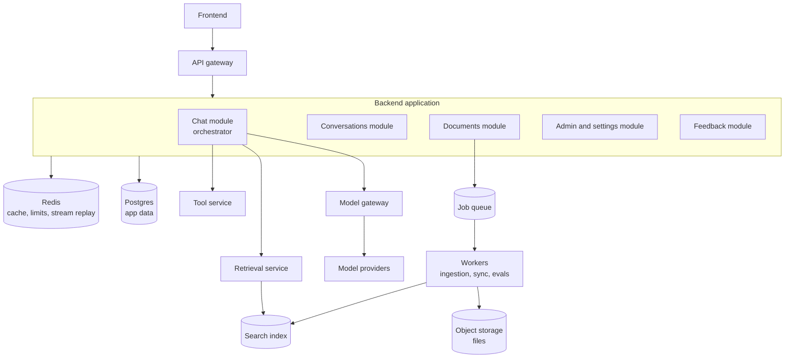

The backend turns a user's message into a safe, permission-checked, logged, and streamed answer. It also runs everything that happens in the background: ingestion, syncs, evals, and cleanup. This page is the map. The other pages in this section each take one design question, lay out the options, and explain what each option costs.

## The design

## What the backend is responsible for

| Responsibility | What it means in practice | Page |
| --- | --- | --- |
| Run a chat turn | Coordinate history, guardrails, retrieval, the model call, tools, and saving, and stream the result | [Chat orchestration](/docs/backend/orchestration) |
| Offer a stable contract | One API style, one error format, predictable streaming, safe retries | [API design](/docs/backend/api-design) |
| Know who is asking | Sign-in, sessions, roles, document permissions, acting in other systems for the user | [Authentication and authorization](/docs/backend/auth) |
| Keep slow work out of requests | Decide what runs in the request, what streams, and what becomes a background job | [Sync and async work](/docs/backend/sync-async) |
| Store state | Pick the right store for each kind of data, and know what must be backed up | [Data stores](/docs/backend/data-stores) |
| Protect capacity and budget | Request limits, token quotas, provider limits | [Rate limits and quotas](/docs/backend/rate-limits) |
| Survive failing dependencies | Timeouts, retries, fallbacks, circuit breakers, cancellation | [Reliability](/docs/backend/reliability) |
| Fail clearly | One error shape and a stable set of error codes | [Errors](/docs/backend/errors) |

## How to group the parts

The same responsibilities can be deployed in very different shapes.

| Option | How it looks | Strengths | Weaknesses |
| --- | --- | --- | --- |
| **Single application** | Everything, including background jobs, in one deployable | Fastest to build and debug. One deploy | Slow jobs compete with chat. One crash affects everything. Every part holds every credential |
| **Modular monolith with a few separate services** | One application split into strict modules, plus separate workers, retrieval, tool service, and model gateway | Simple core, while the parts that scale differently or hold powerful credentials are isolated | Module boundaries need discipline, or the monolith turns into a tangle |
| **Microservices** | Each module is its own service with its own data | Teams ship independently. Each part scales on its own | Network hops, distributed tracing, more deploys, more failure modes. Heavy for a small team |

**Default:** the modular monolith. Split out a part only when it scales differently, holds credentials others must not have, or must fail without taking the rest down. The full set of factors is in [Key decisions](/docs/architecture/decisions).

## Services and modules

| Part | Runs as | Owns | Why it is separate or not |
| --- | --- | --- | --- |
| API gateway | Managed gateway or a thin proxy | TLS, token validation, request rate limits, routing | Rejects bad traffic before it costs anything |
| Chat module (orchestrator) | Module in the backend app | Running a chat turn from message to saved answer | Core logic that changes often. Easiest to debug in-process |
| Conversations module | Module | Listing, renaming, deleting, and sharing conversations | Simple reads and writes |
| Documents module | Module | Uploads, document lists, ingestion job status | Creates jobs. Does no heavy work itself |
| Admin module | Module | Tenant settings, connectors, usage reports, user roles | Admin-only, with stricter checks |
| Feedback module | Module | Ratings, reasons, flags for review | Feeds evaluation |
| Model gateway | Separate service or shared library | Provider adapters, retries, fallback, token counting, cost tracking | Used by online and batch paths. A service once several apps share it |
| Retrieval service | Separate service | Hybrid search, permission filters, re-ranking | Different scaling and latency profile. Often next to the index |
| Tool service | Separate service | Executing actions in other systems | Holds credentials for other systems. Its own security boundary |
| Workers | Separate deployments | Ingestion, connector syncs, eval runs, cleanup | Long-running and resource-heavy. Must not slow the API |

## Principles that apply everywhere

- **Every request carries a context.** User, tenant, permission groups, trace ID, deadline, and a cancellation signal travel with every call. Tenant isolation, tracing, and cancellation then work everywhere without each feature remembering them.
- **The server decides behavior.** Model, system prompt, and sampling settings come from tenant settings and versioned templates, never from the client.
- **Tenant comes from the verified identity.** Never from a path, a body, or a header a caller can set.
- **Slow work leaves the request.** If a user could close the tab and still want the result, it is a background job.
- **Every external call has a timeout, and every write can be retried safely.**
- **The chat flow reads top to bottom in one place.** Anyone on the team can follow a turn from start to finish. See [Chat orchestration](/docs/backend/orchestration).
