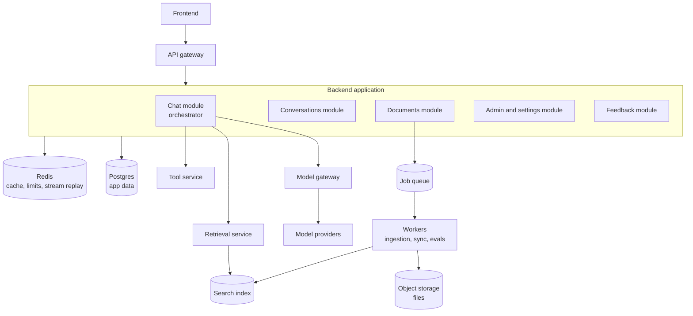

The backend turns a user's message into a safe, permission-checked, logged, and streamed answer. It also runs everything that happens in the background: ingestion, syncs, evals, and cleanup. This page maps the services and their responsibilities. The other pages in this section cover the API contract and the cross-cutting concerns every service must get right.

## The design



As recommended in [Key decisions](/docs/architecture/decisions), most logic lives in **one backend application** split into modules. A few parts run separately because they scale differently or hold powerful credentials.

## Services and modules

| Part | Runs as | Owns | Why it is separate or not |
| --- | --- | --- | --- |
| API gateway | Managed gateway or a thin proxy | TLS, auth token validation, rate limits, routing | Rejects bad traffic before it costs anything |
| Chat module (orchestrator) | Module in the backend app | Running a chat turn: history, guardrails, retrieval, prompt, model call, tools, saving | Core logic, changes often, benefits from being easy to debug |
| Conversations module | Module | Listing, renaming, deleting, sharing conversations | Simple CRUD |
| Documents module | Module | Uploads, document lists, ingestion job status | Creates jobs, does not do heavy work itself |
| Admin module | Module | Tenant settings, connectors, usage reports, user roles | Admin-only endpoints with stricter checks |
| Feedback module | Module | Ratings, reasons, flags for review | Feeds evaluation |
| Model gateway | Separate service or library | Provider adapters, retries, fallback, token counting, cost tracking | Shared by online and batch paths. A service if several apps use it |
| Retrieval service | Separate service | Hybrid search, permission filters, re-ranking | Different scaling and latency profile. Often colocated with the index |
| Tool service | Separate service | Executing actions in other systems | Holds credentials for other systems. Separate security boundary |
| Workers | Separate deployments | Ingestion, connector syncs, eval runs, cleanup | Long-running, CPU and memory heavy, must not slow the API |

## Data stores

| Store | Holds | Notes |
| --- | --- | --- |
| Postgres | Tenants, users, conversations, messages, sources used, feedback, jobs, settings, audit events | Use row-level security by tenant. See [Multi-tenancy](/docs/architecture/multi-tenancy) |
| Redis | Rate limit counters, short-lived caches, stream replay buffers, locks | Everything here can be lost without data loss |
| Object storage | Uploaded files, parsed text, exports | Prefix by tenant. Encrypt at rest. Lifecycle rules for deletion |
| Search index | Chunks, embeddings, metadata, ACLs | Rebuildable from source documents and object storage |

A useful test for every store: **if it were wiped, could you rebuild it?** Postgres cannot be rebuilt, so it needs backups and point-in-time recovery. The search index can be rebuilt from sources, but it takes hours to days, so it still needs a recovery plan. Redis can be lost. See [Disaster recovery](/docs/deployment/disaster-recovery).

## The chat turn in code

The orchestrator's core is a single function that reads like the request lifecycle. Keep it this readable. If it grows past a few hundred lines, extract steps into functions, but keep the top-level sequence in one place.

```ts
export async function runChatTurn(ctx: RequestContext, input: ChatInput, stream: EventStream) {
  const conversation = await conversations.load(ctx, input.conversationId);
  const history = trimHistory(conversation.messages, CONTEXT_BUDGET.history);

  const inputCheck = await guardrails.checkInput(ctx, input.text);
  if (!inputCheck.allowed) return stream.error('input_blocked', inputCheck.reason);

  const query = history.length ? await rewriteQuery(ctx, history, input.text) : input.text;
  stream.status('Searching documents');
  const chunks = await retrieval.search(ctx, query, { topK: 8 });
  stream.sources(chunks);

  const prompt = prompts.render('answer_v14', { chunks, history, question: input.text, ctx });
  const result = await modelGateway.stream(ctx, { model: 'primary', prompt }, (token) => stream.token(token));

  const outputCheck = await guardrails.checkOutput(ctx, result.text, chunks);
  if (!outputCheck.allowed) return stream.error('output_blocked', outputCheck.reason);

  const saved = await conversations.saveTurn(ctx, {
    input, output: result, chunkIds: chunks.map((c) => c.id), promptVersion: 'answer_v14',
  });
  stream.done({ messageId: saved.id, usage: result.usage });
}
```

`RequestContext` carries the user ID, tenant ID, permission groups, trace ID, and a cancellation signal. Every function takes it. That single habit makes tenant isolation, tracing, and cancellation work everywhere without extra effort.

## Pages in this section

| Page | Covers |
| --- | --- |
| [Authentication and authorization](/docs/backend/auth) | SSO, sessions, roles, service identities, acting on behalf of users in other systems |
| [API design](/docs/backend/api-design) | Resources, endpoints, idempotency, pagination, versioning |
| [Sync and async work](/docs/backend/sync-async) | What runs in the request, what streams, what goes to background jobs, queues and retries |
| [Rate limits and quotas](/docs/backend/rate-limits) | Request and token limits, algorithms, headers, cost estimation |
| [Reliability](/docs/backend/reliability) | Timeouts, retries, fallbacks, circuit breakers, cancellation |
| [Errors](/docs/backend/errors) | Error format and the full error code reference |
