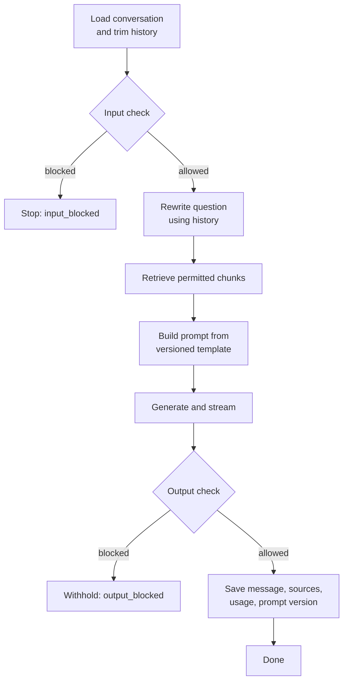
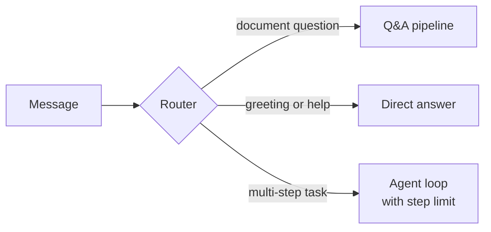
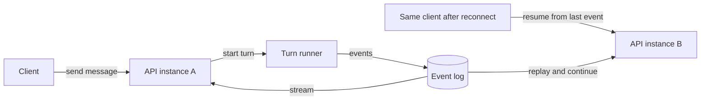

The orchestrator runs a chat turn: it loads history, checks the input, retrieves documents, builds the prompt, calls the model, checks the output, and saves the result, while streaming progress to the user. It is the backend code that changes most often and the first place to look when an answer is wrong or slow. How it is structured matters more than which framework it uses.

For what happens inside each step, and how long each one takes, see [Request lifecycle](/docs/architecture/request-lifecycle).

## The steps

| Step | Purpose | When it fails |
| --- | --- | --- |
| Load conversation | Get recent history that fits the context budget | Return an error. Nothing useful can happen without it |
| Input check | Block unsafe or out-of-policy input before it costs anything | Fail open or closed by policy. See [Reliability](/docs/backend/reliability#fail-open-or-fail-closed) |
| Rewrite question | Turn a follow-up such as "and for Japan?" into a standalone search query | Use the user's message as is |
| Retrieve | Find chunks the user is allowed to see | Never skip the permission filter. Without retrieval, answer with a clear notice or return an error |
| Build prompt | Combine template, history, chunks, and question | A bug, not a runtime failure. Catch it in tests |
| Generate and stream | Call the model through the model gateway and forward tokens | The gateway retries and falls back. See [Reliability](/docs/backend/reliability) |
| Output check | Catch unsafe content and unsupported claims | Withhold the answer and say so |
| Save | Record what was answered and what it was built from | Retry. The user already saw the answer, so losing it breaks history and lineage |

## How to structure the turn

| Option | How it works | Strengths | Weaknesses | Fits when |
| --- | --- | --- | --- | --- |
| **Fixed pipeline** | The same steps in the same order for every message | Predictable latency and cost. Easy to read, test, and debug | Every question gets the same treatment, even a greeting | Most questions are "answer from documents" |
| **Router plus pipelines** | A fast classifier or rules pick one of a few pipelines: document Q&A, small talk, a specific tool flow | Each kind of request gets the right handling. Still predictable | A wrong route gives a wrong answer. The router needs its own evaluation | There are a few clearly different kinds of request |
| **Agent loop** | The model decides at each step: search, call a tool, or answer. Repeats until done | Handles multi-step tasks no one planned for | Variable latency and cost. Harder to test. Can loop. Needs step limits | Tasks truly need several dependent tool calls |
| **Workflow graph** | Steps and branches defined as a graph or state machine, often in a workflow engine | Visible structure, can pause for human approval and resume | Another abstraction to learn. Overkill for simple flows | Long, branching flows with waits or approvals |

**Default:** start with a fixed pipeline. Add a router when distinct kinds of request need different handling. Use an agent loop only for tasks that require it, inside a step limit and a token budget. See [Agents and tools](/docs/ai-model/agents-tools).

Whatever the structure, **keep the top-level sequence in one place**. One readable function or graph per flow, with each step behind a clear interface. Avoid spreading a turn across middleware chains, event handlers, and callbacks: it looks flexible but makes "what happened in this turn?" hard to answer.

## Parallel steps

Some steps do not depend on each other. Running them in parallel saves time but can waste work.

| Option | Latency | Cost | Risk |
| --- | --- | --- | --- |
| **Sequential** | Highest. Each step waits for the previous | Lowest. Nothing runs that is later thrown away | None |
| **Input check in parallel with rewrite and retrieval** | Lower. Saves the input check's duration | Rewrite and retrieval are wasted when input is blocked | Nothing may be streamed to the user until the input check passes |
| **Parallel retrieval from several sources** | Lower when there are several indexes or connectors | More load on search | One slow source delays everything unless each has its own timeout |

**Default:** run the input check in parallel with query rewrite and retrieval, and gate the first streamed event on the input check. Blocked inputs are rare, so the wasted work is small.

## When to run the output check

The answer streams token by token, but the output check needs text to judge.

| Option | User experience | Safety |
| --- | --- | --- |
| **Check the full answer after streaming** | Fastest. Full streaming | The user may briefly see text that is then withdrawn |
| **Check in chunks as it streams**, such as each sentence or paragraph | Small delay per chunk | Bad content is caught within one chunk |
| **Buffer the whole answer, check, then show** | No streaming. Feels slow | Nothing unchecked is ever shown |

**Default:** check in chunks for general use. Buffer fully only for tenants or features where showing unchecked text even briefly is unacceptable. See [Guardrails](/docs/responsible-ai/guardrails).

## Where turn state lives

A turn holds state for seconds to minutes: history, retrieved chunks, partial answer, pending tool calls.

| Option | How it works | Strengths | Weaknesses |
| --- | --- | --- | --- |
| **Stateless servers, state in the database** | Each request loads what it needs and saves at the end. Any instance can serve any request | Simple scaling and deploys | A crash mid-turn loses the partial answer |
| **Sticky sessions, state in server memory** | The load balancer sends a conversation to the same instance | Fast access to state | Deploys and crashes drop users. Uneven load |
| **Durable workflow engine** | The engine records each step's result and resumes after a crash | Survives crashes and deploys. Good for long agent runs | Another system. Each step must be safe to replay |

**Default:** stateless servers with state in the database. Move long agent runs, which can take minutes, to a durable workflow engine.

## Streams and disconnects

Networks drop, laptops sleep, and deploys restart servers. Decide what happens to an answer in progress.

| Option | How it works | Strengths | Weaknesses |
| --- | --- | --- | --- |
| **Generation tied to the connection** | When the connection drops, the turn is cancelled | Simplest. No orphaned work | A short network drop loses the answer. The user must resend |
| **Tied to the connection, with a replay buffer** | Events are kept briefly, for example a few minutes in Redis. A reconnecting client resumes from its last event | Survives short drops | Lost on server crash or deploy |
| **Generation decoupled from the connection** | The turn runs as its own task and writes events to a shared log. Any server can stream them to any client | Survives deploys and reconnects from another device. Fits long agent runs | More infrastructure. Explicit cleanup and cancellation needed |

**Default:** tie generation to the connection and add a replay buffer. Decouple when turns regularly run longer than a minute or must survive deploys. In every option, an explicit stop from the user cancels the turn, because a dropped connection behind several proxies does not always reach the server. See [Streaming](/docs/frontend/streaming).

## Request context

The orchestrator creates a request context at the start of a turn and passes it to every call.

| Carries | Makes this work |
| --- | --- |
| User ID and tenant ID | Tenant isolation in every query and every downstream call |
| The user's principals: user plus groups | Permission filtering in retrieval and tools |
| Trace ID | Following one turn across services in logs and traces |
| Deadline | Downstream calls know how much time is left |
| Cancellation signal | Stop and disconnect reach the model provider |
| Prompt version and feature flags | Recording exactly how the answer was made |

## Checklist

- [ ] The structure (pipeline, router, agent, graph) matches the requests you actually get.
- [ ] Each flow's top-level sequence reads in one place.
- [ ] Every step has a defined behavior on failure.
- [ ] Nothing streams to the user before the input check passes.
- [ ] The output check timing is a deliberate choice per tenant or feature.
- [ ] Servers are stateless, or the state is in a durable engine.
- [ ] There is a defined behavior for dropped connections, and stop always cancels.
- [ ] A request context reaches every call.
