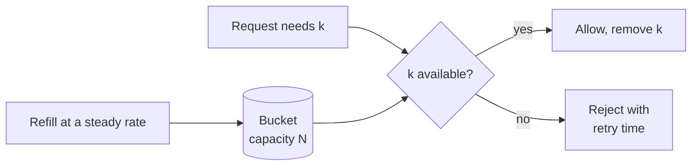

import { TokenBucketDemo } from "@/components/demos/rate-limits";

In a normal web app, a request costs a fraction of a cent. In an AI app, one request can cost from a few cents to around a dollar, depending on the model and how much context it reads. Model providers also cap throughput per account. Without limits, one script, one runaway agent loop, or one enthusiastic team can exhaust the budget or the provider capacity for everyone.

## What to limit

| Limit | Unit | Protects against | Typical starting value |
| --- | --- | --- | --- |
| Request rate per user | Requests per minute | Scripts, double-submits, loops | 20 to 30 per minute |
| Concurrent streams per user | Open streams | One user opening many tabs or parallel calls | 3 |
| Token rate per tenant | Tokens per minute | One tenant consuming the shared provider capacity | A share of provider capacity, set by contract |
| Daily token quota per user | Tokens per day | Individual overuse and cost blowout | Generous, for example 2 million tokens |
| Monthly budget per tenant | Currency | Cost overruns against contract | Set by contract, with alerts at 50%, 80%, 100% |
| Agent steps per turn | Tool calls or model calls | Infinite agent loops | 10 to 20 |
| Upload size and count | Bytes and files per day | Ingestion overload | 50 MB per file, a few hundred files per day |

The starting values are illustrative. Tune them from your own usage data. Limits at several levels catch different problems: request limits stop bursts, token quotas stop slow and expensive overuse, and step limits stop loops that pass the other two.

## Choosing an algorithm

| Algorithm | How it works | Strengths | Weaknesses |
| --- | --- | --- | --- |
| **Fixed window** | Count requests per calendar minute. Reset at the boundary | Simplest | Allows double bursts across a boundary. Feels arbitrary to users |
| **Sliding window log** | Keep a timestamp per request. Count those in the last minute | Exact | Memory grows with traffic |
| **Sliding window counter** | Blend the current and previous window counts | Close to exact with little memory | Approximate |
| **Token bucket** | A bucket holds up to N tokens and refills steadily. Each request spends tokens | Allows short bursts while enforcing an average. Handles weighted costs, such as model tokens | Two parameters to tune |
| **Leaky bucket** | Requests queue and drain at a fixed rate | Smooth output, good for protecting a fragile downstream | Adds waiting instead of rejecting |
| **Concurrency limit** | Count requests in progress, not requests over time | Right for long streams, which hold resources while open | Says nothing about cost over time |

**Default:** a token bucket for rates and quotas, and a concurrency limit for open streams.

A user asking three quick follow-ups is allowed. A script sending a request every second is not.

<TokenBucketDemo />

## Where the counters live

| Option | Strengths | Weaknesses |
| --- | --- | --- |
| **Memory inside each server** | No network call. No dependency | With 10 servers, a user effectively gets 10 times the limit. Resets on deploy |
| **Shared store** (Redis) with atomic updates | One accurate counter across all servers | A network call per check. Another dependency |
| **API gateway product** | No code to write. Rejects traffic early | Usually request counts only, not model tokens or budgets |

**Default:** request rate limits at the gateway, and token quotas and budgets in a shared store.

When the shared store is down, decide per limit. Request rate limits can fail open for a few minutes, since the gateway and provider limits still protect you. Budget limits should fail closed for tenants with hard spending caps.

## Cost you cannot know in advance

You do not know how many tokens a request will use until it finishes, but you must decide whether to allow it before it starts.

| Option | How it works | Strengths | Weaknesses |
| --- | --- | --- | --- |
| **Check only** | Allow if some quota remains | Simple | Many concurrent requests can overshoot the quota together |
| **Reserve and reconcile** | Estimate before the call, reserve the estimate, refund the difference after | Never overshoots by more than one request's estimate | More bookkeeping. A crash can leave a reservation that must expire |
| **Bill after** | Allow everything and record actual usage. Enforce on the next request | No estimate needed | One huge request can blow through the quota |

**Default:** reserve and reconcile. The estimate is the prompt's input tokens, counted after the prompt is built, plus the maximum output tokens allowed for the call. Every model call must have a maximum output length, or one request can consume a whole daily budget.

## Where limits are enforced

| Layer | Enforces |
| --- | --- |
| API gateway | Request rate per user and per IP, concurrent connections |
| Orchestrator | Daily token quota per user, agent step limits |
| Model gateway | Token rate per tenant and per provider account, monthly budgets, the provider's own limits |
| Job queue | Concurrent jobs per tenant, upload limits |

The model gateway is the last line. Even if a bug skips a check upstream, the gateway refuses calls that would exceed a tenant's budget.

## When a limit is hit

| Option | User experience | Fits when |
| --- | --- | --- |
| **Reject with a retry time** | Clear, immediate | Request rate limits, hard budgets |
| **Queue briefly** | A short wait instead of an error | Provider capacity is momentarily full |
| **Degrade**, such as a smaller model or shorter answer | The user still gets an answer, possibly a weaker one | Soft daily quotas where some answer is better than none |
| **Allow and alert** (soft limit) | No interruption | Early customers, or limits you are still calibrating |

Whatever you choose, tell the client what happened and when to try again: a 429 status, a retry-after time, and a stable error code that distinguishes a short-term rate limit from an exhausted quota. See [Errors](/docs/backend/errors) and [Error and empty states](/docs/frontend/error-states).

## Respecting provider limits

Providers enforce their own limits, in requests and tokens per minute.

- Track your usage against provider limits in the model gateway and slow down **before** hitting them. Queueing a request for 2 seconds is better than failing it.
- Spread load across multiple accounts, projects, or regions where the provider and your contract allow it.
- Give interactive chat capacity first. Batch jobs, such as re-embedding and evals, use what remains and back off when chat is busy.
- Honor the retry-after time a provider returns.

## Usage visibility

Users and admins handle limits much better when they can see usage before they hit a wall.

- Show admins usage by team, user, and model, with cost.
- Alert tenant admins at 50%, 80%, and 100% of the monthly budget.
- Show users a gentle notice near their daily limit, not only when blocked.
- Record usage per message (input tokens, output tokens, model, cost). It is the basis for every report and chargeback.

## Checklist

- [ ] Request rate, token quota, and agent step limits are all in place.
- [ ] Counters are shared across servers, not per instance.
- [ ] Each limit has a deliberate behavior when its store is down.
- [ ] Token usage is reserved before calls and reconciled after.
- [ ] Every model call has a maximum output length.
- [ ] The model gateway enforces tenant budgets as a last line.
- [ ] Interactive traffic has priority over batch work for provider capacity.
- [ ] Limit errors include a retry time and a stable error code.
- [ ] Admins can see usage and get budget alerts.
