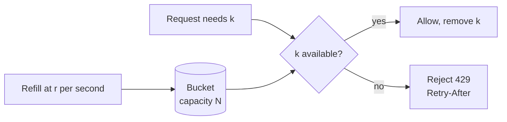

In a normal web app, a request costs a fraction of a cent. In an AI app, one request can cost several cents to a dollar, depending on the model and how much context it reads. Model providers also cap throughput per API key. Without limits, one script, one runaway agent loop, or one enthusiastic team can exhaust the budget or the provider quota for everyone.

## What to limit

| Limit | Unit | Protects against | Typical starting value |
| --- | --- | --- | --- |
| Request rate per user | Requests per minute | Scripts, double-submits, loops | 20 to 30 per minute |
| Concurrent streams per user | Open streams | One user opening many tabs or parallel calls | 3 |
| Token rate per tenant | Tokens per minute | One tenant consuming the shared provider quota | A share of provider capacity, set by contract |
| Daily token quota per user | Tokens per day | Individual overuse and cost blowout | Generous, for example 2 million tokens |
| Monthly budget per tenant | Currency | Cost overruns against contract | Set by contract, with alerts at 50%, 80%, 100% |
| Agent steps per turn | Tool calls or model calls | Infinite agent loops | 10 to 20 |
| Upload size and count | Bytes and files per day | Ingestion overload | 50 MB per file, a few hundred files per day |

Limits at several levels catch different problems. Request limits stop bursts. Token quotas stop slow, expensive overuse. Step limits stop loops that would pass the other two.

## Algorithm: token bucket

Use a **token bucket** for rate limits. Each user has a bucket that holds up to N tokens and refills at a steady rate. Each request takes one token (or, for token quotas, the number of model tokens it will use). If the bucket is empty, the request is rejected.



Why a token bucket: it allows short bursts (a user asks three quick follow-ups), while enforcing an average rate over time. Fixed windows, such as "30 per calendar minute", allow double bursts at window boundaries and feel arbitrary to users.

Implement it in Redis with an atomic script, so concurrent requests across many API servers share one counter:

```lua
-- KEYS[1] = bucket key, ARGV = capacity, refill_per_sec, now_ms, cost
local cap, rate, now, cost = tonumber(ARGV[1]), tonumber(ARGV[2]), tonumber(ARGV[3]), tonumber(ARGV[4])
local b = redis.call('HMGET', KEYS[1], 'tokens', 'ts')
local tokens = tonumber(b[1]) or cap
local ts = tonumber(b[2]) or now
tokens = math.min(cap, tokens + (now - ts) / 1000 * rate)
local allowed = tokens >= cost
if allowed then tokens = tokens - cost end
redis.call('HSET', KEYS[1], 'tokens', tokens, 'ts', now)
redis.call('PEXPIRE', KEYS[1], math.ceil(cap / rate * 1000) + 1000)
return { allowed and 1 or 0, tokens }
```

## Token quotas need estimates

You do not know how many tokens a request will use until it finishes. But you need to decide whether to allow it before you start.

The approach that works:

1. **Estimate before the call.** Count input tokens with the model's tokenizer after the prompt is built. Add the maximum output tokens you allow for this call.
2. **Reserve** that estimate from the quota.
3. **Reconcile after the call.** When the model returns actual usage, refund the difference between reserved and actual.

If you cannot reserve, at least check that the remaining quota is above the estimate. Never let a single request run without a `max_tokens` limit, or one request can consume a whole daily budget.

## Where limits are enforced

| Layer | Enforces |
| --- | --- |
| API gateway | Request rate per user and per IP, concurrent connections |
| Orchestrator | Daily token quota per user, agent step limits |
| Model gateway | Token rate per tenant and per provider key, monthly budgets, the provider's own limits |
| Job queue | Concurrent jobs per tenant, upload limits |

The model gateway is the last line. Even if a bug skips a check upstream, the gateway refuses calls that would exceed a tenant's budget.

## Respecting provider limits

Providers enforce their own limits, in requests per minute and tokens per minute, per key or per project. When you hit them you get `429` responses.

- Track your usage against provider limits in the model gateway, and slow down **before** you hit them. Queueing a request for 2 seconds is better than failing it.
- Spread load across multiple keys, projects, or regions where the provider and your contract allow it.
- Prioritize: interactive chat gets capacity first. Batch jobs, such as re-embedding and evals, use what remains and back off when chat is busy.
- When the provider returns `429` with a `retry-after` value, honor it.

## What clients receive

Return `429 Too Many Requests` with the standard error body and headers that tell the client what to do:

```http
HTTP/1.1 429 Too Many Requests
Retry-After: 18
RateLimit-Policy: 30;w=60
RateLimit: limit=30, remaining=0, reset=18
Content-Type: application/json

{
  "error": {
    "code": "rate_limited",
    "message": "Too many messages. Try again in 18 seconds.",
    "retryable": true,
    "trace_id": "7f3a9c2e"
  }
}
```

For quota exhaustion, use `code: quota_exceeded` and include when it resets. Show both cases clearly in the UI. See [Error and empty states](/docs/frontend/error-states).

## Usage visibility

Users and admins handle limits much better when they can see usage before they hit a wall.

- Show admins usage by team, user, and model, with cost.
- Alert tenant admins at 50%, 80%, and 100% of monthly budget.
- Show users a gentle notice near their daily limit, not only when blocked.
- Record usage per message (input tokens, output tokens, model, cost) in the database. It is the basis for every report and chargeback.

## Checklist

- [ ] Request rate, token quota, and agent step limits are all in place.
- [ ] Rate limiting uses a token bucket in a shared store.
- [ ] Token usage is estimated and reserved before calls, and reconciled after.
- [ ] Every model call has a `max_tokens` limit.
- [ ] The model gateway enforces tenant budgets as a last line.
- [ ] Interactive traffic has priority over batch work for provider capacity.
- [ ] `429` responses include `Retry-After` and a stable error code.
- [ ] Admins can see usage and get budget alerts.
