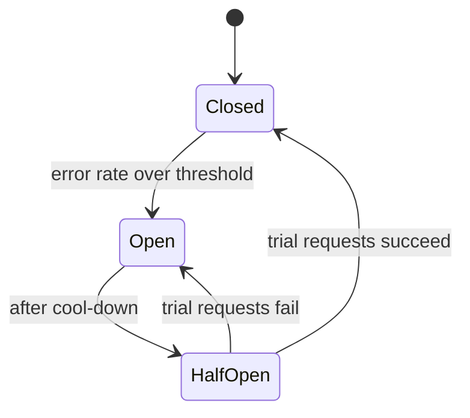

An AI request depends on more external systems than a typical web request: one or more model providers, an embedding service, a search index, a re-ranker, guardrail models, and the APIs behind tools. Each one fails sometimes. With six dependencies at 99.9% availability each, the chain is down for about 9 hours a year unless you design for failure.

## Failure modes to expect

| Dependency | Common failures |
| --- | --- |
| Model provider | `429` rate limits, `5xx` errors, very slow first tokens, streams that stall midway, regional outages |
| Embedding API | Rate limits during bulk ingestion, timeouts |
| Search index | Slow queries under load, node failures, stale replicas |
| Re-ranker | Slow when given too many candidates |
| Tool target APIs | Maintenance windows, expired user tokens, validation errors |
| Your own database | Connection pool exhaustion when requests hang |

The worst failure is usually not an error but **slowness**. A provider that hangs for 60 seconds holds a connection, a worker, and a database connection for that whole time. Enough of those and your whole service stops, even for requests that do not use the slow provider.

## Timeouts

Every network call gets a timeout. No exceptions.

| Call | Timeout | Notes |
| --- | --- | --- |
| Guardrail check | 300 ms to 1 s | Decide whether to fail open or closed. See below |
| Query rewrite | 2 s | Fall back to the raw user message on timeout |
| Retrieval and re-rank | 1 to 2 s | Fall back to retrieval without re-rank |
| Model, time to first token | 10 to 20 s | Then retry or fall back |
| Model, gap between tokens | 15 to 30 s | Detects stalled streams |
| Model, total | 60 to 120 s | Depends on maximum answer length |
| Tool call | 10 to 30 s | Depends on the target system |

Note the two kinds of model timeout. A total timeout alone is not enough: a stream can deliver its first token quickly and then stall forever. Track time since the last token.

Also propagate a **deadline** through the request. If the user's request has 90 seconds left, a downstream call should not start with a fresh 120 second timeout.

## Retries

Retry only when the failure is likely temporary and the operation is safe to repeat.

| Situation | Retry? |
| --- | --- |
| `429` from provider | Yes, after the `retry-after` time, or with backoff |
| `500`, `502`, `503`, `504` | Yes, with backoff |
| Connection reset before any response | Yes |
| `400` invalid request, context too long | No. It will fail the same way |
| `401`, `403` | No. Refresh credentials once if applicable |
| Stream failed after tokens were sent to the user | Not silently. The user saw partial text. Report and let them retry |
| Tool call with side effects | Only with an idempotency key the target honors. Otherwise no |

Use **exponential backoff with jitter**, and a small maximum. For interactive chat, one or two retries is the limit. The user is waiting, and three retries with backoff can take longer than the user's patience.

```ts
async function withRetry<T>(fn: () => Promise<T>, { attempts = 2, base = 300 } = {}) {
  for (let i = 0; ; i++) {
    try {
      return await fn();
    } catch (err) {
      if (i >= attempts || !isRetryable(err)) throw err;
      const delay = base * 2 ** i * (0.5 + Math.random()); // jitter
      await sleep(retryAfterMs(err) ?? delay);
    }
  }
}
```

**Avoid retry storms.** If every layer retries three times, one failure at the bottom becomes 27 calls. Retry at one layer only, usually the one closest to the failing dependency. The model gateway retries model calls. The orchestrator does not retry the model gateway.

## Fallbacks

A fallback is a different way to get a useful result when the primary way fails.

| Primary | Fallback |
| --- | --- |
| Primary model provider | Same model family in another region, or a comparable model from another provider |
| Large model | Smaller, faster model with a note that the answer may be less detailed |
| Hybrid search with re-rank | Hybrid search without re-rank |
| Query rewrite | Use the user's message as is |
| Live connector search (if used) | Indexed copy only, with a note about freshness |

Rules for fallbacks:

- **Test them.** A fallback that has never run in production will fail when you need it. Route a small share of traffic through fallbacks continuously, or run scheduled drills.
- **Evaluate them.** A fallback model needs its own prompt testing. Prompts tuned for one model can perform badly on another. See [Model selection](/docs/ai-model/model-selection).
- **Record them.** Log which path served each request, so a quality drop can be traced to fallback usage.

## Circuit breakers

When a dependency is failing, retrying every request against it wastes time and adds load to a system that is trying to recover. A circuit breaker stops calling it for a while.



- **Closed**: calls go through. Track the error rate over a sliding window.
- **Open**: calls fail immediately or go straight to the fallback. No waiting for timeouts.
- **Half-open**: after a cool-down, such as 30 seconds, let a few requests through to test recovery.

Put circuit breakers in the model gateway per provider and region, and in the tool service per target system.

## Fail open or fail closed

When a guardrail service is down, do you let requests through without the check, or block them?

| Check | Usual choice | Reason |
| --- | --- | --- |
| Input PII detection | Closed for regulated tenants, open with logging for others | Depends on the cost of a leak versus the cost of downtime |
| Prompt injection classifier | Open with logging, if tools with side effects still need confirmation | Confirmation is the stronger control |
| Output content safety | Closed | Users should not see unchecked harmful content |
| Permission filtering in retrieval | **Always closed** | A permission check that fails open is a data leak |

Make the choice explicit per check and per tenant setting. Never let it be an accident of how an exception is handled.

## Cancellation

When the user presses stop or closes the tab, stop the work.

- Pass a cancellation signal (`AbortSignal` in Node, context cancellation in Go, `asyncio` cancellation in Python) through every call in the request.
- When the client disconnects, cancel the signal.
- The model gateway cancels the provider stream, which stops token billing on most providers.
- Pending tool calls that have not started are dropped. Tool calls already in progress run to completion and are recorded, since a half-done side effect is worse than a finished one.

## Backpressure and bulkheads

- **Bounded queues and pools.** Limit concurrent model calls per instance. When the limit is reached, queue briefly, then reject with `503`, rather than accepting unlimited work and slowing everyone down.
- **Bulkheads.** Use separate connection pools and worker pools for interactive chat and batch work, so a large batch job cannot starve chat.
- **Load shedding.** Under extreme load, reject low-priority requests first: batch, then background summarization, then chat.

## Checklist

- [ ] Every network call has a timeout, and model streams have an inter-token timeout.
- [ ] Deadlines propagate through the request.
- [ ] Retries happen at one layer only, with backoff and jitter, and only for retryable errors.
- [ ] Every critical dependency has a tested fallback.
- [ ] Circuit breakers protect against failing providers and tool targets.
- [ ] Each guardrail has an explicit fail-open or fail-closed decision. Permission filtering always fails closed.
- [ ] Cancellation reaches the model provider when the user stops or disconnects.
- [ ] Interactive and batch work use separate pools.
