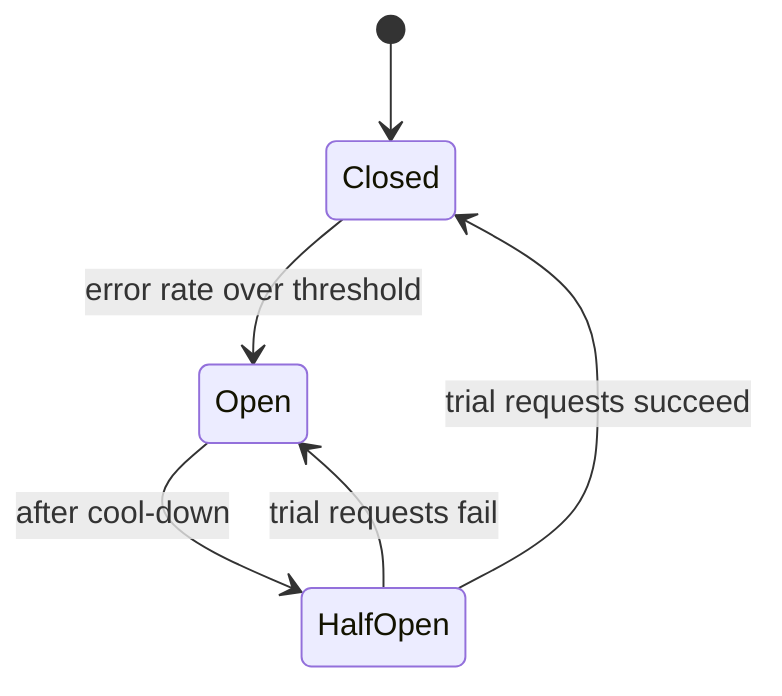

import { CircuitBreakerDemo, RetryStormDemo } from "@/components/demos/reliability";

An AI request depends on more external systems than a typical web request: one or more model providers, an embedding service, a search index, a re-ranker, guardrail models, and the APIs behind tools. Each fails sometimes. As a rough illustration, six dependencies at 99.9% availability each, all required, give about 99.4% for the chain, or roughly 52 hours of failure a year, unless you design for failure.

## Failure modes to expect

| Dependency | Common failures |
| --- | --- |
| Model provider | Rate limits, server errors, very slow first tokens, streams that stall midway, regional outages |
| Embedding API | Rate limits during bulk ingestion, timeouts |
| Search index | Slow queries under load, node failures, stale replicas |
| Re-ranker | Slow when given too many candidates |
| Tool target APIs | Maintenance windows, expired user tokens, validation errors |
| Your own database | Connection pool exhaustion when requests hang |

The worst failure is usually not an error but **slowness**. A provider that hangs for 60 seconds holds a connection, a worker, and possibly a database connection the whole time. Enough of those and the whole service stops, even for requests that do not use the slow provider.

## Timeouts

Every network call gets a timeout. No exceptions.

| Call | Starting timeout | On timeout |
| --- | --- | --- |
| Guardrail check | 300 ms to 1 s | Fail open or closed by policy. See below |
| Query rewrite | 2 s | Use the user's message as is |
| Retrieval and re-rank | 1 to 2 s | Use retrieval without re-ranking |
| Model, time to first token | 10 to 20 s | Retry or fall back |
| Model, gap between tokens | 15 to 30 s | Treat the stream as stalled |
| Model, total | 60 to 120 s | Depends on maximum answer length |
| Tool call | 10 to 30 s | Depends on the target system |

A total timeout alone is not enough for model streams: a stream can deliver its first token quickly and then stall. Track the time since the last token too.

Also propagate a **deadline** through the request. If the turn has 30 seconds left, a downstream call should not start with a fresh 120 second timeout.

## Retries

Retry only when the failure is likely temporary and the operation is safe to repeat.

| Situation | Retry? |
| --- | --- |
| Rate limit from the provider | Yes, after the time it asks for, or with backoff |
| Server errors and gateway timeouts | Yes, with backoff |
| Connection reset before any response | Yes |
| Invalid request, context too long | No. It will fail the same way |
| Authentication failure | No. Refresh credentials once if applicable |
| Stream failed after the user saw part of the answer | Not silently. Report it and let the user retry |
| Tool call with side effects | Only with an idempotency key the target honors |

Use **exponential backoff with jitter** and a small maximum. For interactive chat, one or two retries is the limit: the user is waiting.

### Where to retry

| Option | Strengths | Weaknesses |
| --- | --- | --- |
| **At every layer** | Each layer feels safe | Retry storms. Three layers retrying three times turn one failure into 27 calls |
| **At one layer, closest to the dependency** | Bounded load. One place to tune | Callers above must accept the failure |
| **Only at the client** | Simple backend | The user waits through every failure. Slow for streams |

**Default:** one layer, closest to the failing dependency. The model gateway retries model calls, and the orchestrator does not retry the model gateway. Add a **retry budget** too: allow retries only up to a small share of traffic, such as 10%, so retries cannot multiply load during an outage.

<RetryStormDemo />

### Hedged requests

For calls where slowness is the main problem, send a second request if the first has not answered within a short delay, and use whichever finishes first.

| | Benefit | Cost |
| --- | --- | --- |
| Hedging cheap calls, such as search or embedding | Cuts slow outliers with little extra cost | A few percent more load |
| Hedging model generation | Can rescue a slow first token | Possibly paying for two generations. Use only for short, high-value calls |

## Fallbacks

A fallback is a different way to get a useful result when the primary way fails.

| Primary | Fallback | Trade-off |
| --- | --- | --- |
| Model provider in one region | Same model in another region | Closest in quality. Check data residency rules first |
| One provider | A comparable model from another provider | Survives a whole-provider outage. Needs its own prompt testing |
| Large model | Smaller, faster model, with a note that the answer may be less detailed | Always available, but weaker answers |
| Hybrid search with re-rank | Hybrid search without re-rank | Faster, slightly worse ranking |
| Query rewrite | The user's message as is | Follow-up questions retrieve worse |
| Live connector search | Indexed copy only, with a note about freshness | Possibly stale data |

Rules for fallbacks:

- **Test them.** A fallback that has never run in production will fail when you need it. Route a small share of traffic through it continuously, or run scheduled drills.
- **Evaluate them.** Prompts tuned for one model can perform badly on another. See [Model selection](/docs/ai-model/model-selection).
- **Record them.** Log which path served each request, so a quality drop can be traced to fallback usage.

## Circuit breakers

When a dependency is failing, sending every request to it wastes time and adds load to a system that is trying to recover. A circuit breaker stops calling it for a while.

- **Closed**: calls go through. Track the error rate over a sliding window.
- **Open**: calls fail immediately or go straight to the fallback. No waiting for timeouts.
- **Half-open**: after a cool-down, such as 30 seconds, let a few requests through to test recovery.

<CircuitBreakerDemo />

Put circuit breakers in the model gateway per provider and region, and in the tool service per target system.

## Fail open or fail closed

When a guardrail is down, do you let requests through without the check, or block them?

| Check | Usual choice | Reason |
| --- | --- | --- |
| Input PII detection | Closed for regulated tenants, open with logging for others | Depends on the cost of a leak versus the cost of downtime |
| Prompt injection classifier | Open with logging, if tools with side effects still need user confirmation | Confirmation is the stronger control |
| Output content safety | Closed | Users should not see unchecked harmful content |
| Permission filtering in retrieval | **Always closed** | A permission check that fails open is a data leak |

Make the choice explicit per check and per tenant setting. Never let it be an accident of how an exception is handled.

## Cancellation

When the user presses stop or closes the tab, stop the work.

- Carry a cancellation signal in the request context and pass it to every call.
- Trigger it on an explicit stop and on client disconnect.
- The model gateway cancels the provider stream, which on most providers stops further token billing.
- Tool calls that have not started are dropped. Tool calls already running finish and are recorded, because a half-done side effect is worse than a finished one.

## Overload

| Technique | What it does | Trade-off |
| --- | --- | --- |
| **Bounded pools and queues** | Limit concurrent model calls per instance. Queue briefly, then reject | Some users get a "busy" error instead of everyone getting slow |
| **Bulkheads** | Separate pools for chat and batch work | Idle capacity in one pool cannot help the other |
| **Load shedding by priority** | Under extreme load, reject batch work first, then background summaries, then chat | Batch work falls behind and must catch up later |
| **Degraded modes** | Turn off expensive features, such as re-ranking or agents, under pressure | Answers get simpler for a while |

See [Disaster recovery](/docs/deployment/disaster-recovery) for degraded modes during larger outages.

## Checklist

- [ ] Every network call has a timeout, and model streams have an inter-token timeout.
- [ ] Deadlines propagate through the request.
- [ ] Retries happen at one layer only, with backoff, jitter, and a retry budget.
- [ ] Every critical dependency has a tested fallback.
- [ ] Circuit breakers protect against failing providers and tool targets.
- [ ] Each guardrail has an explicit fail-open or fail-closed decision. Permission filtering always fails closed.
- [ ] Cancellation reaches the model provider when the user stops or disconnects.
- [ ] Chat and batch work use separate pools.
