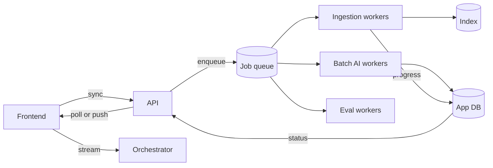
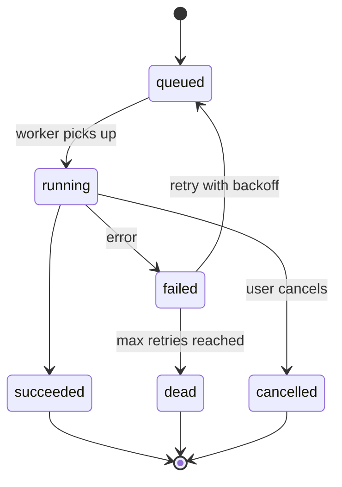

AI work is slow and uneven. A chat answer takes seconds. Indexing a 300-page PDF takes minutes. Re-embedding the whole corpus takes hours. If all of this runs the same way, the system is either slow for users or fragile in the background. This page explains how to split the work.

## Three execution modes

| Mode | Use it when | Examples | User experience |
| --- | --- | --- | --- |
| **Synchronous** | The work finishes in under about 1 second and the user waits for it | Load a chat, save feedback, list documents | Normal request and response |
| **Streaming** | The work takes seconds but produces output progressively | Chat answers, long summaries | Text appears as it is generated |
| **Background job** | The work takes longer than a user will wait, or does not need the user at all | Ingest an upload, sync a connector, run an eval suite | The user gets a job and sees progress or a notification |

The rule of thumb: **if a user could close the tab and still want the result, it is a job.**

## The design

## Streaming

Streaming is what makes a 10 second answer feel fast. It is not optional for chat. The server keeps the response open and sends small typed events as they are ready: status, text, citations, tool call updates, and a final done or error event. The transport options are compared in [API design](/docs/backend/api-design#streaming-transport), and what happens when a stream breaks is in [Chat orchestration](/docs/backend/orchestration#streams-and-disconnects).

**What breaks streaming in practice:**

- **Buffering.** Proxies, CDNs, and compression middleware that collect the whole response before sending it. Tokens then arrive in one lump at the end.
- **Idle timeouts.** A model that thinks for 40 seconds before its first token gets cut off by a 30 second load balancer timeout. Send a keep-alive event about every 15 seconds.

## Background jobs

### When something becomes a job

Make it a job if any of these is true:

- It can take more than about 10 seconds.
- It processes more than one item, such as a folder of files.
- It must survive a deploy or a crash and still finish.
- It calls a rate-limited external API many times.

### Choosing a queue

| Option | Strengths | Weaknesses | Fits when |
| --- | --- | --- | --- |
| **Jobs table in your database** | No new system. Jobs and data change in one transaction | Polling load on the database. Limited throughput | Early stage, moderate volume |
| **Redis-based queue** | Fast, simple, many libraries | Durability depends on Redis configuration | You already run Redis and can tolerate rare loss |
| **Managed queue** (SQS, Pub/Sub, Cloud Tasks) | No servers to run. Scales far | Vendor limits on message size, visibility timeouts, and ordering | Most production systems on a cloud |
| **Message broker** (RabbitMQ) | Flexible routing and priorities | You operate and monitor it | Complex routing needs and a team to run it |
| **Event log** (Kafka) | Replay, very high throughput, many consumers per event | Heavy to run. Awkward for per-job retries and delays | Event streaming at large scale, not one-off jobs |

**Default:** a managed queue, or a database-backed queue until volume demands more.

### Job lifecycle

Keep each job's state in the database, not only in the queue. The queue delivers work. The database is where the frontend and support staff look up what happened. A job record holds:

| Field | Purpose |
| --- | --- |
| ID | Returned to the client to follow the job |
| Tenant and user | Permissions and fair scheduling |
| Type | Such as file ingestion, connector sync, or eval run |
| Status | One of the states above |
| Attempts | How many times it has been tried |
| Progress | Such as 120 of 300 files done |
| Last error | A message safe to show to support |
| Idempotency key | Prevents duplicate jobs for the same input |
| Created, started, finished times | Latency metrics and stuck-job alerts |

### Retries and idempotency

Jobs fail. Model APIs return rate limits and server errors. Parsers crash on odd files.

- **Retry with exponential backoff and jitter**, for example after 10 s, 30 s, 90 s, and 270 s, then give up. Jitter stops a thousand failed jobs from retrying in the same second.
- **Retry only what can succeed later.** A rate limit will clear. A corrupt PDF will not. Mark permanent failures as dead right away and show the reason.
- **Make every job idempotent.** Running it twice must give the same result as running it once. For ingestion, give each chunk a deterministic ID, such as one derived from the document ID and chunk position, and overwrite instead of inserting.

Queues deliver messages **at least once**. Duplicates will happen. Idempotency is how you survive them.

### Fair scheduling

One tenant uploading 50,000 files must not delay everyone else's single upload.

| Option | Strengths | Weaknesses |
| --- | --- | --- |
| **Separate queues by priority**: interactive uploads fast, bulk syncs slow | Simple. Protects the common case | A large tenant can still starve other tenants inside the slow queue |
| **Per-tenant concurrency limits** | No tenant takes more than its share of workers | Idle capacity when only one tenant has work, unless limits flex |
| **Weighted fair queuing** | Each tenant gets a fair share at all times | More complex to build and reason about |

**Default:** start with priority queues, and add per-tenant limits when the first large customer arrives.

### Long workflows

Some jobs have many steps: fetch, parse, chunk, embed, index, notify. If step 4 fails, you do not want to redo steps 1 to 3.

| Option | Strengths | Weaknesses | Fits when |
| --- | --- | --- | --- |
| **Chain small jobs**, each enqueuing the next | Simple. Uses the queue you have | Hard to see the whole workflow. Branches get messy | A few linear steps |
| **Durable workflow engine** (Temporal, AWS Step Functions) | Resumes from the failed step. Visible history. Handles waits and approvals | Another system to learn and run. Steps must be safe to replay | Branches, long waits, or human approval steps |

## Telling the user

For jobs the user started, show progress where they started it.

| Option | Fits when |
| --- | --- |
| **Polling** every few seconds | Simple, few concurrent jobs per user |
| **Push** over an existing live connection | Many jobs, or a live connection already exists |
| **Notification**, by email or in the app, when done | Jobs that take minutes to hours |
| **Webhook** to a customer system | Unattended integrations |

Always handle the user who leaves and comes back. The job list must load from the database, not only from live events.

## Trade-offs

| Choice | Benefit | Cost |
| --- | --- | --- |
| Do more work synchronously | Simpler code, immediate result | Slow requests, timeouts, poor experience under load |
| Move work to jobs | Resilient, scalable, fair | A queue, a jobs table, a progress UI, and idempotent code |

## Checklist

- [ ] Chat responses stream, and nothing between server and browser buffers them.
- [ ] Keep-alive events are sent during long model pauses.
- [ ] Anything that can take more than about 10 seconds is a job with a database record.
- [ ] Every job is idempotent and has a retry limit.
- [ ] Permanent failures are not retried.
- [ ] One tenant cannot starve others in the job queue.
- [ ] Stuck jobs trigger an alert.
