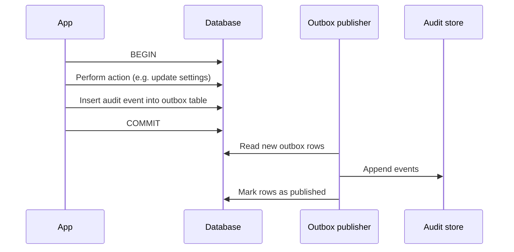

Audit logs answer "who did what, when, and to what?" They are different from application logs, which help engineers debug. Audit logs are evidence: for security investigations, compliance audits, customer questions, and legal disputes. They must be complete, accurate, and protected from tampering.

## What to record

| Category | Events |
| --- | --- |
| Authentication | Sign-in, sign-out, failed sign-in, session revoked, SSO configuration changed |
| Users and roles | User provisioned, deprovisioned, role changed, group membership synced |
| Configuration | Tenant settings changed, model or provider settings changed, guardrail settings changed, retention changed |
| Connectors | Connector added, removed, scope changed, sync started, sync failed |
| Data access | Document uploaded, deleted. Conversation shared, exported, deleted. Bulk export requested |
| AI actions | Tool action proposed, confirmed, rejected, executed, failed |
| Privileged access | Support access granted, used, expired. Admin viewed another user's content |
| Security events | Guardrail block of a severe category, injection detected, rate limit abuse, permission denied on a sensitive resource |
| Compliance operations | Deletion request received and completed, legal hold placed or lifted, data export for an access request |

### Do you log every question and answer?

Usually **not** in the audit log. The audit log records that a conversation happened and its ID, not its content. Content stays in the conversation store with its own access controls and retention. Mixing content into audit logs creates a second, long-retained copy of sensitive data.

Some regulated customers do require a content archive, such as financial firms with communication record-keeping rules. Offer that as an explicit, tenant-configured archive with its own retention, not as a side effect of audit logging.

## Event structure

```json
{
  "id": "aud_2Kq8d9",
  "timestamp": "2026-03-14T09:31:07.412Z",
  "tenant_id": "ten_acme",
  "actor": {
    "type": "user",
    "id": "usr_alice",
    "email": "alice@acme.com",
    "ip": "203.0.113.24",
    "user_agent": "Mozilla/5.0 ..."
  },
  "on_behalf_of": null,
  "action": "tool.execute",
  "target": { "type": "tool_call", "id": "tc_77ab", "tool": "create_it_ticket" },
  "outcome": "success",
  "details": {
    "conversation_id": "conv_8f2k",
    "message_id": "msg_91xa",
    "confirmed_by": "usr_alice",
    "external_ref": "IT-4821",
    "arguments_hash": "sha256:4b1c..."
  },
  "trace_id": "7f3a9c2e5b1d"
}
```

| Field | Notes |
| --- | --- |
| `actor` | Who performed the action. For system actions, the service and the reason, such as `retention_job` |
| `on_behalf_of` | Set when an admin or support engineer acts for another user |
| `action` | A fixed vocabulary, `resource.verb`, documented |
| `outcome` | `success`, `failure`, `denied` |
| `details` | Structured, minimal, no content. Hash arguments if they might contain sensitive data, and keep the full arguments in the tool call record |
| `trace_id` | Links to operational traces for investigation |

## Protecting the log

| Requirement | Implementation |
| --- | --- |
| Append-only | Applications can write but not update or delete. Use a dedicated store or service with write-only credentials |
| Tamper-evident | Hash chaining (each record includes the hash of the previous), or write-once storage such as object lock |
| Separate access | Different credentials and ideally a different account from production data. Engineers who run production cannot alter audit logs |
| Complete | Write audit events in the same transaction as the action where possible, or through an outbox pattern, so actions cannot succeed without being logged |
| Retained | Per compliance needs, often one to seven years. Separate from content retention |
| Time-accurate | Synchronized clocks, UTC timestamps |

### Outbox pattern

Writing to the database and to a separate audit store are two operations, and one can fail. The outbox pattern makes them consistent:



If the action commits, the audit event is guaranteed to be published eventually.

## Making logs useful

Logs nobody can search are not useful evidence.

- **Tenant admin view**: a searchable audit log in the admin UI, filtered to the tenant, with filters by user, action, and date. Enterprise customers expect this.
- **Export**: to the customer's SIEM (Splunk, Sentinel, or similar) through a streaming integration or scheduled export.
- **Investigation queries**: support common questions, such as "all actions by this user in the last 30 days", "all tool executions in this tenant", "all admin views of user content".
- **Alerts**: on high-risk events, such as SSO configuration changes, bulk exports, support access grants, and repeated permission denials.

## AI-specific audit questions

Customers and auditors increasingly ask questions that need AI-specific records. Combine audit logs with lineage from [Schema and lineage](/docs/data/schema):

| Question | Answer from |
| --- | --- |
| Which actions did the assistant take in our systems last month, and who approved each? | `tool.execute` audit events with `confirmed_by` |
| Which model and prompt version produced this answer? | Generation record for the message |
| Who saw content from this document? | Message sources by document, joined with conversations |
| When did the model provider change, and who approved it? | Configuration change audit events, plus the change's pull request |
| Did anyone at the vendor view our data? | Privileged access audit events |

## Checklist

- [ ] Audit events cover authentication, users, configuration, connectors, data access, AI actions, privileged access, security, and compliance operations.
- [ ] Audit events contain no conversation content.
- [ ] Events follow a documented schema with actor, on-behalf-of, action, target, outcome, and trace ID.
- [ ] The audit store is append-only, tamper-evident, and separately controlled.
- [ ] Events are written transactionally or through an outbox.
- [ ] Tenant admins can search and export their audit logs.
- [ ] High-risk events trigger alerts.
