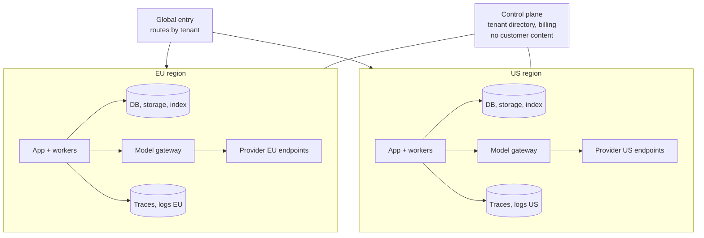

Data residency means a customer's data is stored, and often processed, only in specific geographic regions, such as the EU, a single country, or the US. Many enterprise and public sector customers require it. In an AI system this is harder than usual, because data moves to model providers on every request.

## Where data goes

Every one of these locations must be inside the required region for a residency-bound tenant:

| Data flow | Often forgotten? |
| --- | --- |
| App database, object storage, search index | No |
| Backups and snapshots | Sometimes. Cross-region backup copies need a region inside the boundary |
| Model calls for answers | **Yes**. The provider's endpoint and its processing location |
| Embedding calls during ingestion and queries | **Yes** |
| Re-ranker and guardrail model calls | **Yes**. Often a different provider with different regions |
| Provider abuse monitoring and logging | **Yes**. Some providers store prompts for abuse review in a specific region unless you have an exemption |
| Prompt caching at the provider | Usually same region as processing. Confirm |
| Traces and logs in an observability platform | **Yes**. The vendor's region |
| Error tracking and analytics tools | **Yes** |
| Eval runs using production-derived data | **Yes** |
| Support engineers viewing data | **Yes**. Access from outside the region can count as a transfer |

## Design for regions



The common pattern is **regional stacks with a thin global control plane**:

- Each region runs a full data plane: app, workers, database, storage, index, model gateway, observability.
- A tenant is assigned to one region at creation. All its data and processing stay there.
- A global control plane holds only what must be global: the tenant directory (which region a tenant lives in), billing aggregates, and feature flags. **No customer content.**
- Routing sends each request to the tenant's region, based on the tenant in the token or a region-specific hostname.

### Model calls

The model gateway enforces region rules per tenant:

```yaml
tenants:
  acme-eu:
    region: eu
    allowed_providers:
      - provider_a: { endpoints: [eu-west, eu-central] }
      - provider_b: { endpoints: [eu] }
    data_retention: zero
```

- Use **regional endpoints** or cloud-hosted models in the required region. Global endpoints may route to any region.
- Check **model availability per region**. The newest models often launch in a few regions first. A residency-bound tenant may be limited to older models for a while. Evaluate the models available in each region separately.
- Make sure **fallback models** are also in-region. A fallback that silently routes to another region breaks residency during exactly the outages when nobody is watching.
- Block any call that would violate the tenant's region rules, and alert. Failing is better than silently transferring data.

### Embeddings and the index

The embedding model used for a tenant's index must be available in the tenant's region, for both ingestion and queries. If the best embedding model is not available in a region, you may need a different embedding model there, which means separate evaluation for that region.

## Support access

When support engineers outside the region view a tenant's data, that can be a data transfer. Options:

- Region-based support teams for residency-bound tenants.
- Support tooling that shows metadata (timings, errors, IDs) by default, and content only with explicit, logged, time-limited access.
- Contractual terms that describe exactly what support access may happen from where.

## Verifying residency

Claims need evidence.

- **Configuration tests** in CI: for every residency-bound tenant configuration, assert that every provider endpoint, storage location, and observability destination is in-region.
- **Runtime checks** in the model gateway that refuse out-of-region calls, with metrics on refusals.
- **Data flow diagram** per region, kept current, for customers and auditors.
- **Subprocessor list with regions**, so customers can see where each vendor processes their data. See [Vendors and contracts](/docs/compliance/vendors).

## Moving a tenant

Customers sometimes need to move regions. Plan it as a migration:

1. Provision the tenant in the new region.
2. Copy database records and files. Re-index in the new region, which may mean re-embedding if the embedding model differs.
3. Switch routing.
4. Delete data in the old region, including backups on their normal expiry, with records.

## Checklist

- [ ] Every data flow in the table above is mapped to a region per tenant.
- [ ] Regional stacks hold all customer content. The global control plane holds none.
- [ ] The model gateway enforces allowed providers and endpoints per tenant, including fallbacks.
- [ ] Model and embedding availability is evaluated per region.
- [ ] Observability, error tracking, and analytics are regional or content-free.
- [ ] Support access to content respects residency and is logged.
- [ ] Residency configuration is tested in CI and enforced at runtime.
