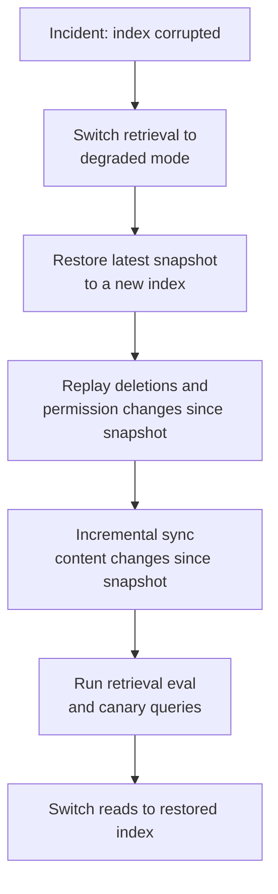

Not every store needs a backup. Some can be rebuilt from other data. The question for each store is: if it disappeared, how would you get it back, and how long would that take?

## Back up or rebuild

| Store | Strategy | Why |
| --- | --- | --- |
| App database (conversations, settings, users, audit) | **Back up** with point-in-time recovery | Cannot be rebuilt. It is the system's own data |
| Object storage (uploads, raw source copies) | **Replicate and version**, with deletion rules | Uploads cannot be rebuilt. Source copies can be re-fetched but slowly |
| Search index | **Rebuild** from raw copies, plus snapshots for speed | Derived data, but rebuilding a large index takes hours to days |
| Redis (limits, caches, stream buffers) | **Neither**. Accept loss | Everything here is temporary |
| Traces and logs | Platform's own durability. No special backup | Short-lived operational data |
| Audit events | **Back up**, append-only, separate account | Compliance requires integrity and availability |
| Configuration, prompts, model routes | **In git** | Already versioned |
| Secrets | Secret manager with its own backup and recovery | Losing them blocks recovery of everything else |

## Recovery targets

Two numbers define each target:

- **RPO** (recovery point objective): how much data, measured in time, you can afford to lose.
- **RTO** (recovery time objective): how long you can afford to be down.

| Store | RPO | RTO | How |
| --- | --- | --- | --- |
| App database | 5 minutes | 1 hour | Managed Postgres with continuous WAL archiving and point-in-time restore. Cross-region replica for regional failure |
| Uploads | 0 (replicated) | 1 hour | Cross-region replication of the bucket |
| Search index | 24 hours | 4 hours | Daily snapshot restore, then incremental re-sync from connectors for changes since the snapshot |
| Search index, full rebuild | n/a | 1 to 3 days | Re-run ingestion from raw copies. Embedding API limits decide the duration |
| Audit events | 0 | 24 hours | Write-once storage replicated to a separate account |

These are examples. Set your own with the business, and remember that tighter targets cost more.

### Why the index needs snapshots

Rebuilding the index from raw copies works, but at scale it is slow and expensive: millions of chunks to re-embed, at embedding API rate limits. A daily snapshot lets you restore in hours, then catch up with incremental syncs. Keep snapshots in the same region as the index for fast restore, plus at least one copy in another region.

When restoring a snapshot, **re-apply deletions and permission changes** that happened after the snapshot before serving traffic. Otherwise the restored index serves deleted documents and revoked access. Connector reconciliation can do this, but it must run before the index goes live, not after.

## What a restore looks like

**Degraded mode** means the assistant keeps working without retrieval, clearly telling users it cannot search documents right now, or answering only from user uploads. Decide this behavior in advance. An assistant that silently answers company questions without sources during an index outage will hallucinate company facts.

## Encryption and access

- Backups are encrypted with keys managed in your key management service.
- Backup storage is in a separate account or project with restricted access. An attacker who compromises production should not be able to delete backups.
- Enable deletion protection or object lock for backups and audit logs.
- Access to restore is limited, logged, and requires approval.

## Testing recovery

A backup that has never been restored is a hope, not a backup.

| Test | Frequency |
| --- | --- |
| Restore the app database to a point in time in a non-production environment, and run integrity checks | Monthly |
| Restore the search index from snapshot, replay deletions, and run retrieval evaluation | Quarterly |
| Full regional failover drill | Yearly, or per contract |
| Rebuild the index from raw copies for one tenant and measure the duration | Yearly, and after major corpus growth |

Record the measured time for each test. If the measured recovery time exceeds the RTO, either improve the process or change the target honestly.

See [Disaster recovery](/docs/deployment/disaster-recovery) for regional failover and the broader recovery plan.

## Checklist

- [ ] The app database has point-in-time recovery and a cross-region replica.
- [ ] Uploads are replicated, and versioning works with deletion rules.
- [ ] The search index has daily snapshots, and a full rebuild procedure is documented.
- [ ] Restores replay deletions and permission changes before serving traffic.
- [ ] Degraded mode is defined for when retrieval is unavailable.
- [ ] Backups are encrypted, in a separate account, with deletion protection.
- [ ] Restore tests run on a schedule, and recovery times are measured.
