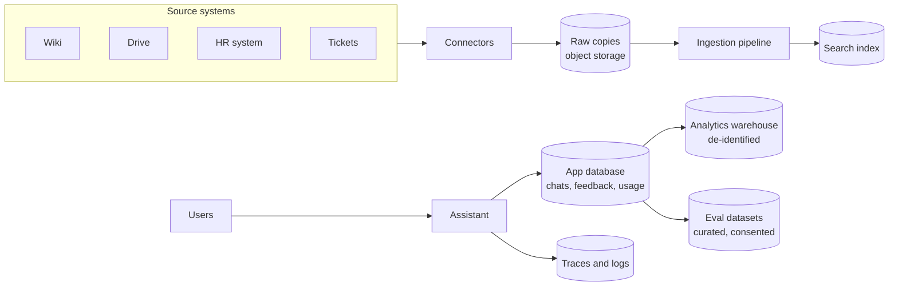

An AI assistant handles two very different kinds of data. It **reads** company knowledge that belongs to other systems, and it **creates** its own data: conversations, feedback, traces, and usage. The two have different owners, different lifecycles, and different legal rules. Mixing them up is how teams end up unable to answer "where is this person's data, and can we delete it?"

## Data inventory

| Data | Origin | Owner | Where it lives | Sensitivity |
| --- | --- | --- | --- | --- |
| Source documents | Wiki, drives, HR systems, ticketing | The source system | Source system. Copies in object storage | Varies, up to highly confidential |
| Chunks and embeddings | Derived from source documents | The assistant, as a copy | Search index | Same as the source document |
| Document ACLs | Source systems | The source system | Copied onto chunks | Reveals who can see what |
| User uploads | Users | The user | Object storage, search index | Often sensitive: contracts, CVs, financials |
| Conversations and messages | Users and the assistant | The user, under company policy | App database | High: users paste anything |
| Feedback | Users | The company | App database | Medium, can include free text |
| Traces and logs | The system | The company | Observability platform | High if they contain prompts |
| Usage and cost records | The system | The company | App database, warehouse | Low to medium |
| Evaluation datasets | Curated from the above | The AI team | Repository or dataset store | Depends on what was copied in |
| Audit events | The system | The company | Append-only store | Medium, must be tamper-resistant |

Keep this table current for your system. Security reviews, privacy assessments, and customer questionnaires all start with it.

## The design

## Principles

- **Source systems stay the source of truth.** The index is a copy for search. If a document is deleted or unshared at the source, the copy must follow. The assistant never becomes the place where a document survives after the owner removed it.
- **Derived data inherits sensitivity.** A chunk of a confidential document is confidential. An embedding of it is too: embeddings can be partly inverted to recover text.
- **Collect the minimum.** Do not store full prompts in logs by default. Do not keep conversations forever by default.
- **Every store has a retention rule and a deletion path.** If you cannot delete from it, do not put personal data in it.
- **Copying into evaluation datasets is a decision, not a habit.** It needs a reason, a review, and usually de-identification.

## Pages in this section

| Page | Covers |
| --- | --- |
| [Sources and connectors](/docs/data/sources-connectors) | Pulling documents and permissions from source systems, and keeping them in sync |
| [Pipelines and freshness](/docs/data/pipelines) | Scheduling ingestion, freshness targets, monitoring, and backfills |
| [Schema and lineage](/docs/data/schema) | The app database schema, and tracing any answer back to its sources |
| [Retention and deletion](/docs/data/retention) | How long each kind of data is kept, and how deletion reaches every copy |
| [Backups and recovery](/docs/data/backups) | What to back up, what to rebuild, and how to test it |
