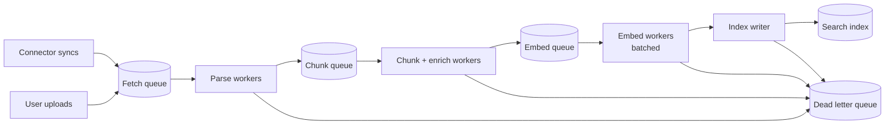

The ingestion pipeline turns connector output into searchable chunks. [RAG ingestion](/docs/ai-model/rag-ingestion) explains what each step does to a document. This page is about running the pipeline in production: scheduling, freshness targets, failure handling, backfills, and monitoring.

## Pipeline shape

Separate queues per stage let each stage scale on its own. Parsing is CPU-heavy. Embedding is limited by the embedding API's rate limit. Index writes are limited by the index. A single monolithic job hides which stage is the bottleneck.

For simpler systems, one worker that runs all stages per document is fine. Split when one stage clearly limits throughput.

## Priorities

Not all ingestion is equally urgent.

| Priority | Work | Target |
| --- | --- | --- |
| Highest | Permission changes and deletions | Minutes |
| High | User uploads in an active conversation | Seconds to a minute |
| Normal | Incremental content syncs | Minutes to an hour |
| Low | Initial full syncs, reconciliation, re-embedding, backfills | Hours to days, in the background |

Use separate queues or weighted scheduling, so a large initial sync of one tenant never delays a user's upload or a permission revocation.

## Freshness targets

Freshness is the delay between a change in a source and that change being reflected in answers. Define targets explicitly and measure them.

| Change | Target (p95) |
| --- | --- |
| Access removed (unshare, user leaves group) | 15 minutes |
| Document deleted | 1 hour |
| Document edited | 1 hour |
| New document created | 1 hour |
| User upload ready to query | 2 minutes for typical files |

These are examples. Agree on yours with stakeholders. Access removal is the one with real risk, so it gets the tightest target.

### Measuring freshness

Record timestamps along the way:

- `source_modified_at`: when the source says it changed.
- `detected_at`: when the connector saw the change.
- `indexed_at`: when the index write completed.

Freshness lag is `indexed_at - source_modified_at`. Plot p50 and p95 per connector and tenant. Alert when p95 exceeds the target.

Also run **canary documents**: a scheduled job creates or edits a test document in each source, then queries the index until it appears. This measures the whole path end to end, including parts with no internal timestamps.

## Failure handling

| Failure | Handling |
| --- | --- |
| Source API throttling | Retry after the given delay. Slow the connector's rate |
| Unparseable file | Mark as permanently failed with a reason. Do not retry. Show it in the admin view |
| Embedding API error | Retry with backoff. If persistent, pause the embed stage and alert |
| Index write failure | Retry. If the index is unhealthy, pause writes and queue up |
| Poison message (crashes a worker repeatedly) | After N attempts, move to the dead letter queue with the error |

Review the dead letter queue regularly. Each entry is a document users cannot find. Patterns there, such as all PDFs from one scanner, usually point to a parser fix that recovers thousands of documents.

## Backfills and reprocessing

You will reprocess the whole corpus several times over the system's life: a better parser, a new chunking strategy, contextual headers, a new embedding model.

Design for it from the start:

- Keep **raw source copies** in object storage, so reprocessing does not need to re-fetch from every source system.
- Keep a **pipeline version** on every chunk, such as `parser=v4,chunker=v7,embed=modelX`.
- Run backfills as low-priority jobs that select chunks by pipeline version.
- For changes that alter vectors, write to a **new index** and switch over after evaluation. See the embedding migration steps in [RAG ingestion](/docs/ai-model/rag-ingestion).
- Estimate cost and duration before starting. Re-embedding 50 million chunks is a large bill and takes days at typical rate limits.

## Upload path

User uploads are interactive, so they get their own fast path:

1. The browser uploads directly to object storage with a pre-signed URL.
2. The backend registers the document and enqueues a high-priority job.
3. Workers parse, chunk, embed, and index it, reporting progress.
4. The document is scoped to the uploading user, or the conversation, by its ACL.
5. The frontend shows "Ready" when indexing completes.

For a single file the user is about to ask about, consider skipping the index entirely and putting the file's text directly in the prompt if it fits. See [Context management](/docs/ai-model/context).

## Monitoring dashboard

A single dashboard should answer "is the index healthy?"

| Panel | Shows |
| --- | --- |
| Freshness lag | p50 and p95 per connector |
| Queue depth and age | Per stage. Growing age means a stalled stage |
| Throughput | Documents and chunks per minute per stage |
| Failures | By stage and reason, plus dead letter queue size |
| Connector last success | Per connector and tenant, with how long since |
| Index size | Chunks per tenant, growth over time |
| Canary results | Pass or fail and latency per source |

## Checklist

- [ ] Pipeline stages are separated, or at least measured separately.
- [ ] Permission changes and deletions have the highest priority.
- [ ] Freshness targets are written down and measured with timestamps and canary documents.
- [ ] Permanent failures are not retried, and are visible to admins.
- [ ] A dead letter queue exists and is reviewed.
- [ ] Raw copies and pipeline versions make reprocessing possible without re-fetching.
- [ ] Backfills run at low priority with cost estimates.
- [ ] A dashboard shows freshness, queues, failures, and canaries.
