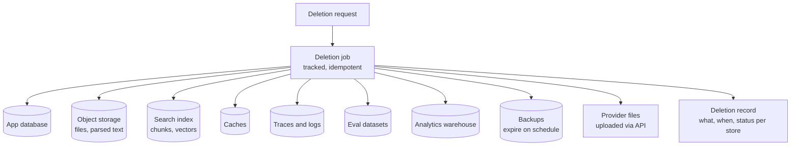

AI systems copy data into many places: raw file copies, chunks, embeddings, caches, prompts in traces, evaluation datasets, and sometimes model providers' systems. A deletion that removes the database row but leaves the embedding, the trace, and the eval example is not a deletion. This page defines retention periods and the deletion paths that reach every copy.

## Retention schedule

Set a default per data type, let tenants configure within limits, and write the result down. Example defaults:

| Data | Default retention | Configurable | Reason |
| --- | --- | --- | --- |
| Conversations and messages | 90 days after last activity | Yes, 0 days to 2 years | Users want history. Companies want limits |
| Generations metadata (tokens, cost, versions) | 2 years | No | Billing, capacity planning. Contains no content |
| Message sources (chunk references) | Same as messages | Follows messages | Lineage for the message's lifetime |
| Feedback with comments | 1 year | Yes | Evaluation, with comments reviewed and de-identified |
| Full prompts in traces | 30 days | Yes, 0 to 90 days | Debugging needs recent data only |
| Application logs without content | 90 days | No | Operations |
| Audit events | 1 to 7 years | Per compliance needs | Legal and compliance |
| User uploads | Same as the conversation, or until deleted by the user | Yes | User-owned |
| Indexed copies of source documents | As long as the source exists and is in scope | Follows source | Must follow the source |
| Provider-side data | Zero retention where available | Contract | Minimize copies outside your control |
| Evaluation datasets | Until the dataset is retired | Reviewed yearly | Must not contain data that should have been deleted |

## Kinds of deletion

| Trigger | Scope |
| --- | --- |
| User deletes a conversation | That conversation's messages, sources, generations, tool call records, uploads tied to it, traces |
| User deletes an upload | The file, its parsed text, its chunks and vectors, caches containing it |
| Retention expiry | Everything older than the configured period, per type |
| Source document deleted | Raw copy, chunks, vectors. Answers that cited it keep their text but lose the live link |
| User leaves the company (account deleted) | Their conversations, uploads, feedback, personal settings, OAuth tokens |
| Privacy request (for example GDPR erasure) | All personal data about the person, including in other users' content where required |
| Tenant offboarding | Everything for the tenant, across every store |

## Deletion must reach every copy

Build deletion as a **tracked job** that visits every store, records success per store, and retries failures. A deletion request is complete only when every store reports done.

### Store-specific notes

| Store | How deletion works | Pitfall |
| --- | --- | --- |
| App database | Soft delete for immediate hiding, hard delete in the job | Forgetting child tables. Use foreign keys with `ON DELETE CASCADE` where appropriate |
| Object storage | Delete objects by prefix or ID. Check versioned buckets also delete old versions | Versioning keeps "deleted" files |
| Search index | Delete by `document_id` or by user upload ID | Some indexes mark deletions and purge later. Make sure purge runs |
| Caches | Include IDs in keys so you can delete, or keep expiry short | Response and embedding caches holding content |
| Traces and logs | Delete by trace IDs, or rely on short retention | Logs that captured prompts by accident |
| Eval datasets | Track the origin of every example. Remove those linked to deleted data | Examples copied into spreadsheets and repositories |
| Warehouse | Delete by hashed user ID, or keep it de-identified so it is out of scope | Keeping raw text "just in case" |
| Backups | Usually not edited. Expire on a fixed schedule, and re-apply deletions if a backup is restored | Restoring a backup resurrects deleted data |
| Model provider | Delete files uploaded through provider APIs. Use zero-retention terms for prompts | Fine-tuning files and batch inputs left on the provider |

### Backups and restored data

You generally cannot delete one user's data from an immutable backup. Standard practice:

1. Keep backups on a fixed, documented expiry, such as 35 days.
2. Keep a **deletion log** outside the backup.
3. If you restore a backup, replay the deletion log against the restored data before it serves traffic.

## Deletion inside embeddings and models

- **Embeddings** of deleted chunks must be deleted. Embeddings can leak text, so they are personal data if the text was.
- **Fine-tuned models** trained on data that is later deleted cannot have that data cleanly removed. This is a major reason to avoid fine-tuning on personal or customer data. If you must, keep the training set traceable and plan to retrain without deleted examples.
- **Prompt caches** at providers are short-lived, usually minutes to hours. Document that in your data processing description.

## Legal holds

Sometimes data must **not** be deleted: litigation or an investigation requires preserving it. A legal hold overrides retention and user deletion for the data in scope.

- Support holds by tenant, user, or conversation.
- When a held item is "deleted" by a user, hide it from them, but keep it until the hold is lifted.
- Record who placed and lifted each hold.

## Proving deletion

Customers and auditors will ask for evidence. Keep a deletion record per request: what was requested, by whom, when each store completed, and the final status. Do not keep the deleted content in the record. Offer tenant admins a report of deletions within a date range.

## Checklist

- [ ] Every data type has a written retention period.
- [ ] Retention jobs run daily and are monitored.
- [ ] Deletion is a tracked job that reaches the database, object storage, index, caches, traces, eval datasets, warehouse, and provider files.
- [ ] Object storage versioning does not keep deleted files.
- [ ] Backups expire on schedule, and a deletion log is replayed after any restore.
- [ ] Eval examples are traceable to their origin.
- [ ] Legal holds override deletion and are recorded.
- [ ] Deletion records can be produced for audits.
