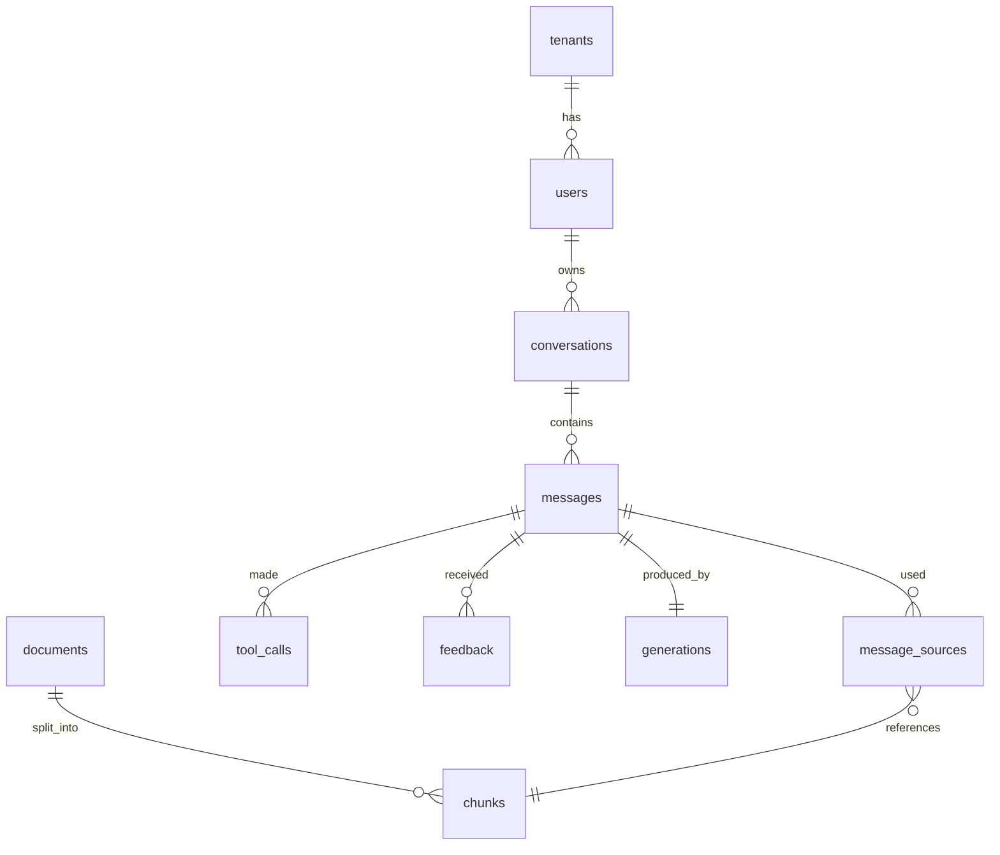
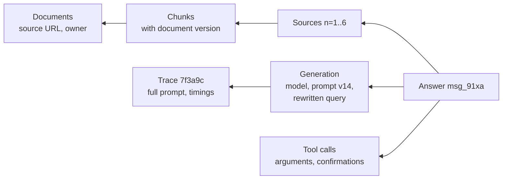

The app database stores what the assistant creates. Its most important job beyond serving the UI is **lineage**: for any answer, you must be able to show what it was built from. That is how you debug wrong answers, respond to audits, and handle deletion requests.

## Core schema



The tables below use Postgres. Every table carries `tenant_id`, and row-level security enforces it.

```sql
CREATE TABLE conversations (
  id            text PRIMARY KEY,             -- conv_...
  tenant_id     text NOT NULL,
  user_id       text NOT NULL,
  title         text,
  summary       text,                          -- running summary for long chats
  created_at    timestamptz NOT NULL DEFAULT now(),
  updated_at    timestamptz NOT NULL DEFAULT now(),
  deleted_at    timestamptz                    -- soft delete, hard delete by retention job
);

CREATE TABLE messages (
  id               text PRIMARY KEY,           -- msg_...
  tenant_id        text NOT NULL,
  conversation_id  text NOT NULL REFERENCES conversations(id),
  role             text NOT NULL CHECK (role IN ('user', 'assistant')),
  parent_id        text REFERENCES messages(id), -- supports edits and regenerations as branches
  client_id        uuid,                        -- idempotency from the browser
  status           text NOT NULL,               -- pending, done, stopped, failed, blocked
  content          jsonb NOT NULL,              -- typed parts: text, citations, tool cards
  created_at       timestamptz NOT NULL DEFAULT now(),
  UNIQUE (tenant_id, client_id)
);

-- One row per assistant message: how it was generated
CREATE TABLE generations (
  message_id       text PRIMARY KEY REFERENCES messages(id),
  tenant_id        text NOT NULL,
  model            text NOT NULL,              -- concrete model version actually used
  model_route      text NOT NULL,              -- logical name, e.g. answer
  fallback_used    boolean NOT NULL DEFAULT false,
  prompt_template  text NOT NULL,              -- e.g. answer
  prompt_version   text NOT NULL,              -- e.g. v14
  rewritten_query  text,
  input_tokens     int NOT NULL,
  output_tokens    int NOT NULL,
  cached_tokens    int NOT NULL DEFAULT 0,
  cost_usd         numeric(12,6) NOT NULL,
  ttft_ms          int,
  total_ms         int,
  trace_id         text NOT NULL,
  guardrail_flags  jsonb NOT NULL DEFAULT '[]'
);

-- Which chunks were given to the model, and which were cited
CREATE TABLE message_sources (
  message_id       text NOT NULL REFERENCES messages(id),
  tenant_id        text NOT NULL,
  n                int NOT NULL,               -- the citation number in the prompt
  chunk_id         text NOT NULL,
  document_id      text NOT NULL,
  document_version text NOT NULL,              -- content hash or source version at answer time
  rerank_score     real,
  cited            boolean NOT NULL DEFAULT false,
  PRIMARY KEY (message_id, n)
);

CREATE TABLE tool_calls (
  id            text PRIMARY KEY,
  tenant_id     text NOT NULL,
  message_id    text NOT NULL REFERENCES messages(id),
  tool          text NOT NULL,
  arguments     jsonb NOT NULL,
  status        text NOT NULL,                 -- proposed, confirmed, rejected, succeeded, failed
  confirmed_by  text,
  result        jsonb,
  created_at    timestamptz NOT NULL DEFAULT now()
);

CREATE TABLE feedback (
  id          text PRIMARY KEY,
  tenant_id   text NOT NULL,
  message_id  text NOT NULL REFERENCES messages(id),
  user_id     text NOT NULL,
  rating      smallint NOT NULL CHECK (rating IN (-1, 1)),
  reasons     text[] NOT NULL DEFAULT '{}',
  comment     text,
  created_at  timestamptz NOT NULL DEFAULT now()
);
```

### Design notes

- **`generations` is separate from `messages`.** Messages are what users see. Generations are how they were made. Keeping them apart keeps the hot message table small and lets you apply different retention and access rules.
- **`message_sources` stores the document version.** If the document changes later, you can still show what it said at answer time, or at least prove it changed.
- **`parent_id` makes branches possible.** Editing a question or regenerating an answer creates a sibling, not an overwrite.
- **`content` is JSON parts**, matching the frontend's message model. See [Chat UI](/docs/frontend/chat-ui).
- **Soft delete, then hard delete.** `deleted_at` hides data immediately. A retention job removes it for real. See [Retention and deletion](/docs/data/retention).

### Indexes

```sql
CREATE INDEX ON conversations (tenant_id, user_id, updated_at DESC) WHERE deleted_at IS NULL;
CREATE INDEX ON messages (conversation_id, created_at);
CREATE INDEX ON message_sources (tenant_id, document_id);  -- find answers that used a document
CREATE INDEX ON feedback (tenant_id, created_at) WHERE rating = -1;
CREATE INDEX ON generations (tenant_id, prompt_version);
```

The `message_sources` index on `document_id` matters for two real tasks: "which answers quoted this outdated policy?" and "delete everything derived from this document".

### Row-level security

```sql
ALTER TABLE messages ENABLE ROW LEVEL SECURITY;
CREATE POLICY tenant_isolation ON messages
  USING (tenant_id = current_setting('app.tenant_id'));
```

Set `app.tenant_id` at the start of each transaction from the verified request context. A query that forgets a tenant filter then returns nothing instead of another tenant's data.

## Lineage

Lineage is the chain from an answer back to everything that shaped it.



With this in place you can answer:

| Question | Query path |
| --- | --- |
| Why did the assistant say this? | Message, then generation and sources, then the trace for the exact prompt |
| Which answers used the old travel policy? | `message_sources` by `document_id`, filtered by `document_version` |
| Did quality drop after prompt v15 went live? | `generations` by `prompt_version`, joined with `feedback` |
| How much did this tenant spend on the fallback model? | `generations` where `fallback_used`, summed by cost |
| Who confirmed this ticket creation? | `tool_calls` by message |

### Full prompts

The schema above stores references, not the full prompt text. The full prompt is reconstructed from the template version, the chunks, and the history, or kept in the trace store. Storing full prompts in the main database duplicates large amounts of sensitive text and makes retention harder. If you do store them, put them in a separate table or store with a short retention period and restricted access.

## Analytics

Run analytics on a copy, not on the production database.

- Replicate to a warehouse with change data capture or nightly exports.
- **De-identify** before it lands: drop message text, or replace it with categories from a classifier. Keep IDs hashed, timestamps, token counts, costs, ratings, prompt versions, and models.
- Product questions, such as "which teams use the assistant most?" or "which prompt version has the best feedback?", rarely need message text.

## Checklist

- [ ] Every table has `tenant_id` with row-level security.
- [ ] Each assistant message has a generation record with model, prompt version, tokens, cost, and trace ID.
- [ ] Each assistant message records which chunks it received and which it cited, with document versions.
- [ ] Edits and regenerations are branches, not overwrites.
- [ ] Full prompts live in the trace store or a restricted table with short retention.
- [ ] Analytics run on a de-identified copy.
