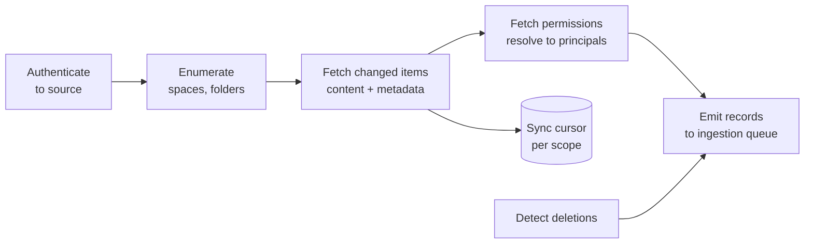

A connector is the code that reads from a source system such as Confluence, SharePoint, Google Drive, Notion, Jira, ServiceNow, or Salesforce. It fetches content, metadata, and permissions, and hands them to the ingestion pipeline. Connectors are unglamorous, and they decide whether the assistant knows anything at all.

## What a connector does



Every connector implements the same interface, so the pipeline does not care which system a document came from:

```ts
interface Connector {
  // Full listing, used for the first sync and periodic reconciliation
  listAll(scope: Scope): AsyncIterable<ItemRef>;
  // Changes since a cursor, used for incremental syncs
  listChanges(scope: Scope, cursor: string): AsyncIterable<Change>; // created, updated, deleted, permissions_changed
  fetch(ref: ItemRef): Promise<SourceDocument>; // content, metadata, ACL
  resolvePrincipals(acl: SourceAcl): Promise<string[]>; // map to user and group IDs
}
```

## Authentication to sources

| Approach | When | Notes |
| --- | --- | --- |
| Admin-installed app with org-wide read access | Indexing company-wide content | One install per tenant. Needs admin consent. Read-only scopes only |
| Per-user OAuth | Content only the user can see, such as their own mailbox | Each user connects. Index is per user |
| Service account with explicit sharing | Systems without app models | Admins share specific spaces with the account |

Always request **read-only** scopes for indexing. A connector should never be able to modify source content. Tools that write to these systems use separate, user-delegated credentials. See [Agents and tools](/docs/ai-model/agents-tools).

## Permissions

Copying permissions correctly is the hardest and most important part of a connector.

### Mapping to principals

Every source has its own permission model. The connector converts it into a flat list of principals that your system understands:

| Source concept | Becomes |
| --- | --- |
| Shared with a user | `user:alice@corp.com` |
| Shared with a group | `group:<idp-group-id>` |
| Space or site membership | The group or users of that space, or a synthetic `space:<id>` principal resolved at query time |
| "Anyone in the organization" | `tenant:all` |
| "Anyone with the link" | Treat as restricted to users who have opened it, or exclude. Never as public |
| Inherited from parent folder | Resolved at fetch time, or stored as a reference and resolved later |
| Explicit deny | Rare, but if supported, must be honored. Often easiest to exclude such documents |

Use the same identity namespace as your sign-in system, so `group:eng` in the index is the same group the user has in their token. Mismatched identities are a common reason users "cannot find" documents they can see in the source.

### Fail closed

- If the connector cannot read a document's permissions, do not index the document.
- If a principal cannot be mapped, drop it rather than widening access.
- Never default to `tenant:all`.

### Permission sync speed

Permission changes must reach the index faster than content changes. Target minutes. Approaches:

- Subscribe to the source's **change notifications** or audit events for sharing changes.
- Run a **permission-only sync** frequently. It is cheaper than a content sync because it fetches ACLs, not content.
- Run a full **reconciliation** periodically, such as weekly, to catch anything missed.

## Syncing changes

| Sync type | How | Frequency |
| --- | --- | --- |
| Initial full sync | Enumerate everything in scope | Once per connector |
| Incremental sync | Ask for changes since the last cursor, or receive webhooks | Every few minutes, or on webhook |
| Permission sync | Fetch ACLs for items in scope | Every few minutes to hourly |
| Reconciliation | Compare the full source listing with the index. Delete what is gone | Daily or weekly |

**Deletions are easy to miss.** Many APIs do not report deleted items in change feeds, or report them only for a short window. Reconciliation is what catches them. Without it, deleted documents stay searchable indefinitely.

### Cursors

Store a sync cursor per connector and scope, such as a timestamp or a change token. Advance it only after the batch it covers has been durably queued. If a sync crashes midway, it restarts from the last committed cursor, and idempotent ingestion makes the replay harmless.

## Rate limits and large sources

Source APIs have rate limits, often strict ones. A first sync of a large SharePoint tenant can take days.

- Respect `429` and `Retry-After` responses. Getting your app throttled or blocked by a customer's tenant is a serious incident.
- Run initial syncs at low priority, with progress visible to admins.
- Fetch content only for changed items. Use ETags or modification times to skip unchanged files.
- Parallelize across scopes, not within one, to stay within per-resource limits.

## Scope and filtering

Admins must control what gets indexed. Indexing everything by default is how an assistant ends up answering from an abandoned 2014 draft or someone's personal notes.

Offer:

- Include and exclude lists of spaces, sites, folders, or projects.
- File type filters.
- Age filters, such as excluding documents not modified in five years.
- Label-based exclusion, such as anything marked "Confidential - Legal hold" or with a sensitivity label your company uses.

Show admins a preview: how many documents are in scope before they start a sync.

## Common source quirks

| Source type | Watch out for |
| --- | --- |
| Wikis | Page hierarchies where permissions inherit from parents. Attachments with separate permissions. Macros that render content dynamically |
| File drives | Shortcuts and duplicates across folders. Shared drives vs personal drives. Very large files |
| Ticketing systems | Comments with different visibility (internal vs public). Huge histories. Attachments |
| CRM | Field-level security. Records owned by teams with complex sharing rules |
| Chat platforms | Volume. Private channels. Messages that only make sense in thread context |
| HR systems | The most sensitive data. Usually best accessed through specific tools with strict checks, not bulk indexing |

## Monitoring connectors

Track per connector and tenant:

- Last successful sync time, for content and for permissions.
- Items synced, failed, and skipped, with reasons.
- API errors and throttling.
- Lag: time between a change in the source and its arrival in the index.

Alert when a connector has not synced successfully within its expected window. A silently broken connector looks like the assistant getting gradually dumber. See [Pipelines and freshness](/docs/data/pipelines).

## Checklist

- [ ] Connectors use read-only scopes for indexing.
- [ ] Every indexed document has a resolved principal list, and documents with unreadable ACLs are skipped.
- [ ] Principals use the same identity namespace as sign-in.
- [ ] Permission changes sync within minutes.
- [ ] Reconciliation catches deletions.
- [ ] Sync cursors advance only after durable queuing.
- [ ] Source API rate limits are respected.
- [ ] Admins control scope and see a preview before syncing.
- [ ] Sync lag and failures are monitored and alerted.
