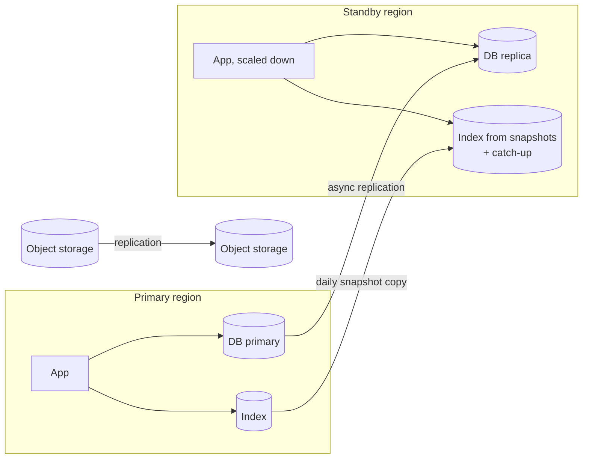

Disaster recovery covers failures beyond normal faults: a whole cloud region down, a primary model provider unavailable for hours, a corrupted index, or a destructive mistake in production data. [Reliability](/docs/backend/reliability) handles everyday failures. [Backups and recovery](/docs/data/backups) covers restoring individual stores. This page ties them into a plan.

## Scenarios

| Scenario | Impact without a plan | Strategy |
| --- | --- | --- |
| Primary model provider outage, hours | Assistant unusable | Fallback providers, pre-tested with current prompts |
| Model provider region outage | Unusable for tenants routed there | Fallback to another region within residency rules |
| Cloud region outage | Everything in that region down | Warm standby in a second region |
| Search index corruption or loss | No retrieval, hallucination risk if unhandled | Snapshot restore, degraded mode |
| Database corruption or bad migration | Data loss | Point-in-time restore |
| Accidental deletion (human or bug) | Data loss | Point-in-time restore, object versioning, deletion protection |
| Compromised credentials or account | Data exposure, destruction | Backups in a separate account, key rotation, incident response |
| Source system connector outage | Stale answers | Serve from index, show freshness, catch up after |

## Recovery targets

Set targets per scenario with the business. Example:

| Scenario | RTO | RPO |
| --- | --- | --- |
| Model provider outage | 5 minutes (automatic fallback) | None |
| Cloud region outage | 1 to 4 hours | 15 minutes |
| Index loss | 4 hours to degraded-but-working, 24 hours to fully current | 24 hours, then catch-up sync |
| Database corruption | 1 hour | 5 minutes |

Tighter targets cost more: hot standby regions double infrastructure cost. Pick targets that match what the assistant is worth to the business, and write them down. See [Backups and recovery](/docs/data/backups) for per-store targets.

## Model provider outage

This is the most likely major failure, and the easiest to prepare for.

- Every model route has a **fallback chain** across providers or regions. See [Model selection](/docs/ai-model/model-selection).
- Fallback models are **evaluated with current prompts** on every prompt change, not just when they were first set up.
- **Quota** on fallback providers must cover full production load, not a trickle. Confirm limits with the provider in advance. A fallback that gets rate limited at 10% of your traffic is not a fallback.
- **Residency rules apply to fallbacks.** A tenant that requires EU processing needs EU fallbacks.
- **Embeddings cannot fall back** to a different model. If the embedding provider is down, queries cannot be embedded. Options: a second deployment of the same embedding model in another region, keyword-only retrieval as a degraded mode, or a self-hosted copy of the embedding model if its license allows.

## Cloud region outage

Warm standby is a common balance:

- **Database**: cross-region replica with asynchronous replication. Promote on failover.
- **Object storage**: cross-region replication.
- **Index**: snapshots copied to the standby region, plus connector catch-up after failover. Restoring a large index takes time, so this is often the longest step.
- **App and workers**: deployed in standby at minimum scale, scaled up on failover. Infrastructure as code makes the standby identical.
- **Secrets and config**: replicated, or available in both regions.
- **DNS or global load balancing** to switch traffic.

Data residency limits where the standby can be. A tenant whose data must stay in the EU needs an EU standby region.

## Degraded modes

Decide in advance how the assistant behaves when parts are unavailable, so it degrades safely rather than failing badly.

| Component down | Degraded behavior |
| --- | --- |
| Primary model | Fallback model, with a subtle note if quality may differ |
| All generation models | Show a maintenance banner. Allow browsing past conversations |
| Re-ranker | Hybrid search results without re-ranking |
| Search index | Do not answer company questions without sources. Answer from user uploads only, or general help, with a clear notice |
| Guardrail service | Per guardrail fail-open or fail-closed setting. See [Reliability](/docs/backend/reliability) |
| Tool service or target system | Read-only answers. Tool actions disabled with a clear message |
| Connector | Serve from index with freshness dates visible |

The most dangerous degraded mode is the one nobody designed: an assistant that silently answers company questions without retrieval will invent policies.

## The recovery plan

Write a disaster recovery plan that someone who did not build the system can follow:

- Scenarios, with detection signals and the decision criteria for declaring a disaster.
- Roles: who decides on failover, who executes, who communicates.
- Step-by-step procedures for each scenario, with commands and links.
- Communication templates for customers and internal stakeholders.
- Contact details for cloud and model provider support, with account and contract identifiers.
- How to fail back to the primary region afterward.

Store it where it is available during an outage of your primary systems: not only in a wiki hosted in the region that just failed.

## Drills

| Drill | Frequency | Success criteria |
| --- | --- | --- |
| Force fallback for each model route in production for a short window | Monthly | Answers continue, quality within agreed margin, no residency violations |
| Restore database to a point in time in a test environment | Monthly | Restored within RTO, integrity checks pass |
| Restore index from snapshot and catch up | Quarterly | Retrieval evaluation passes, deletions replayed |
| Full region failover to standby | Yearly, or as contracts require | Service restored within RTO, data loss within RPO |
| Tabletop exercise for a data exposure incident | Twice a year | Team follows the plan, gaps recorded |

Record each drill's measured times and the problems found. Fix the problems. A drill that finds nothing is either perfect or not realistic enough.

## Checklist

- [ ] Recovery targets are written down per scenario and agreed with the business.
- [ ] Fallback models cover full load, respect residency, and are evaluated with current prompts.
- [ ] Embedding availability has its own fallback or degraded mode.
- [ ] A standby region exists, with database replication, storage replication, and index snapshots.
- [ ] Degraded modes are designed and tested for each component.
- [ ] The recovery plan is written, accessible during outages, and owned.
- [ ] Drills run on schedule with measured results and tracked fixes.
