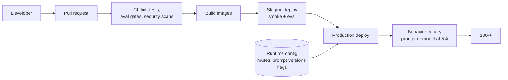

Deploying an AI assistant involves two kinds of change. **Code changes** behave like in any web service: tests pass or fail. **Behavior changes**, such as a new prompt version, a different model, a new chunking strategy, or a guardrail threshold, can pass every test and still make answers worse. The deployment process has to handle both.

## What gets deployed

| Artifact | Changes how often | Deployed by | Rollback |
| --- | --- | --- | --- |
| Application code (API, orchestrator, workers) | Daily | CI/CD pipeline, container images | Previous image |
| Frontend | Daily | CI/CD, static assets on a CDN | Previous build |
| Prompt templates | Weekly | Shipped with code, version selected by config | Config change to the previous version |
| Model routes | Monthly | Config change | Config change |
| Guardrail settings | As needed | Config change | Config change |
| Infrastructure | Weekly | Infrastructure as code pipeline | Revert and apply |
| Index (pipeline version, embedding model) | Rarely | Migration jobs, new index plus switch | Switch back to the old index |
| Self-hosted model weights | Rarely | Model serving deployment | Previous deployment |

The key design choice: **behavior is selected by configuration at runtime**, so prompt versions, model routes, and guardrail settings can be rolled out gradually and rolled back in seconds without a code deploy.

## The design

## Pages in this section

| Page | Covers |
| --- | --- |
| [Environments and CI/CD](/docs/deployment/environments) | Environments, pipeline stages, what runs where, secrets per environment |
| [Infrastructure](/docs/deployment/infrastructure) | Infrastructure as code, compute, scaling, and hosting models |
| [Rollouts](/docs/deployment/rollouts) | Releasing prompt, model, and retrieval changes safely, with canaries, flags, and rollback |
| [Disaster recovery](/docs/deployment/disaster-recovery) | Regional failure, provider failure, recovery plan, and drills |
