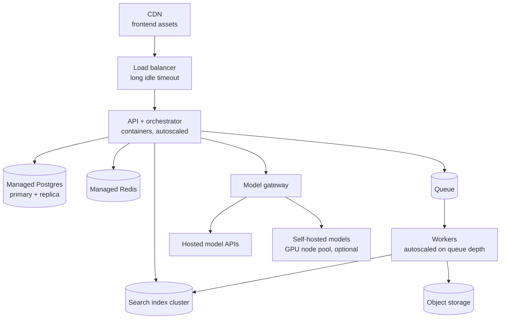

This page covers what the assistant runs on and how it scales. Most of it is a standard cloud setup. The parts that need special attention are long-lived streaming connections, bursty ingestion, the search index, and GPU hosting if you self-host models.

## Infrastructure as code

Define all infrastructure in code (Terraform, OpenTofu, Pulumi, or your cloud's native tool):

- Every environment is created from the same modules with different variables.
- Changes go through pull requests with a plan output for review.
- No manual changes in the console. Detect drift and alert on it.
- Regional stacks for data residency are the same modules instantiated per region. See [Data residency](/docs/compliance/data-residency).

## Reference layout

| Component | Typical hosting | Notes |
| --- | --- | --- |
| Frontend | CDN with static hosting or edge rendering | Cache static assets aggressively |
| API and orchestrator | Containers on Kubernetes or a managed container service | Stateless. Scale on concurrent streams, not CPU |
| Workers | Containers, separate deployment per worker type | Scale on queue depth and age |
| Postgres | Managed service with high availability | Separate instance for vector search if using pgvector at scale |
| Redis | Managed service | Rate limits, caches, stream replay |
| Search index | Managed OpenSearch, managed vector database, or self-managed cluster | Memory-heavy. Size for vectors in memory |
| Object storage | Cloud object storage | Versioning and lifecycle rules |
| Queue | Managed queue service | Dead letter queues configured |
| Model serving (optional) | GPU node pool with vLLM or similar | See below |

## Scaling the API

Chat requests are long-lived streams, mostly waiting on the model. A single instance can hold many concurrent streams, but each holds memory and a connection.

- **Scale on concurrent active streams** per instance, not CPU. CPU stays low while instances fill up with waiting connections.
- Use an async runtime (Node.js, Python asyncio, Go) so waiting streams do not occupy threads.
- Set **load balancer idle timeouts** above your longest gap between events, and send keep-alive comments. See [Sync and async work](/docs/backend/sync-async).
- Size **database connection pools** so that streams do not hold a database connection while waiting on the model. Acquire, query, and release.

## Scaling workers

Ingestion is bursty: a new tenant's initial sync can enqueue hundreds of thousands of documents at once.

- Autoscale workers on **queue depth and oldest message age**.
- Set a **maximum** worker count based on downstream limits: the embedding API rate limit and the index's write capacity. More workers than the embedding quota allows just produces 429s.
- Use separate deployments for parsing (CPU and memory heavy, sandboxed) and embedding (I/O bound, rate limited).
- Spot or preemptible instances work well for workers, since jobs are idempotent and retried.

## The search index

| Concern | Guidance |
| --- | --- |
| Memory | Vector indexes such as HNSW perform best when they fit in memory. Estimate: vectors times dimensions times 4 bytes, plus graph overhead of roughly 1.5 to 2 times |
| Example sizing | 10 million chunks at 1,024 dimensions is about 40 GB of raw vectors, so plan for 60 to 80 GB of index memory before replicas |
| Reducing memory | Smaller embedding dimensions, quantization (int8 or binary), or disk-based indexes, with recall measured after each change |
| Replicas | At least two for availability, more for query throughput |
| Tenant layout | Namespaces or indexes per tenant for isolation and deletion. Watch per-index overhead with many small tenants |
| Write and read isolation | Heavy re-indexing can slow queries. Throttle bulk writes, or build new indexes on separate capacity and switch |

## Self-hosted models

Only if you have decided to self-host. See [Key decisions](/docs/architecture/decisions).

### Serving

- Use a serving engine designed for LLMs: **vLLM**, **TGI**, **TensorRT-LLM**, or **SGLang**. They provide continuous batching, paged attention for efficient memory, streaming, and OpenAI-compatible APIs.
- Expose them to the model gateway as one more provider.

### Sizing

| Factor | Effect |
| --- | --- |
| Model size | Weights must fit in GPU memory. A 70B parameter model in 16-bit needs about 140 GB for weights alone, so multiple GPUs. Quantization reduces this |
| Context length and concurrency | The KV cache grows with tokens in flight across all requests. Long contexts with high concurrency need much more memory than the weights |
| Throughput target | Tokens per second across all users, at peak |
| Latency target | Larger batches raise throughput but also per-request latency |

Load test with realistic prompt and output lengths, and measure tokens per second and TTFT at your target concurrency before committing to hardware.

### Scaling GPUs

- GPU instances take minutes to start and load weights. Scale ahead of demand using schedules for known peaks, and keep headroom.
- Keep a minimum number of replicas warm. Cold starts in the request path are unacceptable for chat.
- Use the hosted API as overflow and fallback when self-hosted capacity is exhausted, if data rules allow.
- Watch **GPU utilization**. Idle GPUs are expensive. If average utilization is low, self-hosting may cost more than hosted APIs.

## Cost controls for infrastructure

- Tag every resource with environment, component, and team.
- Shut down preview environments automatically after pull requests close.
- Scale non-production environments to zero outside working hours.
- Review the largest cost items monthly: index memory, GPU nodes, database instances, and egress.

## Checklist

- [ ] All infrastructure is defined in code, reviewed, and drift-monitored.
- [ ] API instances scale on concurrent streams, with long idle timeouts and keep-alives.
- [ ] Database connections are not held during model calls.
- [ ] Workers autoscale on queue depth, capped by downstream rate limits.
- [ ] The index is sized for vectors in memory, with at least two replicas.
- [ ] Bulk re-indexing cannot degrade query latency.
- [ ] Self-hosted models use an LLM serving engine, are load tested, and keep warm replicas.
- [ ] Resources are tagged, and non-production environments scale down when idle.
