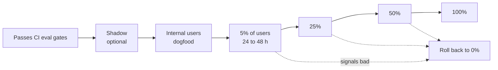

Code deploys and behavior changes need different release strategies. A code deploy is usually all or nothing, protected by tests. A behavior change, such as a new prompt or model, is better released gradually: its effect on real questions is only fully visible in production, and some quality signals take hours to show.

## What gets a behavior rollout

| Change | Rollout | Rollback speed |
| --- | --- | --- |
| Prompt template version | Canary by percentage | Seconds (config) |
| Model route (new model or provider) | Canary by percentage | Seconds (config) |
| Retrieval parameters (top-k, threshold, re-ranker) | Canary by percentage | Seconds (config) |
| Guardrail thresholds | Shadow mode, then canary | Seconds (config) |
| Chunking or embedding change | New index, shadow evaluation, then switch | Minutes (switch back to old index) |
| New tool | Feature flag per tenant, then wider | Seconds (flag) |
| New feature | Feature flag per tenant or user group | Seconds (flag) |

## Assignment

Assign users, not individual requests, to variants. A user who gets different prompt versions on every message has an inconsistent experience, and their signals become hard to interpret.

```ts
function variantFor(ctx: RequestContext, rollout: Rollout): string {
  // Stable per user: the same user always lands in the same bucket for this rollout
  const bucket = hash(`${rollout.id}:${ctx.userId}`) % 100;
  return bucket < rollout.percent ? rollout.candidate : rollout.current;
}
```

Include the rollout ID in the hash, so different rollouts get independent buckets and the same users are not always the canaries.

Record the variant on every generation (prompt version and model are already stored), so every metric can be split by variant.

## Stages of a rollout



### Shadow mode

Run the new version alongside the current one on real traffic, without showing its output to users. Compare offline.

- Useful for **guardrails** (would the new threshold block more or less?) and **retrieval** (does the new configuration retrieve different chunks?), where you can compare outputs without a user seeing them.
- Expensive for full answer generation, since you pay for two answers. Use a sample.
- Shadow traffic must follow the same data rules as production: same providers, regions, and retention.

### Internal users first

Roll out to employees of your own company, or a pilot group, before customers. They tolerate rough edges and give detailed feedback.

### Canary

At each stage, compare candidate and control:

| Signal | When it becomes meaningful | Automatic rollback? |
| --- | --- | --- |
| Error rate, fallback rate | Minutes | Yes, on clear increase |
| TTFT, total latency | Minutes | Yes, on clear increase |
| Input and output tokens, cost per answer | Minutes | Alert |
| Guardrail block rate | An hour | Alert |
| Not found rate | Hours | Alert |
| Sampled groundedness | Hours | Alert |
| Thumbs down, regenerations | Hours to days | Human decision |

Hold each stage long enough for slow signals to accumulate. A 24 hour minimum at 5% covers a full daily usage cycle.

## Rollback

Rollback must be fast, rehearsed, and possible without a deploy.

- Behavior changes roll back by **config change**: set the rollout percentage to 0, or point the route back to the previous version.
- On-call can roll back without approval. Investigate after.
- Rolling back a prompt version does not touch conversations already answered. Their generation records still show the version used.
- For index changes, keep the **old index** until the new one has been at 100% for long enough to be trusted, often a week or two.

## Model migrations

Moving to a new model, often forced by provider deprecations, is the largest behavior change you will make regularly.

1. **Start early.** Note deprecation dates for every pinned model. Begin migration at least two to three months ahead.
2. **Evaluate offline** on all datasets, including slices and safety. Expect to adjust prompts: what worked for one model often needs changes for another.
3. **Check non-functional fit**: latency, cost, rate limits, region availability, data terms.
4. **Canary** as above, with extra attention to tool use and citation formats, which models handle differently.
5. **Update fallback chains** so the fallback is also tested with current prompts.
6. **Record** the migration in the model records and system card.

## Index migrations

For chunking, parsing, or embedding changes that alter the index:

1. Build the **new index** in the background from raw copies.
2. Keep both indexes updated with new changes during the migration.
3. Run **retrieval evaluation** against both.
4. **Shadow** retrieval on live queries: compare which chunks each index returns.
5. Switch **reads** for a canary percentage, then all traffic.
6. Keep the old index for rollback, then delete it.

## Feature flags

Use a feature flag system for new features and tools:

- Flags evaluated per tenant and per user group.
- Defaults off for new capabilities, enabled for internal tenants first.
- Admin-facing toggles for tenants to opt in to preview features.
- Remove flags once a feature is fully launched. Old flags become hidden complexity.

## Checklist

- [ ] Prompt versions, model routes, retrieval parameters, and guardrails roll out by config with percentage canaries.
- [ ] Assignment is stable per user and independent per rollout.
- [ ] Every generation records the variant used.
- [ ] Canary stages compare candidate and control, with automatic rollback on errors and latency.
- [ ] Each stage runs long enough for slow quality signals.
- [ ] On-call can roll back any behavior change in seconds without a deploy.
- [ ] Model migrations start months before deprecation, and include prompt adjustment and fallback testing.
- [ ] Index changes use a parallel index with shadow evaluation and a kept rollback path.
