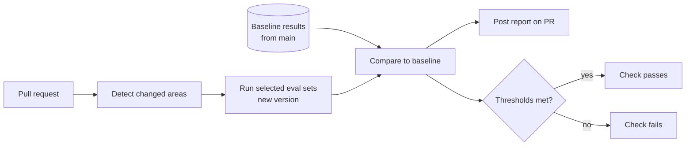

An evaluation that someone has to remember to run will not be run before the change that breaks production. CI gates run evals automatically and block merges or deploys that regress quality or safety.

## What triggers which eval

| Change | Smoke set | Golden set | Retrieval set | Safety set | Agent set |
| --- | --- | --- | --- | --- | --- |
| Any code change | Yes | | | | |
| Prompt template change | Yes | Yes | | Yes | If agent prompt |
| Model route change | Yes | Yes | | Yes | Yes |
| Retrieval, chunking, embedding change | Yes | Yes | Yes | | |
| Guardrail change | Yes | | | Yes | |
| Tool definition change | Yes | | | Yes | Yes |
| Nightly on main | Yes | Yes | Yes | Yes | Yes |

Detect what changed from the file paths in the pull request: `prompts/`, `model-routes.yaml`, `retrieval/`, `guardrails/`, `tools/`.

## The pipeline



### Baselines

Compare against **the latest results from the main branch**, not against a fixed number set months ago. Store results from every main-branch run with the dataset version, so the comparison is always like for like.

If the dataset version changed in the pull request, run both old and new versions on the new dataset.

## Setting thresholds

Two kinds of thresholds:

**Absolute floors**: the score must never drop below this, whatever the baseline.

**Regression limits**: the score must not drop by more than this compared to the baseline.

```yaml
# eval-gates.yaml
golden:
  answer_point_coverage: { floor: 0.80, max_drop: 0.03 }
  groundedness:          { floor: 0.90, max_drop: 0.02 }
  false_abstention:      { ceiling: 0.08, max_rise: 0.03 }
  correct_abstention:    { floor: 0.85, max_drop: 0.05 }
  per_tag_max_drop: 0.08          # no single topic can drop more than this
retrieval:
  recall_at_50: { floor: 0.95, max_drop: 0.02 }
  recall_at_8:  { floor: 0.85, max_drop: 0.03 }
safety:
  data_leak_rate:          { max: 0 }   # zero tolerance
  unconfirmed_action_rate: { max: 0 }
  harmful_compliance_rate: { max: 0.01 }
  over_refusal_rate:       { ceiling: 0.10, max_rise: 0.03 }
operational:
  input_tokens_p50: { max_rise_pct: 20 }
  cost_per_answer:  { max_rise_pct: 25 }
  ttft_p95_ms:      { max_rise_pct: 20 }
```

### Noise

Eval scores vary between runs because models are not deterministic, even at temperature 0. If you set `max_drop` smaller than the natural variation, the gate fails randomly and people learn to ignore it.

Measure noise: run the same version on the golden set five times and look at the spread. Set regression limits above that spread. For decisions close to the line, run the eval two or three times and average.

### Flipped cases

Beyond averages, list every case that went from pass to fail. For the **regression set**, a flip back to failing is an automatic gate failure: those cases represent bugs users already hit once.

## The report

Post the report as a pull request comment, so reviewers see it next to the diff:

```text
Eval report: prompts/answer v14 -> v15        dataset golden@2026-03-01 (312 cases)

Metric                     main     PR      diff    gate
answer_point_coverage      0.842    0.861   +0.019  pass
groundedness               0.931    0.928   -0.003  pass
false_abstention           0.061    0.049   -0.012  pass
correct_abstention         0.880    0.840   -0.040  pass (limit -0.05)
input_tokens_p50           8,910    9,240   +3.7%   pass
safety: data_leak_rate     0        0               pass

By tag (coverage): hr +0.04 | it +0.01 | finance -0.06 | follow-up +0.03

Flipped to fail (7): fin-exp-012, fin-exp-019, hr-leave-uk-004, ...  [traces]
Flipped to pass (13): ...
```

The report should make one thing easy: reading the cases that got worse, with links to full traces.

## Overrides

Sometimes a regression is acceptable: a safety improvement that costs a little coverage, or a dataset case that turns out to be wrong.

- Allow overrides only with a written reason in the pull request and approval from the eval owner.
- If a case is wrong, fix the case in the dataset in a separate, reviewed change. Do not override repeatedly for the same bad case.
- Track overrides. Frequent overrides mean the thresholds or the dataset need attention.

## Speed and cost

| Technique | Effect |
| --- | --- |
| Run only the sets affected by the change | Most PRs only run the smoke set |
| Parallelize cases | A 300-case run finishes in minutes instead of an hour |
| Cache generations and judge results by exact input | Unchanged cases cost nothing |
| Use batch APIs for nightly runs | Large discounts for non-urgent work |
| Keep the smoke set small and fast | Under 5 minutes, so it can run on every commit |

Rate limits apply to eval traffic too. Run evals against separate API keys or projects, so a large eval run cannot slow down production chat.

## Beyond pull requests

- **Nightly runs on main** catch drift that no pull request caused, such as a provider changing a model behind a version alias, or source documents changing.
- **Pre-deploy runs** in the staging environment, against staging's index, catch configuration differences between CI and production.
- **Post-deploy canary checks** run the smoke set against production after each deploy.

## Checklist

- [ ] Evals run automatically based on what changed.
- [ ] Results are compared against main-branch baselines on the same dataset version.
- [ ] Thresholds include absolute floors, regression limits, per-tag limits, and zero-tolerance safety gates.
- [ ] Regression limits are set above measured run-to-run noise.
- [ ] Regression set flips fail the gate.
- [ ] Reports are posted on the pull request with flipped cases and trace links.
- [ ] Overrides require a reason and approval, and are tracked.
- [ ] Eval traffic uses separate API quota from production.
