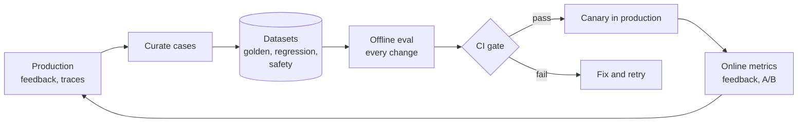

In normal software, a test passes or fails, and the same input gives the same output. AI systems are different: outputs vary between runs, "correct" is often a judgment call, and a change that fixes one case can quietly break twenty others. Without systematic evaluation, every prompt edit, model upgrade, or retrieval tweak is a guess.

Evaluation is how you replace "it looks better on the three examples I tried" with "it scores 4 points higher on 300 representative cases, with no regressions in the safety set".

## The evaluation loop

The loop is what matters. Production reveals failures. Failures become test cases. Test cases block regressions. Changes go to production gradually, and production reveals the next failures.

## Layers of evaluation

| Layer | What it checks | When | Page |
| --- | --- | --- | --- |
| Component evals | Retrieval recall, query rewrite quality, guardrail accuracy, tool selection | On changes to that component | [Metrics](/docs/evaluation/metrics) |
| End-to-end evals | Final answer correctness, grounding, citations, format | On every prompt, model, or retrieval change | [Metrics](/docs/evaluation/metrics) |
| Safety evals | Refusals of harmful requests, resistance to injection, no data leaks | On every change, as a hard gate | [Red teaming](/docs/evaluation/red-teaming) |
| Online signals | Feedback, regenerations, escalations, A/B results | Continuously | [Online evaluation](/docs/evaluation/online) |
| Human review | Expert grading of samples | Weekly or per release | [LLM-as-judge](/docs/evaluation/llm-judge) |

Component evals are what make debugging possible. If an end-to-end score drops, the component scores tell you whether retrieval, the prompt, or the model is responsible.

## What "good" means for this assistant

Write down quality criteria before building evals. For the reference assistant:

| Criterion | Definition |
| --- | --- |
| Correct | The answer's claims match the source documents |
| Grounded | Every company-specific claim is supported by a cited source |
| Complete | The answer covers what the question asked, including important conditions and exceptions |
| Honest about gaps | When sources lack the answer, it says so instead of guessing |
| Well cited | Citations point to the passage that supports the sentence they follow |
| Concise and clear | Direct answer first, no filler, appropriate formatting |
| Safe | No leaked data, no harmful content, no actions without confirmation |
| Permission-correct | Never uses content the user cannot access |

Each criterion maps to one or more metrics. Criteria that do not map to a metric are not being evaluated.

## Who owns evaluation

Evaluation fails when it is everyone's job. Assign:

- An **owner for each dataset**, who keeps it current and representative.
- **Domain experts** (HR, legal, IT) who define correct answers in their area and review samples. Engineers cannot judge whether an answer about parental leave in Germany is right.
- An **AI engineer** who maintains the eval harness, judges, and CI gates.

## Pages in this section

| Page | Covers |
| --- | --- |
| [Datasets](/docs/evaluation/datasets) | Building golden, regression, and safety datasets that represent real use |
| [Metrics](/docs/evaluation/metrics) | Retrieval, answer, citation, safety, and operational metrics, and how to compute them |
| [LLM-as-judge](/docs/evaluation/llm-judge) | Using models to grade answers, calibrating them against humans, and their limits |
| [CI gates](/docs/evaluation/ci-gates) | Running evals on every change and blocking regressions |
| [Online evaluation](/docs/evaluation/online) | Feedback, implicit signals, A/B tests, and canaries in production |
| [Red teaming](/docs/evaluation/red-teaming) | Attacking the system on purpose to find safety and security failures |
