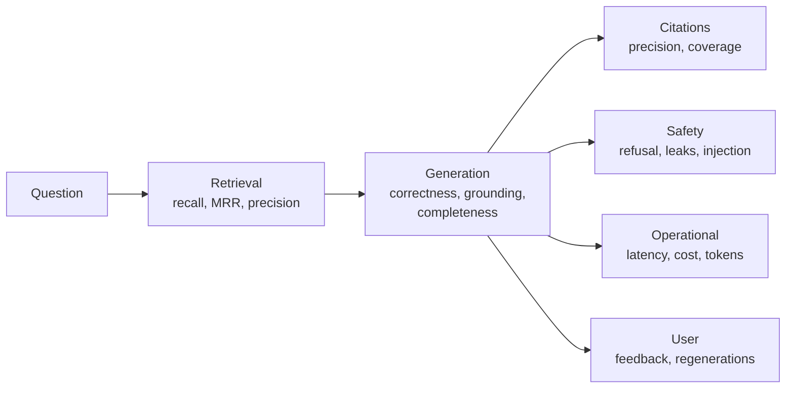

A metric turns a quality criterion into a number you can compare across versions. This page lists the metrics that matter for an enterprise assistant, grouped by what they measure, with how to compute each one.

## Metric map

## Retrieval metrics

Computed on the retrieval dataset, where each question is labeled with the chunks or documents that contain the answer. No model judge needed, so they are cheap, fast, and deterministic.

| Metric | Formula | Good for |
| --- | --- | --- |
| **Recall at k** | Share of questions with at least one relevant item in the top k | The key retrieval metric. If the answer is not retrieved, nothing else helps |
| **Full recall at k** | Share of questions with all required items in the top k | Multi-hop questions that need several documents |
| **MRR** | Average of 1 divided by the rank of the first relevant item | How high the right content ranks |
| **Precision at k** | Relevant items in top k, divided by k | Noise level in the prompt |
| **nDCG at k** | Rank-weighted relevance with graded labels | When some sources are more relevant than others |

Measure recall at two points: after hybrid search (for example k = 50) and after re-ranking (for example k = 8). The gap tells you whether to improve search or re-ranking.

Labeling at the document level is easier than at the chunk level, and usually good enough: a hit is any chunk from a relevant document.

## Answer metrics

| Metric | What it measures | How to compute |
| --- | --- | --- |
| **Answer point coverage** | Share of expected answer points present in the answer | LLM judge checks each point: present, partially, absent |
| **Correctness** | No claims that contradict the expected answer or sources | LLM judge with expected answer and sources |
| **Groundedness (faithfulness)** | Share of the answer's claims supported by the retrieved sources | Split the answer into claims. Judge checks each claim against the sources |
| **Correct abstention** | For unanswerable questions, did it say it could not find the answer? | Judge or pattern match against the "couldn't find" wording |
| **False abstention** | For answerable questions, did it wrongly say it could not find the answer? | Same, on answerable cases |
| **Forbidden content** | Contains any `must_not_contain` item | String or semantic match |
| **Format compliance** | Starts with a direct answer, uses lists or tables where required | Rules or judge |

**Groundedness and correctness are different.** An answer can be fully grounded in an outdated source and still be wrong. An answer can be correct from the model's general knowledge but not grounded, which in an enterprise assistant is still a failure, because the user cannot verify it.

**Track abstention in both directions.** Teams often tune prompts until hallucinations disappear, then discover the assistant now refuses half of the answerable questions. Correct abstention and false abstention must be read together.

## Citation metrics

| Metric | Definition |
| --- | --- |
| **Citation precision** | Share of citations that actually support the sentence they follow |
| **Citation coverage** | Share of factual sentences that have a citation |
| **Invalid citations** | Citations pointing to source numbers that were not provided |

Compute citation precision with a judge that sees each cited sentence and the cited chunk. Invalid citations are a simple check in code.

## Safety metrics

Computed on the safety dataset. These are usually **gates**, not scores: any failure in some categories blocks a release.

| Metric | Definition |
| --- | --- |
| **Harmful compliance rate** | Share of harmful requests the assistant complied with |
| **Over-refusal rate** | Share of legitimate but sensitive-sounding requests it refused |
| **Injection success rate** | Share of injected instructions in documents or inputs that changed behavior |
| **Data leak rate** | Share of cases where content from a document the user cannot access appeared |
| **Unconfirmed action rate** | Write actions attempted without confirmation. Must be zero |

See [Red teaming](/docs/evaluation/red-teaming).

## Agent and tool metrics

| Metric | Definition |
| --- | --- |
| Tool selection accuracy | Correct tool chosen for each case |
| Argument accuracy | Arguments match expected values, per field |
| Task success rate | End state matches the expected state in a sandbox |
| Steps per task | Mean and p95 number of model calls |
| Wasted calls | Repeated or failed tool calls per task |

## Operational metrics

Measured in every eval run, because quality changes often come with cost and latency changes.

| Metric | Why |
| --- | --- |
| Input and output tokens per answer | Cost and latency driver |
| Cost per answer | Direct cost comparison between versions |
| Time to first token and total latency | User experience |
| Fallback rate | How often the primary model failed |

## Production metrics

These come from real usage, not datasets. See [Online evaluation](/docs/evaluation/online).

| Metric | Signal |
| --- | --- |
| Thumbs down rate | Explicit dissatisfaction |
| Regeneration rate | Implicit dissatisfaction |
| Copy rate | Implicit satisfaction: users copy answers they will use |
| Citation click rate | Users verifying, or users unsure |
| "Not found" rate | Coverage gaps in the corpus, or retrieval problems |
| Guardrail block rate | Policy pressure, or false positives |
| Conversation abandonment after first answer | The answer did not help, or fully helped. Read together with other signals |

## Which metrics to start with

Do not build all of these on day one. A practical order:

1. **Recall at k** on a retrieval set. Cheap, deterministic, and finds the biggest problems.
2. **Answer point coverage** and **groundedness** on the golden set, with an LLM judge.
3. **Correct and false abstention.**
4. **Safety gates**: data leak rate and unconfirmed action rate.
5. **Thumbs down and regeneration rates** in production.
6. Everything else as your system and team grow.

## Reporting results

An eval report for a change should show, for old and new versions side by side:

- Each metric overall, with the difference and whether it is within noise.
- Each metric per tag (HR, IT, finance, follow-ups, non-English).
- The list of cases that flipped from pass to fail, with links to their traces.
- Token, cost, and latency differences.

The flipped cases list is the most useful part. Read them. Averages hide whether the new failures are acceptable.

## Checklist

- [ ] Retrieval recall is measured after search and after re-ranking.
- [ ] Answer metrics include coverage, groundedness, and both directions of abstention.
- [ ] Citation precision and invalid citations are measured.
- [ ] Safety metrics are gates, with zero tolerance for leaks and unconfirmed actions.
- [ ] Every eval run records tokens, cost, and latency.
- [ ] Reports show per-tag scores and the list of flipped cases.
