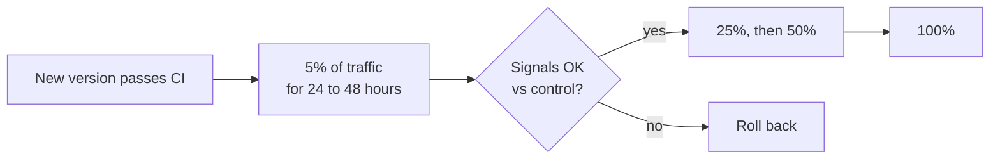

Offline evaluation tells you how a change performs on cases you thought of. Production tells you how it performs on everything users actually do. Online evaluation is how you listen, and how you decide whether a change really improved the assistant.

## Signals from production

### Explicit feedback

Thumbs up and down with optional reasons. See [Chat UI](/docs/frontend/chat-ui).

- Typically only 1 to 5 percent of answers get any feedback, and negative feedback is over-represented. Use it as a signal for **finding failures**, not as an accurate quality score.
- Reasons ("wrong", "outdated", "missing sources") route issues: "outdated" usually points to content owners, "wrong" to retrieval or the prompt.

### Implicit signals

These exist for every answer, not just the few with feedback.

| Signal | Usually means | Caveat |
| --- | --- | --- |
| Regenerate | Dissatisfied with the answer | Some users regenerate to see alternatives |
| Rephrase the same question immediately | The answer missed | Detect with similarity between consecutive user messages |
| Copy answer text | Found it useful | Strong positive signal |
| Click citation | Verifying, or unsure | Neutral alone. Useful combined with feedback |
| Stop generation early | Wrong direction, or already got the answer | Read with what follows |
| Conversation ends after first answer | Satisfied, or gave up | Ambiguous alone |
| Escalation to a human channel | Assistant failed to resolve | Strong negative, if your system links to support |

Combine signals into a simple **answer outcome** label: likely good (copied, positive feedback, no follow-up rephrase), likely bad (thumbs down, regenerated, rephrased), or unknown. Track the share of each over time.

### Sampled grading

Run the same LLM judges used offline on a random sample of production answers, for example 1 to 2 percent. Groundedness and citation precision work without reference answers, since they only need the answer and its sources. This gives you a quality trend with no labeling effort.

Respect privacy rules: sampled grading processes real conversations, so it must be covered by your data processing terms, and results should store scores, not content copies.

## Dashboards

| Panel | Purpose |
| --- | --- |
| Thumbs down rate, by topic and by tenant | Where quality is weakest |
| Regeneration and rephrase rates | Implicit dissatisfaction trend |
| Sampled groundedness and citation precision | Hallucination trend |
| "Not found" rate, with top unanswered topics | Content gaps to fix at the source |
| Guardrail block rate, with false positive reports | Policy tuning |
| Quality metrics split by prompt version and model | Effect of each release |

Split everything by prompt version and model. When a metric moves, the first question is always "what changed?"

## Canary releases

Every change to prompts, models, or retrieval goes to a small share of traffic first.

During the canary, compare canary and control on:

- Error and fallback rates (fast signal, minutes).
- Guardrail block rate and latency (fast).
- Thumbs down, regeneration, and rephrase rates (slow, needs hours to days of traffic).
- Sampled groundedness (medium).

Roll back automatically on hard signals such as error rate spikes. Decide on soft signals such as feedback rates by looking at the data, since they are noisy at small traffic shares.

See [Rollouts](/docs/deployment/rollouts) for the mechanics.

## A/B tests

Use a proper A/B test when you want to know whether a change improves outcomes, not just whether it is safe.

- **Randomize by user, not by message.** A user who gets different behavior on each message has a confusing experience, and their messages are not independent.
- **Choose one primary metric** in advance, such as the "likely bad" outcome rate, and a few guardrail metrics that must not get worse, such as latency and cost.
- **Estimate the sample size** before starting. Feedback-based metrics are noisy, and detecting a one point change can need tens of thousands of answers.
- **Run for full weeks.** Usage on Monday morning differs from Friday afternoon.
- **Do not stop early** when the result looks good. Peeking and stopping inflates false positives.

For most changes in a young product, canary plus offline evals is enough. Reserve A/B tests for decisions where the offline evaluation cannot capture the effect, such as a change in answer style or length.

## From production failures to test cases

This is the loop that makes quality improve over time.

1. Every week, collect the week's negative signals: thumbs down, regenerations, escalations, low sampled grades.
2. Triage a sample with the trace view. Classify the cause: retrieval miss, bad source content, prompt issue, model error, guardrail false positive, out of scope.
3. Fix what is fixable. Route content problems to document owners.
4. Add the case, de-identified, to the regression set with the correct expected answer.
5. Track the categories over time. If retrieval misses dominate, invest there.

| Cause | Typical owner | Typical fix |
| --- | --- | --- |
| Retrieval miss | AI engineer | Chunking, contextual headers, query rewrite, re-ranker |
| Outdated or conflicting source | Content owner | Archive old documents, fix the source |
| Not in corpus | Content owner or admin | Add the source or connector |
| Prompt issue | AI engineer | Prompt change, evaluated |
| Guardrail false positive | Safety owner | Tune the guardrail |
| Permission confusion | Admin | Fix group membership or explain access |

## Checklist

- [ ] Explicit feedback and implicit signals are collected for every answer.
- [ ] Signals are combined into an answer outcome label and tracked over time.
- [ ] A sample of production answers is graded with the offline judges.
- [ ] Dashboards split quality by prompt version, model, topic, and tenant.
- [ ] Every prompt, model, or retrieval change goes through a canary with comparison to control.
- [ ] A/B tests randomize by user, with a pre-set primary metric and sample size.
- [ ] Negative signals are triaged weekly and become regression cases.
