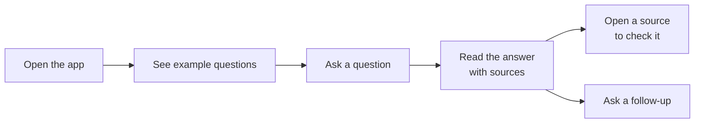

Good interfaces are not drawn in one go. Designers move through a few steps, and each step settles one question before any visual detail is decided. This page follows the process from Juxtopposed's [world's shortest UI/UX design course](https://www.youtube.com/watch?v=wIuVvCuiJhU), a seven-minute video worth watching alongside it.

| Step | Question it answers | Result |
| --- | --- | --- |
| 1. User flow | What is the user trying to do, and what path gets them there? | A map of steps |
| 2. Wireframes | What goes on each screen, and where? | Rough layouts with no color or style |
| 3. Design system | What do the building blocks look like? | Colors, type, icons, and components |
| 4. Design | How do the blocks come together? | Finished screens and a clickable prototype |

## 1. Start with the user flow

Begin with the problem, not the screen. Write down who the user is and the one goal they came for. Then map the shortest path from the moment they arrive to the moment that goal is done.

For an AI assistant that answers questions about company policies, the main flow might be:

Every step you remove makes the product easier to use. Every screen you add later must serve a step in this flow.

## 2. Sketch wireframes

Turn each step into a screen and sketch its layout: boxes for content, lines for text, labels for buttons. No colors, fonts, or images yet.

Wireframes are cheap on purpose. You can draw five versions in ten minutes, show them to someone, and throw away four. Moving a box in a sketch takes seconds. Moving it in a finished design takes hours.

Pen and paper works. So do whiteboard tools such as FigJam, or wireframing tools such as Balsamiq and Figma.

For each screen, ask: does it help the user finish a step in the flow? If not, it does not belong.

## 3. Define a design system

A design system is the set of building blocks every screen is made from. Decide them once, and every screen matches.

| Block | What to decide |
| --- | --- |
| Color | Background and text colors, a primary color for main actions, and colors with meaning such as error, warning, and success |
| Typography | One or two typefaces, and a small set of sizes for body text, small text, and headings |
| Icons | One style, such as outlined or filled, used everywhere |
| Components | Buttons, inputs, cards, and menus, each with its states such as hover, disabled, and loading |

These choices set the product's character. A typeface alone can make a product feel playful, serious, or elegant. An internal tool for a legal team should not look like a game.

A design system can be small. A few colors, three text sizes, and a handful of components is already one. You do not have to invent it either: most teams start from an existing component library and adjust it.

## 4. Design, then test

Build the final screens from your wireframes and your design system. As you go, check each screen against six principles:

| Principle | What it means | Learn more |
| --- | --- | --- |
| Hierarchy | The most important thing is the most noticeable | [Visual design](/docs/frontend/basics/visual-design#hierarchy) |
| Contrast | Elements stand apart and text stays readable | [Visual design](/docs/frontend/basics/visual-design#color-and-contrast) |
| Balance | Spacing and alignment feel even and organized | [Visual design](/docs/frontend/basics/visual-design#spacing) |
| Consistency | The same thing looks and behaves the same everywhere | [Visual design](/docs/frontend/basics/visual-design#consistency) |
| Simplicity | Nothing on screen that the user does not need | [Usability](/docs/frontend/basics/usability#fewer-choices-clearer-path) |
| Feedback | Every action gets a visible response | [Feedback and states](/docs/frontend/basics/feedback) |

Use real text, not placeholder text. Placeholder text hides problems: a label that is too long, an answer that does not fit, an error message that makes no sense. For an AI product, fill the screens with real questions and real model answers, including long answers and bad ones.

Then link the screens into a clickable prototype, put it in front of real users, and fix what confuses them. Design is a loop, not a straight line. Testing often sends you back to the flow or the wireframes.
