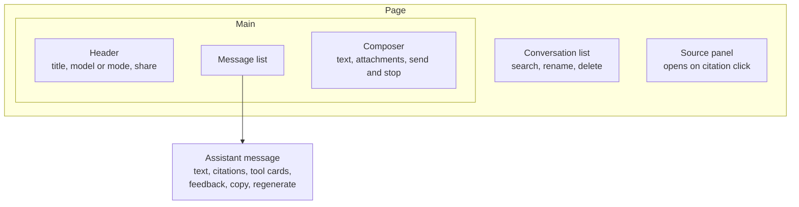

The chat UI looks simple: a list of messages and a text box. The details are what make it trustworthy and usable for work. This page goes through each part and the decisions behind it.

## Anatomy



## Messages

### User messages

Show them immediately when sent, before the server confirms. If sending fails, keep the message visible with a retry action. Never silently drop text the user typed. Losing a carefully written question is one of the most frustrating failures in any chat product.

Allow editing the last user message. Editing creates a new branch of the conversation: the old answer is replaced by a new one generated from the edited text. Keep the old version reachable with a small "1 of 2" switcher, because users often want to compare.

### Assistant messages

An assistant message is more than text. It is a container for several parts, each rendered by its own component:

| Part | Purpose |
| --- | --- |
| Text | The answer, rendered as safe markdown |
| Citations | Numbered markers inline, plus a source list at the end |
| Tool cards | What the assistant did or wants to do, such as "Searching tickets" or "Create ticket? Confirm or cancel" |
| Status line | "Searching 3 sources", "Thinking", or "Stopped" |
| Actions | Copy, regenerate, thumbs up and down, report |
| Metadata on hover | Time, and for internal users the model and trace ID |

Model the message as a list of typed parts, not one string. Then a tool card can appear between two paragraphs, and the renderer does not have to parse text to find it.

```ts
type MessagePart =
  | { type: 'text'; text: string }
  | { type: 'citation'; n: number; sourceId: string }
  | { type: 'tool'; callId: string; name: string; status: 'running' | 'awaiting_confirmation' | 'done' | 'failed'; summary?: string };

type AssistantMessage = {
  id: string;
  status: 'streaming' | 'done' | 'stopped' | 'failed' | 'blocked';
  parts: MessagePart[];
  sources: Source[];
};
```

## Citations

Citations are the single most important trust feature in an enterprise assistant. Users act on answers, such as booking travel or replying to a customer, and they need to check the source quickly.

**Inline markers.** Render `[1]` as a small chip next to the claim it supports. Hovering shows the source title and a snippet. Clicking opens the source panel.

**Source panel.** Shows the document title, where it lives (wiki, drive, ticket), when it was last updated, and the exact passage that was used, highlighted. Include a link to open the original. Showing the passage is better than linking to a 40-page PDF, because the user can verify in seconds.

**Source list.** At the end of the message, list every source used, numbered to match the markers.

**Freshness.** Show the source's last-updated date. A travel policy from 2021 might be outdated, and the user should see that without opening it.

**No sources found.** When retrieval finds nothing relevant, the message should say so clearly: "I could not find this in the documents you have access to." It must not look like a normal answer without citations, or users will trust an answer that came from the model's general knowledge.

## Feedback

Feedback is your cheapest source of evaluation data. Make it one click.

- **Thumbs up and down** on every assistant message.
- After thumbs down, offer optional reasons as chips: "Wrong", "Outdated", "Not helpful", "Missing sources", "Unsafe". Add a free text box, but never require it.
- Send the message ID, the reason, and the trace ID. The backend can then join feedback to the exact prompt and sources.
- Tell users what happens with feedback, for example "Your feedback is reviewed by the assistant team." This sets expectations and is often a privacy requirement.

See [Evaluation](/docs/evaluation) for how feedback becomes test cases.

## Stop and regenerate

**Stop** must be visible during streaming, usually by turning the send button into a stop button. Stopping aborts the request on the client and tells the server to cancel generation, so you stop paying for tokens nobody will read. Keep the partial answer and mark it as stopped.

**Regenerate** creates a new answer for the same question. Keep previous answers reachable with the version switcher. Regenerate is also a quality signal: frequent regenerations on a topic mean the answers there are poor.

## The composer

| Feature | Detail |
| --- | --- |
| Multi-line input | Enter sends, Shift+Enter adds a line. Support the reverse as a setting. On mobile, Enter adds a line |
| Auto-grow | Grows up to about 40% of the viewport, then scrolls |
| Draft persistence | Save the draft per conversation in local storage, so switching chats or refreshing does not lose it |
| Disabled while streaming | Either block sending or queue the next message. Blocking is simpler and less surprising |
| Character or token limit | Show a counter near the limit, not all the time. Enforce the limit on the server too |
| Paste handling | Large pastes, such as a whole log file, should become an attachment rather than flooding the input |

### Attachments

When a user attaches a file:

1. Upload it directly to object storage with a pre-signed URL. Do not stream large files through your API servers.
2. Show the file as a chip with a progress bar.
3. After upload, the backend starts an ingestion job. Show "Processing" until the file is parsed and ready.
4. Only enable send when processing is done, or allow sending and let the backend wait. Tell the user which one happens.
5. Show clear errors for unsupported types, files over the size limit, password-protected PDFs, and scanned PDFs that need OCR.

## Tool confirmations

When the assistant wants to take an action with side effects, the UI must show exactly what will happen before it happens.

A good confirmation card shows:

- The action in plain words: "Create IT ticket".
- The exact values that will be sent, as a readable form: title, description, priority, assignee.
- Which system it affects: "ServiceNow, IT queue".
- Buttons: **Confirm**, **Edit**, **Cancel**.

Let the user edit the values before confirming. The model often gets one field slightly wrong, and editing is faster than re-prompting.

After confirming, show the result with a link to the created item. If the action fails, show the error from the target system in plain words.

Never auto-confirm based on the text of the user's message, such as "yes do it". The confirmation must be a click on the card, so a prompt injection in a document cannot fake the user's approval.

## Conversation list

- Title each conversation automatically from the first exchange, using a small model. Let users rename it.
- Group by date: Today, Previous 7 days, Older.
- Search titles first, and message content if you can.
- Delete must really delete, or clearly say how long data is kept. See [Data retention](/docs/data/retention).
- Sharing a conversation is a permissions problem. Shared conversations can expose sources the viewer cannot access. Either re-check sources against the viewer's permissions, or share only the text with sources hidden.

## Checklist

- [ ] User messages appear instantly and are never lost on failure.
- [ ] Assistant messages are typed parts, not one string.
- [ ] Every factual answer shows citations that open the exact passage.
- [ ] "No sources found" looks clearly different from a sourced answer.
- [ ] Feedback is one click and carries the trace ID.
- [ ] Stop cancels generation on the server.
- [ ] Tool actions with side effects require an explicit click on a confirmation card that shows the exact values.
- [ ] Drafts survive refresh and chat switching.
