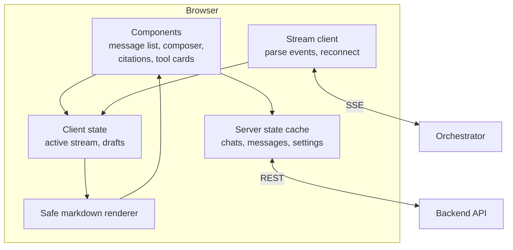

The frontend is where users decide whether to trust the assistant. A correct answer that arrives as a frozen spinner for eight seconds, then dumps a wall of text with no sources, feels worse than a slightly weaker answer that streams in immediately with clickable citations. This section covers how to build a frontend that makes AI output fast, verifiable, and safe to display.

## What is different about an AI frontend

A normal CRUD app sends a request and renders a response. An AI frontend has to handle things most web apps never meet:

| Challenge | Why it is hard | Page |
| --- | --- | --- |
| Responses arrive as a stream over many seconds | You render incomplete markdown, keep scroll position sensible, and allow stopping midway | [Streaming](/docs/frontend/streaming) |
| Output is untrusted text written by a model | Model output can contain HTML, scripts, or malicious links copied from a poisoned document | [Rendering output](/docs/frontend/rendering) |
| Answers must be verifiable | Users need to see which source supports which sentence | [Chat UI](/docs/frontend/chat-ui) |
| State changes mid-message | A message goes through pending, streaming, tool confirmation, done, or failed | [State management](/docs/frontend/state) |
| Failures are frequent and varied | Rate limits, provider outages, blocked content, and dropped streams all need distinct handling | [Error and empty states](/docs/frontend/error-states) |
| Screen readers and live text conflict | Announcing every streamed token makes the app unusable with assistive technology | [Accessibility and i18n](/docs/frontend/accessibility) |
| Perceived speed is everything | Time to first token is the metric users feel | [Performance](/docs/frontend/performance) |

## The design



Three kinds of state live in the browser, and keeping them separate is the main structural decision:

- **Server state**: chats, past messages, user settings, documents. Fetched over REST and cached. A library like TanStack Query or SWR handles caching, refetching, and invalidation.
- **Stream state**: the message currently being generated. It changes many times per second and must not trigger refetches or re-render the whole app.
- **UI state**: the draft in the composer, which panel is open, which citation is highlighted.

## A typical stack

These docs are framework-neutral, but most teams land on something close to this:

| Concern | Common choice | Why |
| --- | --- | --- |
| Framework | React with Next.js, or Vue with Nuxt | Large ecosystem of chat and markdown components |
| Server state | TanStack Query or SWR | Caching and invalidation without hand-written code |
| Stream state | A small store such as Zustand, or `useReducer` | Frequent updates without context re-render storms |
| Streaming transport | Native `fetch` with a stream reader, or `EventSource` | No extra dependency. See [Streaming](/docs/frontend/streaming) |
| Markdown | `react-markdown` with `remark-gfm`, plus a sanitizer | Renders tables and lists, with no raw HTML |
| Code highlighting | Shiki or Prism, loaded lazily | Highlighting libraries are large |
| Styling | Tailwind CSS or a design system | Consistent spacing and typography for long text |

## Folder structure

Group code by feature, not by file type. An AI app has a few large features, and each has its own components, hooks, and types.

```text
src/
  features/
    chat/
      components/      MessageList, Message, Composer, CitationChip, ToolCard
      hooks/           useChatStream, useSendMessage, useAutoScroll
      stream/          parseSSE.ts, events.ts (typed event definitions)
      state/           chatStore.ts (stream state)
    documents/         upload, list, status of ingestion jobs
    admin/             usage, connectors, settings
  shared/
    markdown/          SafeMarkdown, CodeBlock
    api/               fetch client, auth token refresh
    ui/                buttons, dialogs, toasts
```

Put the event types in one file and share them with the backend if you can, for example from a shared package or generated from a schema. When the backend adds a new event type, the frontend should fail to compile, not silently ignore it.

## What the frontend must never do

- **Never call model providers directly from the browser.** API keys would be exposed, and you lose rate limiting, guardrails, logging, and permission checks.
- **Never render model output as raw HTML.** Treat it like user input from a stranger.
- **Never decide permissions.** Hiding a button is a convenience. The backend enforces access.
- **Never build prompts.** The frontend sends the user's message and settings. Prompt assembly belongs to the orchestrator, where it is versioned and logged.

## Pages in this section

| Page | Covers |
| --- | --- |
| [Chat UI](/docs/frontend/chat-ui) | Message layout, citations, feedback, stop and regenerate, attachments, tool confirmations |
| [Streaming](/docs/frontend/streaming) | SSE protocol, parsing, reconnecting, cancelling, auto-scroll |
| [State management](/docs/frontend/state) | Message lifecycle, optimistic updates, server state vs stream state |
| [Rendering output](/docs/frontend/rendering) | Safe markdown, partial markdown, code blocks, links, citations |
| [Accessibility and i18n](/docs/frontend/accessibility) | Screen readers and streaming, keyboard use, languages and RTL |
| [Error and empty states](/docs/frontend/error-states) | Every failure the user can see, and what to show for each |
| [Performance](/docs/frontend/performance) | Time to first token, long conversations, bundle size |
