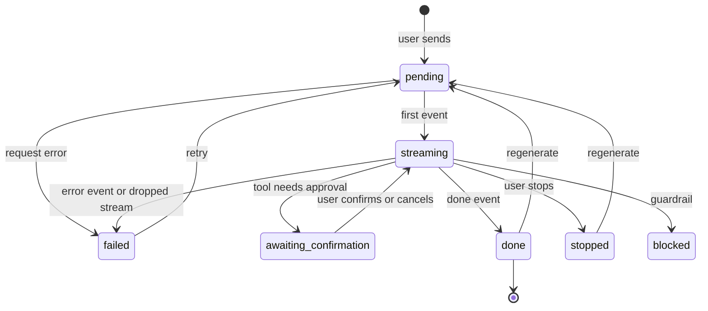

Chat state looks simple until two things happen at once: the user switches conversations while an answer is streaming, or clicks regenerate while a stop request is in flight. This page shows a state model that stays correct under those conditions.

## Three kinds of state

| Kind | Examples | Where it lives | Updated by |
| --- | --- | --- | --- |
| Server state | Conversation list, past messages, settings, uploaded documents | Query cache (TanStack Query, SWR) | REST calls and invalidation |
| Stream state | The message being generated right now: text so far, parts, status | A small store with selectors | SSE events |
| UI state | Composer draft, open panels, highlighted citation | Component state, local storage for drafts | User input |

The common mistake is putting stream state into the query cache. Every token then triggers cache writes and re-renders of anything subscribed to that conversation. Keep the active stream separate, and write the final message into the cache once, when the stream ends.

## Message lifecycle

Every message moves through a fixed set of states. Write them down as a state machine and allow only the listed transitions. Most chat UI bugs are a message stuck in a state it should have left, or reaching a state through a path that was never designed.



| State | What the UI shows |
| --- | --- |
| `pending` | User message visible, assistant placeholder with a subtle loading indicator |
| `streaming` | Text appearing, stop button active |
| `awaiting_confirmation` | Tool confirmation card, stream paused |
| `done` | Full message, actions enabled |
| `stopped` | Partial text, "Stopped" label, regenerate action |
| `failed` | Error message with retry, partial text kept if any |
| `blocked` | Notice explaining the content could not be shown |

Implement it as a reducer so every transition is explicit:

```ts
type Status = 'pending' | 'streaming' | 'awaiting_confirmation' | 'done' | 'stopped' | 'failed' | 'blocked';

const allowed: Record<Status, Status[]> = {
  pending: ['streaming', 'failed'],
  streaming: ['awaiting_confirmation', 'done', 'stopped', 'failed', 'blocked'],
  awaiting_confirmation: ['streaming', 'failed'],
  done: ['pending'],
  stopped: ['pending'],
  failed: ['pending'],
  blocked: [],
};

function transition(msg: Message, next: Status): Message {
  if (!allowed[msg.status].includes(next)) {
    console.warn(`Ignored transition ${msg.status} -> ${next} for ${msg.id}`);
    return msg;
  }
  return { ...msg, status: next };
}
```

Ignoring invalid transitions, instead of applying them, protects against late events. A `token` event that arrives after the user pressed stop should not flip the message back to `streaming`.

## Optimistic updates

When the user sends a message:

1. Create a client ID with `crypto.randomUUID()`.
2. Insert the user message and an empty assistant message into the stream store immediately.
3. Send the request with the client ID.
4. When the `meta` event arrives, record the server's message ID next to the client ID.
5. When `done` arrives, write both messages into the query cache under their server IDs and clear the stream store.

If the request fails before any event arrives, mark the user message as failed and keep its text, with a retry button. Retrying reuses the same client ID, so the server can deduplicate.

## Race conditions to design for

### Switching conversations during a stream

Options:

- **Keep streaming in the background.** The store is keyed by conversation ID, so the stream keeps writing to the right conversation. When the user comes back, the answer is there. This is the better experience.
- **Abort on switch.** Simpler, but users lose answers they were waiting for.

Whichever you choose, never key the stream store by "current conversation". Key it by conversation ID and message ID. Otherwise tokens from conversation A appear in conversation B after a switch.

### Regenerate while a previous stream is still closing

Each stream gets a **generation token**, such as an incrementing number. Event handlers check that their token is still the current one before writing. Late events from an old stream are discarded.

```ts
const gen = ++currentGeneration[messageId];
for await (const ev of readSSE(res)) {
  if (currentGeneration[messageId] !== gen) break; // a newer stream took over
  handle(ev);
}
```

### Two tabs open on the same conversation

Both tabs show the conversation. One tab sends a message. The other tab does not know until it refetches. Options:

- Refetch the conversation when a tab gains focus. Cheap, and covers most cases.
- Use a `BroadcastChannel` to tell other tabs that a message was sent.
- Push updates from the server over a live connection, if you already have one.

Start with refetch on focus.

## Cache invalidation

| Action | Invalidate |
| --- | --- |
| Message completes | The conversation's messages, and the conversation list (for updated time and title) |
| Conversation renamed or deleted | The conversation list |
| Feedback given | Nothing, update the message in the cache directly |
| Document upload finishes | The documents list |
| Settings changed | Settings, and anything that depends on them, such as the available models |

## Drafts

Save the composer draft to local storage keyed by conversation ID, debounced by about 500 ms. Clear it when the message is sent successfully, not when send is clicked, so a failed send does not lose the text.

Do not store drafts that might contain sensitive data longer than needed. Clear drafts older than a few days on load.

## Checklist

- [ ] Stream state is separate from the server state cache.
- [ ] Message status is a state machine with explicit allowed transitions.
- [ ] Messages have client IDs, and retries reuse them.
- [ ] The stream store is keyed by conversation and message ID, never by "current conversation".
- [ ] Stale events from replaced streams are discarded.
- [ ] Drafts are saved per conversation and cleared only after a successful send.
