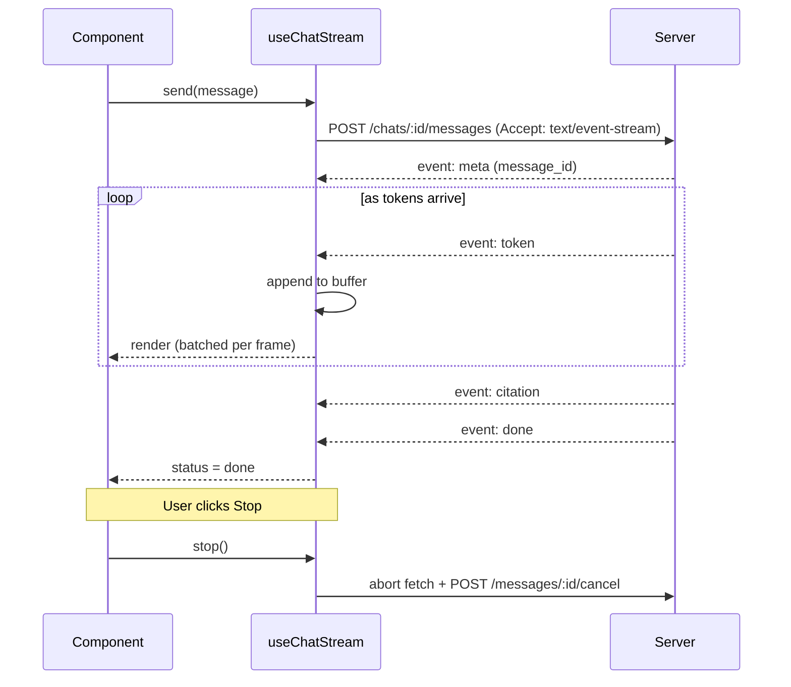

Streaming turns a 10 second wait into text that starts appearing within about a second. It is the most important performance feature in an AI frontend. It is also where most frontend bugs live: half-parsed events, duplicated text after reconnects, and scroll jumping while the user is reading.

## The design



## Transport: SSE

Use **server-sent events (SSE)**: a normal HTTP response with `Content-Type: text/event-stream` that stays open while the server writes events.

| Option | Use it when | Notes |
| --- | --- | --- |
| `fetch` with a stream reader | Default for chat | Supports `POST` bodies and custom headers such as `Authorization`. You parse SSE yourself |
| `EventSource` | Simple `GET` streams, such as job progress | Built-in reconnect, but only `GET` and no custom headers |
| WebSocket | The client also streams to the server, such as live voice | More infrastructure: sticky sessions, separate auth, heartbeats |

Chat needs `POST` with a body and an auth header, so use `fetch`.

## Event protocol

Agree on a small set of typed events with the backend. Every event has a name and a JSON payload.

| Event | Payload | Frontend action |
| --- | --- | --- |
| `meta` | `message_id`, `conversation_id` | Store the server ID for this message |
| `status` | `text`, such as "Searching documents" | Show in the status line |
| `token` | `text` | Append to the current text part |
| `citation` | `n`, `source_id`, `title`, `url`, `snippet` | Register the source so `[n]` markers become chips |
| `tool_call` | `call_id`, `name`, `args`, `status` | Render or update a tool card |
| `error` | `code`, `message`, `retryable` | Stop streaming and show the right error state |
| `done` | `usage`, `finish_reason` | Mark the message done |

Give every event an `id`. The id lets the client resume after a dropped connection.

## Parsing SSE from fetch

SSE is text: events are separated by a blank line, and each line is `field: value`. The tricky part is that a network chunk can end in the middle of a line or even in the middle of a multi-byte character. Always buffer and split on complete events.

```ts
export async function* readSSE(res: Response) {
  const reader = res.body!.pipeThrough(new TextDecoderStream()).getReader();
  let buffer = '';
  while (true) {
    const { value, done } = await reader.read();
    if (done) break;
    buffer += value;
    let sep: number;
    // An event ends with a blank line
    while ((sep = buffer.indexOf('\n\n')) !== -1) {
      const raw = buffer.slice(0, sep);
      buffer = buffer.slice(sep + 2);
      let event = 'message';
      let id: string | undefined;
      const data: string[] = [];
      for (const line of raw.split('\n')) {
        if (line.startsWith(':')) continue; // keep-alive comment
        const i = line.indexOf(':');
        const field = i === -1 ? line : line.slice(0, i);
        const val = i === -1 ? '' : line.slice(i + 1).replace(/^ /, '');
        if (field === 'event') event = val;
        else if (field === 'data') data.push(val);
        else if (field === 'id') id = val;
      }
      if (data.length) yield { event, id, data: JSON.parse(data.join('\n')) };
    }
  }
}
```

`TextDecoderStream` handles multi-byte characters split across chunks. Without it, emoji and non-Latin scripts break into garbage characters at random.

## Rendering without jank

Tokens can arrive 50 to 100 times per second. Re-rendering a long markdown message for each token makes the page stutter.

- **Batch updates per animation frame.** Append tokens to a buffer and flush to state once per `requestAnimationFrame`. Users cannot see faster updates anyway.
- **Only re-render the streaming message.** Completed messages are memoized and never re-render while another streams.
- **Keep the stream state outside of global context.** A context update re-renders every consumer. Use a store with selectors, so only the streaming message subscribes to the text.

```ts
let pending = '';
let scheduled = false;
function onToken(text: string) {
  pending += text;
  if (!scheduled) {
    scheduled = true;
    requestAnimationFrame(() => {
      store.appendText(messageId, pending);
      pending = '';
      scheduled = false;
    });
  }
}
```

## Stopping

Stopping must do two things:

1. **Abort the fetch** with an `AbortController`. This stops the browser from reading.
2. **Tell the server to cancel**, with `POST /messages/:id/cancel`. Aborting the HTTP connection does not always reach the model call behind several proxies. An explicit cancel lets the orchestrator stop the model call and stop paying for tokens.

Keep the partial text, set status to `stopped`, and show a regenerate action.

## Reconnecting

Mobile networks drop, laptops sleep, and proxies close idle connections. Decide what happens when the stream breaks before `done`.

**Option 1, retry the whole message.** Simple. The server must treat the retry as the same message by using the client message ID, or the user gets two answers.

**Option 2, resume from the last event.** The server keeps recent events per message for a few minutes, for example in Redis. The client reconnects with `GET /messages/:id/stream` and the header `Last-Event-ID`. The server replays events after that ID and continues live. This is better for long answers but needs server support.

Whichever you choose:

- Show "Reconnecting" after the stream has been silent for about 5 seconds past the keep-alive interval.
- Stop after 3 attempts and show a retry button.
- Never append replayed tokens twice. Track the last applied event ID and skip anything at or before it.

## Auto-scroll

Users hate two things: the page not following new text, and the page yanking them back down while they are reading earlier text.

The rule: **follow the stream only while the user is at the bottom.**

- Track whether the viewport is within about 80 px of the bottom.
- If yes, scroll to the bottom when new content renders.
- If the user scrolls up, stop following and show a "Jump to latest" button.
- When the user sends a new message, scroll their message to the top of the viewport, so the answer has room to appear below it.

Use `overflow-anchor` in CSS or an `IntersectionObserver` on a sentinel element at the bottom, rather than reading scroll positions on every token.

## Testing streaming

Streaming bugs only appear with real timing. Test with:

- A mock server that sends tokens with random delays and splits events across chunks at random byte positions.
- Very slow first tokens, over 30 seconds, to check timeouts and keep-alives.
- Network throttling and offline mode in browser dev tools.
- Non-Latin text and emoji, to catch decoding bugs.
- Rapid stop and regenerate clicks, to catch race conditions between two streams.

## Checklist

- [ ] SSE is parsed with a buffer that handles events split across chunks.
- [ ] Text is decoded with `TextDecoderStream`.
- [ ] Token updates are batched per animation frame.
- [ ] Only the streaming message re-renders.
- [ ] Stop aborts the fetch and calls the cancel endpoint.
- [ ] Reconnects never duplicate text.
- [ ] Auto-scroll follows only when the user is at the bottom.
