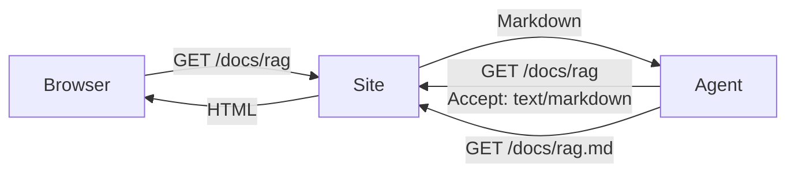

## What this site is

A reference for AI system design. Each page covers one design, such as a RAG system. Every page explains:

- **The design**: a diagram of the components and how data flows between them.
- **Why each component exists**: the problem it solves and what breaks without it.
- **Trade-offs**: the choices you face, what each one costs, and when to pick it.

The goal is to help you reason about a design, not to copy a fixed recipe.

## Who it is for

AI engineers who design, build, or review AI systems, and the agents those engineers work with.

## Read it yourself

Pick a topic in the sidebar. Each page is self-contained, so you can start anywhere.

## Give it to your agent

Every page has one URL. The same URL serves HTML to browsers and markdown to agents, so your agent can read a page and send you back to the same link.

| Need | Use |
| --- | --- |
| Index of all topics and their URLs | `/llms.txt` |
| Every page in one file | `/llms-full.txt` |
| One page as markdown | Add `.md` to the page URL, for example `/docs.md` |
| One page as markdown, same URL | Send the header `Accept: text/markdown` |

To use the site as a knowledge base, give your agent the root `/llms.txt` URL. The agent can find the right page from the index, fetch it as markdown, and cite the page URL in its answer.

Diagrams are written in Mermaid, so agents read the same diagram source that the site renders for people.
