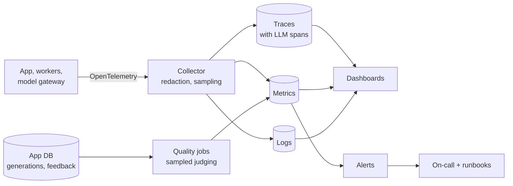

When a user says "the assistant gave me a wrong answer yesterday", you need to find that answer, see exactly what the model was given, and tell whether retrieval, the prompt, the model, or the source data was at fault. When latency doubles at 9 a.m., you need to know which step slowed down. Observability is what makes those questions answerable in minutes instead of days.

## What is different for AI systems

Traditional observability asks "is it up, and is it fast?" AI systems add "is it **right**?", and the answer is not visible in status codes. A request can return `200` in 2 seconds with a confidently wrong answer.

| Traditional signal | AI addition |
| --- | --- |
| Request rate, errors, latency | Time to first token, tokens per second, stalled streams |
| Error logs | Guardrail blocks, abstentions, fallbacks, tool rejections |
| Resource usage | Token usage and cost per request, tenant, and feature |
| Traces across services | Prompt, retrieved chunks, model, and prompt version inside the trace |
| Uptime SLOs | Quality signals: feedback, groundedness samples, "not found" rate |
| Dependency health | Model provider health per model and region |

## The design

Use **OpenTelemetry** for instrumentation. It is vendor-neutral, and its semantic conventions for generative AI define standard attribute names for model calls, so tools can understand your traces. The collector is also where you apply redaction and sampling before data leaves your network.

## The three questions

| Question | Answered by | Page |
| --- | --- | --- |
| What happened in this one request? | Traces, with prompts and retrieved chunks | [Tracing](/docs/observability/tracing) |
| What is happening across all requests right now? | Metrics, dashboards, SLOs | [Metrics and SLOs](/docs/observability/metrics-slos) |
| Is answer quality changing? | Quality monitoring | [Quality monitoring](/docs/observability/quality-monitoring) |

Supporting pages:

| Page | Covers |
| --- | --- |
| [Logging](/docs/observability/logging) | Structured logs, what to log and not log, correlation |
| [Runbooks and incidents](/docs/observability/runbooks) | Alert response, common incidents, on-call, postmortems |

## Principles

- **One trace ID everywhere.** From the browser request through every service and model call, stored on the message record and shown to users as a reference.
- **Content is sensitive.** Prompts and outputs in traces are restricted, redacted, and short-lived. Metrics and logs carry no content.
- **Tag everything with the dimensions you will filter by**: tenant, feature, model, prompt version, route, region.
- **Alert on symptoms users feel**, not on every internal error.
- **Every alert has a runbook.** An alert without instructions wakes someone up to guess.
