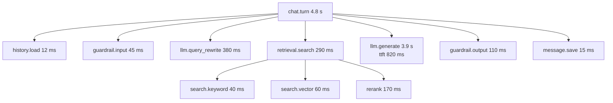

A trace is the full story of one request: every step, its timing, and the data that matters for debugging. For an AI assistant, a good trace answers "why did it say that?" by showing the rewritten query, the retrieved chunks with scores, the exact prompt version, the model's response, and every tool call.

## Shape of a chat trace

Reading this trace, you can immediately see that generation dominated, time to first token was 820 ms, and retrieval was healthy.

## Span attributes

Use OpenTelemetry's generative AI semantic conventions where they exist, such as `gen_ai.request.model` and `gen_ai.usage.input_tokens`, and add your own under a namespace for the rest.

### Root span: `chat.turn`

| Attribute | Example |
| --- | --- |
| `tenant.id` | `ten_acme` |
| `user.id_hash` | `u_5e1f...` |
| `conversation.id`, `message.id` | IDs |
| `app.feature` | `chat`, `upload_qa`, `agent` |
| `app.outcome` | `answered`, `not_found`, `blocked`, `failed`, `stopped` |
| `app.ttft_ms`, `app.total_ms` | Timing as the user felt it |

### Model call span: `llm.generate`

| Attribute | Example |
| --- | --- |
| `gen_ai.system` | Provider name |
| `gen_ai.request.model` | Requested model |
| `gen_ai.response.model` | Model that actually served the request |
| `app.model_route` | `answer` |
| `app.fallback_used` | `false` |
| `app.prompt.template`, `app.prompt.version` | `answer`, `v14` |
| `gen_ai.request.max_tokens`, `gen_ai.request.temperature` | Settings |
| `gen_ai.usage.input_tokens`, `gen_ai.usage.output_tokens` | Usage |
| `app.usage.cached_tokens` | Prompt cache hits |
| `app.cost_usd` | Computed cost |
| `app.ttft_ms`, `app.max_inter_token_ms` | Streaming health |
| `gen_ai.response.finish_reasons` | `stop`, `length`, `tool_calls` |

### Retrieval span: `retrieval.search`

| Attribute | Example |
| --- | --- |
| `app.query.rewritten` | Restricted content. See below |
| `app.retrieval.candidates` | 50 |
| `app.retrieval.returned` | 8 |
| `app.retrieval.top_score` | 0.74 |
| `app.retrieval.chunk_ids` | List of IDs with scores |
| `app.retrieval.filters` | Tenant and principal count (not the full list) |

### Tool span: `tool.execute`

| Attribute | Example |
| --- | --- |
| `app.tool.name` | `create_it_ticket` |
| `app.tool.kind` | `write` |
| `app.tool.confirmation` | `confirmed`, `rejected`, `not_required` |
| `app.tool.target_status` | Target system response code |

## Prompt and output content

The most useful debugging data is the actual prompt and response. It is also the most sensitive. Handle it deliberately.

| Option | Detail | Use when |
| --- | --- | --- |
| No content in traces | Only IDs, counts, and scores. Reconstruct prompts from template version and chunk IDs when needed | Strictest tenants, regulated data |
| Content in a separate restricted store | Spans carry a pointer. Content stored with short retention and access logging | Default for most systems |
| Content in span attributes | Simple, but content flows wherever traces flow | Development and staging only |

Recommended default:

- Store prompts and outputs as **events or attachments in a restricted content store**, keyed by span ID, with a 7 to 30 day retention.
- Apply **redaction** (secrets, high-risk PII) before storing.
- Restrict access to people who need it, and **log every view**.
- Let tenants turn content capture off.

Reconstruction from IDs is a useful fallback: since prompts are versioned templates and chunks have IDs and versions, you can rebuild most prompts later even without stored content. See [Schema and lineage](/docs/data/schema).

## Propagation

The trace ID must flow through everything:

- **Browser to server**: send a `traceparent` header (W3C Trace Context) from the frontend, or start the trace at the gateway and return the trace ID in a response header.
- **Service to service**: OpenTelemetry instrumentation propagates context automatically over HTTP and gRPC.
- **Queues and jobs**: put the trace context into the job payload, and link the job's spans to the trace that created it.
- **Streams**: the stream's `meta` event includes the trace ID, so the frontend can show it.
- **Model providers**: some providers accept a request ID or metadata. Send your trace ID so provider support can find your request.

## Sampling

Tracing every request in full can be expensive at scale.

- **Keep 100 percent** of traces with errors, fallbacks, guardrail blocks, negative feedback, and high latency. Use tail-based sampling in the collector, which decides after the trace completes.
- **Sample** a percentage of normal successful traces, such as 10 to 20 percent.
- Feedback arrives after the trace completes. Store the trace ID on the message, and keep at least span metadata for all requests, so a later thumbs down can still be investigated.

## Tooling

You can use a general observability platform with OpenTelemetry, a specialized LLM observability tool (many are open source and self-hostable), or both. Check:

- Can it show prompts, retrieved documents, and outputs in a readable way?
- Can it be self-hosted or run in your region, given the content it holds?
- Does it support redaction and access control on content?
- Can it link traces to evaluation datasets, so a bad production trace becomes a test case in one click?

## Checklist

- [ ] Every request has one trace from the gateway through model calls, retrieval, and tools.
- [ ] Spans record model, prompt version, tokens, cost, TTFT, chunk IDs with scores, and tool confirmations.
- [ ] Prompt and output content is stored in a restricted, redacted, short-retention store with access logging.
- [ ] Tenants can disable content capture.
- [ ] Trace context propagates through queues, jobs, and streams.
- [ ] Tail-based sampling keeps all error, fallback, block, and slow traces.
- [ ] The trace ID is stored on every message and shown to users.
