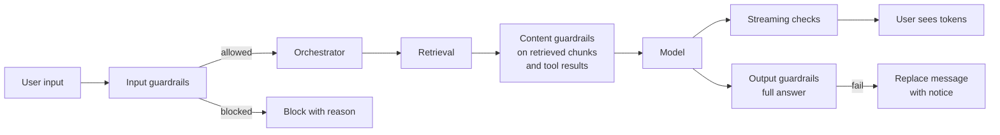

Guardrails are automated checks on what goes into and comes out of the model. They catch things the model should not receive or produce: sensitive data, harmful content, policy violations, and signs of manipulation. They are one layer of defense, not the whole defense.

## Where guardrails sit

## Guardrail catalog

| Guardrail | Stage | What it detects | Typical method | On detection |
| --- | --- | --- | --- | --- |
| Sensitive data in input | Input | Card numbers, national IDs, credentials | Patterns with checksums | Warn or block, redact in logs |
| Harmful request | Input | Requests for violence, self-harm, illegal activity, harassment | Safety classifier | Refuse with a helpful message, show resources for self-harm |
| Prohibited use | Input | Use cases on the prohibited list, such as ranking candidates | Classifier tuned on examples | Explain the policy |
| Injection in content | Retrieved chunks, tool results | Instructions addressed to the model, hidden text | Classifier plus parsing checks | Drop or flag the chunk, alert |
| Off-topic or abuse | Input | Clearly non-work use, if your policy restricts it | Classifier | Gentle redirect. Most companies allow general work help |
| Harmful output | Output | Toxic, harmful, or explicit content | Safety classifier | Replace message |
| Ungrounded claims | Output | Company-specific claims with no supporting source | Groundedness check | Flag, or append a warning |
| Secrets and PII leakage | Output, streaming | Credential formats, personal data that was not in the user's sources | Patterns | Redact in stream |
| Unsafe links and images | Output, rendering | External images, suspicious domains | Renderer rules | Do not render |
| Topic-specific policy | Output | Statements on topics your company handles carefully, such as legal commitments or medical advice | Classifier or rules | Add standard disclaimer, or route to the right resource |

## Building guardrails

### Choose the method by speed and stakes

| Method | Latency | Good for |
| --- | --- | --- |
| Regular expressions and checksums | Under 1 ms | Structured identifiers, credential formats |
| Small classifiers (fine-tuned encoders, provider moderation endpoints) | 10 to 100 ms | Toxicity, harmful requests, injection signals |
| Small LLM with a policy prompt | 200 to 800 ms | Nuanced, company-specific policies |
| Large LLM | Seconds | Offline review, not inline |

Input guardrails sit on the critical path before the first token, so they must be fast. Run them **in parallel** with other pre-processing, such as query rewriting and retrieval, rather than in sequence. If the guardrail blocks, discard the other results.

### Write policies as examples

A policy like "do not provide legal advice" is too vague to implement. Turn it into a labeled set:

| Text | Label | Why |
| --- | --- | --- |
| "What does our NDA template say about non-solicitation?" | Allowed | Explaining company documents |
| "Can I be fired for refusing overtime in France?" | Redirect | Individual legal question, point to HR and legal resources |
| "Draft a reply to the customer saying we accept liability" | Flag | Legal commitment, needs review |

Use the set to build or prompt the classifier, and to evaluate it.

## Tuning: false positives matter

A guardrail that blocks legitimate work is not "safe". It teaches users to avoid the tool, or to paste the same data into an unapproved consumer AI tool with no controls at all.

Measure both directions on a labeled set:

| Metric | Meaning | Typical target |
| --- | --- | --- |
| Recall (catch rate) | Share of truly bad inputs caught | High for severe categories |
| False positive rate | Share of legitimate inputs blocked | Low, especially for common work topics |

Common false positive sources in enterprises:

- Security teams discussing vulnerabilities and attacks.
- HR and legal discussing harassment, discrimination, or misconduct cases.
- Medical or pharmaceutical companies discussing drugs and dosages.
- Customer support quoting abusive customer messages.

Solutions: **per-tenant and per-team policies** (the security team gets a different profile), **domain-aware classifiers**, and **warn instead of block** for borderline categories.

Always provide a **"This was a mistake"** report on blocks. Review reports weekly and add them to the evaluation set. See [Error and empty states](/docs/frontend/error-states).

## Handling a block well

| Situation | Response |
| --- | --- |
| Sensitive data in input | "This message looks like it contains a card number. Remove it and try again, or continue if this is intended." |
| Harmful request | Brief refusal, no lecture. Offer what the assistant can help with |
| Self-harm signals | Calm, supportive message with employee assistance and emergency resources. Never just a refusal |
| Prohibited use | Explain the policy and point to the right process: "The assistant can't rank candidates. HR's hiring guide explains the review process." |
| Output withheld | "The response was withheld because it didn't meet content guidelines." with a report option |

Do not reveal classifier scores or exact rules. Give a category.

## Fail open or closed

Decide for each guardrail what happens when the guardrail service itself fails. See [Reliability](/docs/backend/reliability). Severe harm categories and permission checks fail closed. Low-severity checks can fail open with logging.

## Monitoring

- Block rate per guardrail, per tenant, and over time. A sudden rise usually means a new false positive pattern, or a change in input such as a new team onboarding.
- False positive reports per guardrail.
- Sampled review of blocked and allowed items by a human, weekly.
- Latency of each guardrail, since they sit on the critical path.

## Checklist

- [ ] Each guardrail has a defined stage, method, and action.
- [ ] Input guardrails run in parallel with other pre-processing.
- [ ] Policies are written as labeled examples and evaluated in both directions.
- [ ] Per-tenant or per-team profiles exist for teams with legitimate sensitive topics.
- [ ] Blocks explain the category and offer a "This was a mistake" report.
- [ ] Self-harm signals get a supportive response with resources.
- [ ] Each guardrail has an explicit fail-open or fail-closed setting.
- [ ] Block rates, false positive reports, and latency are monitored.
