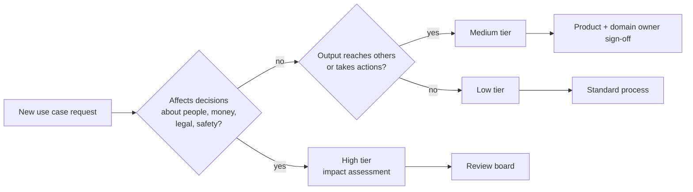

Responsible AI is the set of practices that keep an AI system useful, fair, honest, and under human control. In an enterprise, it is also how you answer questions from legal, works councils, regulators, and customers: what is this system for, what could go wrong, and who is accountable?

This section is practical. It describes the concrete artifacts and controls you build, not principles on a poster.

## Intended use

Write down what the assistant is for. Every other decision refers back to it.

For the reference assistant:

| Intended use | Examples |
| --- | --- |
| Finding and explaining company information | Policies, procedures, product documentation, internal how-tos |
| Working with user-provided documents | Summaries, extraction, comparison, drafting based on a document |
| Small, confirmed actions | Creating tickets, drafting messages for the user to send |
| General work assistance | Writing help, formulas, explaining concepts |

## Prohibited and restricted use

| Category | Status | Reason |
| --- | --- | --- |
| Decisions about individuals' employment: hiring, firing, promotion, performance ratings | Prohibited as decision-maker. Assisting with drafting only under a reviewed, separate use case | High impact on people, legal risk, bias risk. Often classified as high-risk under regulation such as the EU AI Act |
| Monitoring or profiling employees | Prohibited | Legal and trust issues. Often restricted by works council agreements |
| Medical, legal, or financial advice to individuals presented as authoritative | Prohibited | The assistant can point to company policies and resources, not replace professionals |
| Final customer-facing communication without human review | Restricted | Users send drafts after review. Automated sending needs its own risk assessment |
| Processing special category data (health, union membership, and similar) | Restricted | Allowed only where a specific use case was reviewed |
| Emotion recognition, biometric categorization | Prohibited | High legal risk and low reliability |

Publish this in the product (an acceptable use page linked from the assistant) and in internal policy.

## Risk tiers for use cases

New use cases appear constantly: a team wants the assistant to screen supplier contracts, another wants it to summarize customer complaints. Classify each before building.

| Tier | Description | Examples | Required before launch |
| --- | --- | --- | --- |
| Low | Information retrieval and drafting for the user's own use | Policy Q&A, summarizing a document | Standard evaluation, standard guardrails |
| Medium | Output affects others, or actions in systems | Drafting customer replies, creating tickets, summarizing complaints for managers | Domain-specific evaluation set, human review of output, risk assessment |
| High | Output influences decisions about people, money, legal, or safety | Contract risk screening, scoring candidates, credit or pricing suggestions | Formal impact assessment, bias evaluation, human decision-maker, legal review, ongoing monitoring |
| Prohibited | See the table above | | Not built |

## Roles and accountability

| Role | Accountable for |
| --- | --- |
| Product owner | The use cases, intended use, and risk classification |
| AI engineering lead | Evaluation, guardrails, model choices, technical controls |
| Domain owners (HR, legal, IT) | Correctness of answers in their area, and the content of their sources |
| Security and privacy | Threat model, data protection, privacy assessments |
| Responsible AI review group | High-tier approvals, policy, incident review |

Keep the review group small and fast: a few people who meet weekly or on demand. A review process that takes months pushes teams to build around it.

## Pages in this section

| Page | Covers |
| --- | --- |
| [Guardrails](/docs/responsible-ai/guardrails) | Input and output checks, what they catch, and how to tune them |
| [Human oversight](/docs/responsible-ai/human-oversight) | Where humans must approve, review, or be able to intervene |
| [Transparency](/docs/responsible-ai/transparency) | What users are told, model and system documentation, AI labeling |
| [Fairness](/docs/responsible-ai/fairness) | Testing for unequal quality and bias across groups and languages |
| [Governance process](/docs/responsible-ai/governance) | Change approval, impact assessments, documentation, incident review |
