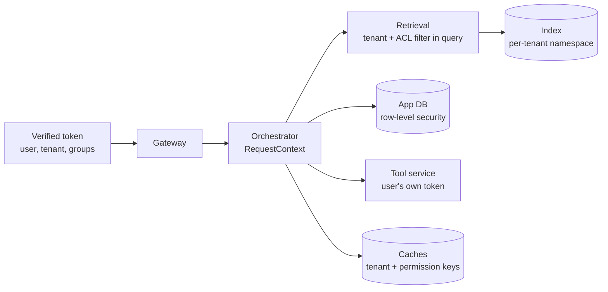

The assistant's most important security property: **a user never receives information from a document they cannot open in the source system, and never receives another tenant's data.** This page shows where that property is enforced and how it fails.

Mechanics are covered elsewhere: identity and roles in [Authentication and authorization](/docs/backend/auth), permission copying in [Sources and connectors](/docs/data/sources-connectors), and tenant isolation models in [Multi-tenancy](/docs/architecture/multi-tenancy). This page ties them together from a security point of view.

## Enforcement points

| Point | Enforcement | Failure if missing |
| --- | --- | --- |
| Gateway | Tenant and user come only from the verified token | Users can claim another tenant by editing a request |
| Database | Row-level security on `tenant_id` | A missing `WHERE` clause leaks conversations |
| Index | Namespace per tenant, plus ACL filter inside the search | Restricted documents reach the prompt |
| Caches | Keys include tenant and permission scope | One user's cached answer served to another |
| Tools | Delegated user tokens, or permission checks before service-account calls | The assistant does what the user could not |
| Shared conversations | Re-check sources against the viewer's permissions | Sharing a chat shares restricted content |
| Exports and admin views | Same permission checks as the UI | Admin features become a bypass |

## Why the model cannot enforce permissions

It is tempting to retrieve broadly and instruct the model: "Do not reveal information from documents the user cannot access." This does not work:

- The model does not know the user's permissions reliably.
- Instructions can be overridden by injection or clever questions.
- Even a refusal leaks: "I can't share details of the Project Falcon acquisition" confirms the project exists.
- Retrieved text influences the answer even when not quoted directly.

**Rule: if content reaches the prompt, assume the user will see it.** Permission enforcement happens before retrieval returns results, never after.

## Common ways it breaks

| Failure | How it happens | Prevention |
| --- | --- | --- |
| Missing ACL treated as public | Connector fails to read permissions and indexes the document with an empty list, which a filter treats as "no restriction" | A chunk with no principals matches nobody. Test it |
| Stale permissions | User removed from a group, index not updated for a day | Fast permission sync, SCIM group updates, short principal cache |
| Identity mismatch | Index uses source system group IDs, the token uses IdP group IDs | One identity namespace, mapping tested per connector |
| Post-filtering | Retrieve top 10, then remove unauthorized | Filter inside the query |
| Inherited sharing missed | Folder shared later, children not re-synced | Resolve inheritance at sync time, reconcile periodically |
| "Anyone with link" treated as public | Link-shared documents indexed for the whole company | Treat link sharing as restricted |
| Cached answers across users | Response cache keyed only by question | Tenant and permission scope in every cache key, or no response caching |
| Shared conversation exposes sources | Viewer sees citations and quoted text from documents they cannot access | Re-filter on view, or share text only |
| Conversation history crosses users | Bug in loading history by conversation ID without owner check | Owner check plus row-level security |
| Summaries persist restricted content | Conversation summary includes restricted facts, and the user loses access later | Accept as a known limit, or regenerate summaries after permission changes for sensitive tenants |
| Eval and debugging tools | Engineers browse traces containing restricted content | Restrict trace access, redact by default |

## Testing access control

Permission bugs are silent: the system works perfectly for the user who should not have seen the document. You only find them by testing deliberately.

### Permission test fixtures

Create a test tenant with a fixed structure:

| User | Groups | Should see |
| --- | --- | --- |
| alice | all-staff, hr | Public docs, HR docs |
| bob | all-staff, eng | Public docs, engineering docs |
| carol | all-staff | Public docs only |
| dan | (removed from hr yesterday) | Public docs only |
| eve | other tenant | Nothing from this tenant |

Seed documents with **canary strings** unique to each permission scope, such as `CANARY-HR-91F2`. Then automate:

- For each user and each scope, ask questions targeting that scope's documents.
- Assert that canary strings from scopes the user cannot access never appear in answers, citations, tool results, or streamed events.
- Run the same checks against the API directly, including conversation sharing, exports, and search endpoints.

Run this suite in CI and against staging on every deploy.

### Permission change tests

- Remove a user from a group. Assert they lose access within the freshness target.
- Unshare a document. Same assertion.
- Delete a document. Assert it disappears from retrieval.

### Multi-tenant tests

- Create the same document title and question in two tenants with different content. Ask in both. Assert each tenant sees only its own.
- Try to access the other tenant's resource IDs through every endpoint. Expect `not_found`.

## Monitoring

- Alert on retrieval queries that return chunks with an empty ACL. That should never happen.
- Track permission sync lag per connector.
- Log, per answer, the document IDs used. This enables after-the-fact investigation: "who was shown content from document X between these dates?"
- Periodically sample answers and verify that every cited document was accessible to the user at answer time.

## Checklist

- [ ] Tenant and user identity come only from the verified token.
- [ ] Row-level security is enabled on all tenant data.
- [ ] Permission filters run inside retrieval queries, never after.
- [ ] Chunks without ACLs match nobody.
- [ ] Cache keys include tenant and permission scope.
- [ ] Shared conversations re-check permissions for the viewer.
- [ ] Canary-based permission tests run in CI and on every deploy.
- [ ] Permission change and multi-tenant tests are automated.
- [ ] Document IDs used per answer are logged for investigations.
